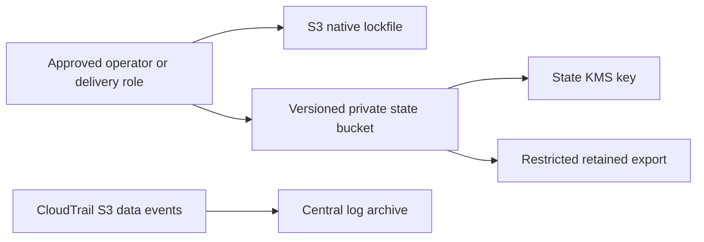
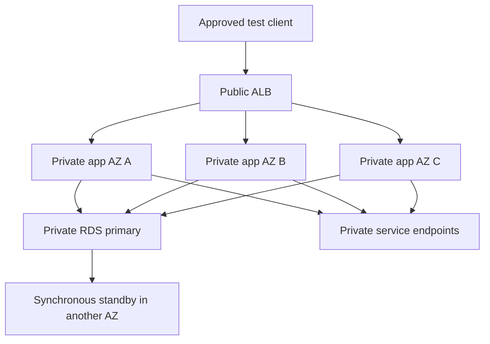
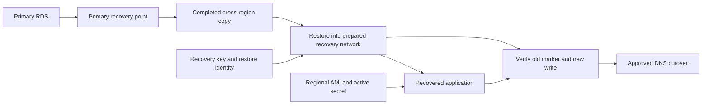

# 10 Terraform Projects for Your Portfolio

**VERIQTA**

A portfolio becomes convincing when it shows how infrastructure behaves under pressure. A successful `terraform apply` is a beginning. The stronger evidence is a recoverable state file, a denied action that stays denied, an application that survives an Availability Zone failure, and a recovery drill with measured data loss and recovery time.

These ten projects build those skills. Each includes a working configuration, an investigation, a recovery procedure, and evidence to collect. The projects can be studied independently; the application and recovery projects share the reusable modules in `modules/`.

## Contents

1. [Build a recoverable Terraform backend](#1-build-a-recoverable-terraform-backend)
2. [Build a multi-account landing zone](#2-build-a-multi-account-landing-zone)
3. [Build a VPC with controlled outbound access](#3-build-a-vpc-with-controlled-outbound-access)
4. [Keep an application running across three Availability Zones](#4-keep-an-application-running-across-three-availability-zones)
5. [Build reusable platform modules](#5-build-reusable-platform-modules)
6. [Deliver infrastructure through a reviewed pipeline](#6-deliver-infrastructure-through-a-reviewed-pipeline)
7. [Recover an application in another Region](#7-recover-an-application-in-another-region)
8. [Investigate drift without undoing a security fix](#8-investigate-drift-without-undoing-a-security-fix)
9. [Find and reduce infrastructure cost](#9-find-and-reduce-infrastructure-cost)
10. [Run a compound platform recovery exercise](#10-run-a-compound-platform-recovery-exercise)
11. [Portfolio evidence and cleanup](#portfolio-evidence-and-cleanup)
12. [Complete code reference](#complete-code-reference)

## Lab workstation

Use Bash or Zsh on Linux, macOS, or Windows through WSL. Use Python 3.11 or later, Terraform **1.13.5**, AWS CLI v2, Git, and `curl`. The AWS configurations pin the AWS provider to **6.19.0**. Keep the standard `.terraform.lock.hcl` files in version control. They pin provider selections and integrity information; they are part of Terraform's normal dependency management.

Install Terraform using the [official installation instructions](https://developer.hashicorp.com/terraform/install) and AWS CLI using the [AWS CLI installation guide](https://docs.aws.amazon.com/cli/latest/userguide/getting-started-install.html). Confirm the tools:

```bash
terraform version
aws --version
python3 --version
git --version
```

Open a terminal in `8. Terraform-Portfolio-Projects` and set the book directory once:

```bash
export BOOK="$(pwd)"
mkdir -p "$BOOK/.private" "$BOOK/artifacts"
chmod 700 "$BOOK/.private" "$BOOK/artifacts"
umask 077

# A short helper: tf 03-egress validate
function tf() {
  local project="$1"
  shift
  terraform -chdir="$BOOK/projects/$project" "$@"
}
```

State, plans, plan JSON, application logs, and restore metadata can contain sensitive information. Keep them in the ignored `.private/` or `artifacts/` directories. Share redacted evidence in a portfolio. Never publish credentials, state, personal account details, or database secrets.

### Start without cloud resources

The following checks initialize providers, validate every Terraform directory, run mocked AWS plans, exercise the Python tools, and run two temporary local-state experiments. They do not create AWS infrastructure. Provider downloads require an internet connection.

```bash
cd "$BOOK"
python3 scripts/validate.py
```

Mocked tests check configuration contracts; they do not prove IAM authorization, regional feature availability, network reachability, backup restorability, or application performance. The live exercises below supply that evidence in an isolated AWS lab.

### Prepare an AWS lab identity

Use a dedicated AWS account with a budget and an approved role. Do not use the root user or long-lived credentials. Configure IAM Identity Center through `aws configure sso`, then log in:

```bash
export AWS_PROFILE=veriqta-lab
export AWS_REGION=us-east-1
aws sso login --profile "$AWS_PROFILE"
aws sts get-caller-identity
export ACCOUNT_ID="$(aws sts get-caller-identity --query Account --output text)"
export AWS_DEFAULT_REGION="$AWS_REGION"
```

Check the account ID before every live exercise. The provider's `allowed_account_ids` setting rejects an unexpected account. These examples use the commercial AWS partition and service names; China and GovCloud require partition, endpoint, ARN, and service-availability changes. Choose Regions with the required services and at least three available AZs for Project 4. Availability Zone letters can refer to different physical zones in different accounts; compare AZ IDs for cross-account designs.

Cloud exercises create billed resources, including endpoints, NAT gateways when enabled, RDS, ALBs, EC2, backups, log ingestion, public IPv4 addresses, and KMS keys. Obtain rates for your Region before applying. A budget notification is not a spending cap. You can complete the local exercises without running any AWS apply.

### The live project workflow

Each project is a separate Terraform root and owns a separate state. A shared provider version does not mean shared state. Create a local `terraform.tfvars` in the selected root; the examples use `.example` files or inline commands to identify the required inputs. Read every plan before applying.

```bash
# Replace 08-drift with the selected project.
tf 08-drift init
tf 08-drift validate
tf 08-drift plan -out="$BOOK/artifacts/08-reviewed.tfplan"
tf 08-drift show -no-color "$BOOK/artifacts/08-reviewed.tfplan"
# Run only after reviewing the resource changes and cost.
tf 08-drift apply "$BOOK/artifacts/08-reviewed.tfplan"
```

Never apply a saved plan from another root, account, environment, or commit. Avoid `-target`, `-lock=false`, and `state push -force` as routine recovery shortcuts. They can hide dependencies or override safety checks.

## 1. Build a recoverable Terraform backend

**Build:** `projects/01-backend`

**Skills:** remote state, locking, encryption, least privilege, version recovery, audit trails.

Terraform state binds resource addresses such as `module.database.aws_db_instance.this` to real AWS objects. It also records attributes and dependency information. State is not a copy of the application database. A lost binding can make Terraform propose creating an object that already exists. Incorrect or obsolete bindings can lead to other unsafe actions. Recover state and application data as separate responsibilities.



The backend creates a private, versioned S3 bucket encrypted with a rotating KMS key. It defines separate dev, staging, and prod state roles. A second private bucket has seven-day governance retention for archived state exports. The live state bucket does not use default Object Lock retention: lockfile deletion must continue to work. Infrastructure-level `prevent_destroy` blocks accidental Terraform deletion of the buckets and key; it does not stop an authorized AWS operator from changing them outside Terraform.

### Step 1: Bootstrap the bucket

Use an existing operator role ARN that is allowed to assume the environment roles. Replace the example role name with the actual approved role, including its full IAM path where applicable.

```bash
export OPERATOR_ROLE_ARN="arn:aws:iam::$ACCOUNT_ID:role/VeriqtaLabOperator"
cat > "$BOOK/projects/01-backend/terraform.tfvars" <<EOF
account_id = "$ACCOUNT_ID"
region = "$AWS_REGION"
name = "veriqta-backend"
trusted_principal_arns = ["$OPERATOR_ROLE_ARN"]
EOF

tf 01-backend init
tf 01-backend plan -out="$BOOK/artifacts/backend.tfplan"
tf 01-backend show "$BOOK/artifacts/backend.tfplan"
tf 01-backend apply "$BOOK/artifacts/backend.tfplan"
export STATE_BUCKET="$(tf 01-backend output -raw bucket)"
export STATE_KMS_KEY="$(tf 01-backend output -raw kms_key_arn)"
export ARCHIVE_BUCKET="$(tf 01-backend output -raw archive_bucket)"
```

The initial bootstrap state is local. Protect its files immediately. Keep a separate restricted recovery copy before migrating it. A backend cannot create its own bucket during `init`; the bucket must already exist.

### Step 2: Configure a consumer backend

For example, put the drift project in its own key:

```bash
cat > "$BOOK/projects/08-drift/backend.tf" <<'EOF'
terraform {
  backend "s3" {}
}
EOF
cat > "$BOOK/.private/08-backend.hcl" <<EOF
bucket = "$STATE_BUCKET"
key = "environments/dev/08-drift/terraform.tfstate"
region = "$AWS_REGION"
kms_key_id = "$STATE_KMS_KEY"
encrypt = true
use_lockfile = true
workspace_key_prefix = "environments/dev/workspaces"
EOF

tf 08-drift init -backend-config="$BOOK/.private/08-backend.hcl"
```

If the project already has local state, use `init -migrate-state` with this backend configuration and inspect the migration prompt. Migrate each root to a unique key. Use the default workspace for these exercises. Explicit environment roots and roles make ownership easier to inspect than an accidental workspace switch.

The operator needs identity-policy permission to assume the state role, and the role's trust policy must permit that operator. A role trust policy alone does not grant the operator permission to assume it. Configure a named AWS CLI role profile with `role_arn` and your approved SSO source profile if you want to use the environment state role directly. When one role cannot both access the backend and manage workloads, use distinct backend and provider assume-role configuration; do not grant the state role broad infrastructure permissions merely to make an apply work.

Terraform's native S3 locking uses a sibling `.tflock` object. State access needs object read/write; the lockfile also needs deletion permission. The supplied policies allow environment-prefixed stack keys while denying deletion of live state objects. See [S3 backend configuration and permissions](https://developer.hashicorp.com/terraform/language/backend/s3).

### Step 3: Verify the controls

```bash
aws s3api get-bucket-versioning --bucket "$STATE_BUCKET"
aws s3api get-public-access-block --bucket "$STATE_BUCKET"
aws s3api get-bucket-encryption --bucket "$STATE_BUCKET"
aws kms describe-key --key-id "$STATE_KMS_KEY"
aws s3api list-object-versions --bucket "$STATE_BUCKET" \
  --prefix environments/dev/08-drift/terraform.tfstate
```

Expected evidence: versioning enabled, all four public-access settings enabled, SSE-KMS configured, the intended key enabled, and multiple object versions after state-changing operations. Test environment isolation with a dev-role profile against a staging key: access should fail. Test lock contention in a disposable consumer root with two terminals; a second state-writing operation should wait or fail with a lock error while the first holds the lock. The local stale-plan experiment in Project 6 tests a different safeguard.

Archive a restricted export with a unique object name:

```bash
tf 08-drift state pull > "$BOOK/.private/08-current.tfstate"
aws s3 cp "$BOOK/.private/08-current.tfstate" \
  "s3://$ARCHIVE_BUCKET/08-drift/$(date -u +%Y%m%dT%H%M%SZ).tfstate" \
  --sse aws:kms --sse-kms-key-id "$STATE_KMS_KEY"
```

Governance retention is useful only if routine identities lack bypass-retention permission. Archive access and recovery access must remain available when the ordinary delivery role is unavailable.

### Incident: a state object was overwritten

**Symptoms:** a formerly stable plan now contains many unexpected creates, deletions, or replacements. Do not apply it.

1. Freeze every writer for this state key: local operators, automation, and other pipelines. Record the exact bucket, key, account, Region, and incident start time.
2. Export the current object and list its versions. Keep version IDs and last-modified times in restricted evidence.
3. Download a candidate previous version without changing the live key:

```bash
export STATE_KEY=environments/dev/08-drift/terraform.tfstate
export CANDIDATE_VERSION='REPLACE_WITH_SELECTED_VERSION_ID'
aws s3api get-object --bucket "$STATE_BUCKET" --key "$STATE_KEY" \
  "$BOOK/.private/current-state.json"
aws s3api get-object --bucket "$STATE_BUCKET" --key "$STATE_KEY" \
  --version-id "$CANDIDATE_VERSION" "$BOOK/.private/candidate-state.json"
python3 - <<'PY'
import json,os,pathlib
for name in ('current-state','candidate-state'):
    p=pathlib.Path(os.environ['BOOK'])/'.private'/f'{name}.json'
    s=json.loads(p.read_text())
    print(name,'lineage=',s.get('lineage'),'serial=',s.get('serial'),'resources=',len(s.get('resources',[])))
PY
```

4. Compare the candidate with the deployment commit, live AWS inventory, resource IDs, and change history. A higher serial does not prove correctness. An older state may omit legitimate later changes.
5. A recovery operator can restore the reviewed S3 version as a new current version while all writers remain frozen. The following operation overwrites the live state key; run it only after the comparison and recovery review:

```bash
python3 - <<'PY'
import os,urllib.parse,pathlib,json
source=urllib.parse.quote(os.environ['STATE_BUCKET']+'/'+os.environ['STATE_KEY'],safe='/')
source+='?versionId='+urllib.parse.quote(os.environ['CANDIDATE_VERSION'],safe='')
(pathlib.Path(os.environ['BOOK'])/'.private'/'copy-source.json').write_text(json.dumps(source))
PY
export COPY_SOURCE="$(python3 -c 'import json,os,pathlib; print(json.loads((pathlib.Path(os.environ["BOOK"])/".private/copy-source.json").read_text()))')"
aws s3api copy-object --bucket "$STATE_BUCKET" --key "$STATE_KEY" \
  --copy-source "$COPY_SOURCE" --server-side-encryption aws:kms --ssekms-key-id "$STATE_KMS_KEY"
tf 08-drift state list
tf 08-drift plan -refresh-only -out="$BOOK/artifacts/recovered-refresh.tfplan"
tf 08-drift show "$BOOK/artifacts/recovered-refresh.tfplan"
tf 08-drift plan -out="$BOOK/artifacts/recovered-normal.tfplan"
```

6. Resolve missing bindings with reviewed `import` blocks and correct addresses. Remove obsolete bindings only after proving ownership. A refresh-only plan updates observations; it does not recreate missing resource bindings or repair configuration.
7. Resume delivery only after the normal plan is understood and all remaining actions are approved.

Investigate the overwrite through S3 object data events, not just CloudTrail event history. Project 2 enables data events for the state bucket. Ordinary management-event history does not contain S3 object data events; see [CloudTrail data-event logging](https://docs.aws.amazon.com/awscloudtrail/latest/userguide/logging-data-events-with-cloudtrail.html). If those events were never enabled, document the evidence gap instead of inventing an actor.

**Portfolio result:** show an architecture diagram, environment access matrix, a redacted recovery timeline, and the before/after plan. Explain why restoring state did not itself restore application data.

## 2. Build a multi-account landing zone

**Build:** `projects/02-landing-zone` and its four independent child roots.

**Skills:** Organizations, OUs, SCPs, identity boundaries, central logging, account vending.

A landing zone is an operating model for accounts. Separate security and logging duties from application environments, then define which identities can cross each boundary.

| Account or OU | Responsibility | Typical access |
|---|---|---|
| Management account | Organizations and billing | Restricted organization administration |
| Security account | Detection and investigations | Security team, delegated service administration |
| Logging account | Organization audit archives | Log ingestion roles and restricted readers |
| Shared services OU | Shared networking, registries, identity integrations | Platform operators |
| Development OU | Experiments and integration | Development deployment roles |
| Staging OU | Release rehearsal | Controlled deployment roles |
| Production OU | Customer workloads | Approved delivery and emergency roles |

Do not run application workloads in the management account. Organizations SCPs constrain permissions; they do not grant them, and they do not constrain identities in the management account. An IAM allow cannot override an applicable explicit SCP deny. See [AWS SCP behavior](https://docs.aws.amazon.com/organizations/latest/userguide/orgs_manage_policies_scps.html).

### Step 1: Inspect the existing organization

Run these commands using an approved management-account identity:

```bash
export AWS_PROFILE=veriqta-management
export ACCOUNT_ID="$(aws sts get-caller-identity --query Account --output text)"
aws organizations describe-organization
aws organizations list-roots
aws organizations list-accounts
aws organizations list-policies --filter SERVICE_CONTROL_POLICY
```

The supplied root consumes an existing organization. Inspect existing OUs first; import matching OUs at the corresponding resource addresses rather than creating a competing hierarchy. It does not create or replace your organization's root structure. Enable all features and the SCP policy type through your organization's established administration process before testing SCPs. Identify a separate disposable member account as the sandbox.

```bash
export SANDBOX_ACCOUNT_ID='REPLACE_WITH_MEMBER_ACCOUNT_ID'
cat > "$BOOK/projects/02-landing-zone/terraform.tfvars" <<EOF
account_id = "$ACCOUNT_ID"
name = "veriqta-landing"
sandbox_account_id = "$SANDBOX_ACCOUNT_ID"
EOF

tf 02-landing-zone init
tf 02-landing-zone plan -out="$BOOK/artifacts/landing.tfplan"
tf 02-landing-zone apply "$BOOK/artifacts/landing.tfplan"
```

This creates security, logging, shared-services, development, staging, production, and sandbox OUs, plus a logging-protection SCP attached directly to the specified sandbox account. Creating the OU does not move that account into it. Moving an account changes its inherited policies; review effective controls before any move. The SCP denies `cloudtrail:StopLogging` and `cloudtrail:DeleteTrail`. It does not supply ordinary service permissions.

### Step 2: Establish account identities and security services

`account-baseline/` creates an explicit-trust deployment role using `modules/identity`, enables GuardDuty and Security Hub locally, enables default EBS encryption, and blocks public S3 access at the account level. Its `deployment_permissions` input is the workload policy you review; it is not an administrator policy hidden in the module.

For a sandbox baseline:

```bash
# Change AWS_PROFILE to the member-account SSO profile first.
export AWS_PROFILE=veriqta-sandbox
export MEMBER_ACCOUNT_ID="$(aws sts get-caller-identity --query Account --output text)"
cat > "$BOOK/projects/02-landing-zone/account-baseline/terraform.tfvars" <<EOF
account_id = "$MEMBER_ACCOUNT_ID"
name = "veriqta-sandbox"
trusted_deployment_role_arns = ["$OPERATOR_ROLE_ARN"]
deployment_permissions = "{\"Version\":\"2012-10-17\",\"Statement\":[{\"Effect\":\"Allow\",\"Action\":[\"ec2:Describe*\"],\"Resource\":\"*\"}]}"
EOF

tf 02-landing-zone/account-baseline init
tf 02-landing-zone/account-baseline plan
```

If a service already exists, import the existing detector or account resource; do not attempt to create a duplicate or disable an existing organization-managed security service. Production organization-wide GuardDuty/Security Hub delegated administration and organization policies require their own approved configuration. Local service enablement is not evidence of complete organization coverage.

### Step 3: Centralize audit logs

Use `log-archive/` in the logging account and `organization-trail/` in the management or authorized delegated account. These must use different credentials and separate state. The log archive needs:

```hcl
# log-archive/terraform.tfvars — replace IDs and ARN before planning.
account_id            = "222222222222"
name                  = "veriqta-logging"
organization_id       = "o-exampleorgid"
management_account_id = "111111111111"
trail_arn             = "arn:aws:cloudtrail:us-east-1:111111111111:trail/veriqta-audit-organization"
```

The bucket policy permits CloudTrail writes to both the management-account and organization prefixes, scopes writes to the expected trail ARN, requires the bucket-owner-full-control ACL, and denies unencrypted transport. Create it before the trail. For the organization trail:

```hcl
account_id          = "111111111111"
name                = "veriqta-audit"
archive_bucket_name = "veriqta-logging-222222222222-org-logs"
state_bucket_arn    = "arn:aws:s3:::REPLACE_WITH_STATE_BUCKET"
```

Plan and apply each root using the common workflow, switching the AWS profile and expected account ID for its owning account. Keep their backend access policies and state keys separate. Verify the trail:

```bash
aws cloudtrail get-trail-status --name veriqta-audit-organization
aws cloudtrail get-event-selectors --trail-name veriqta-audit-organization
# Use logging-account credentials for this command.
aws s3 ls s3://REPLACE_WITH_LOG_ARCHIVE_BUCKET/AWSLogs/ --recursive
```

Check `IsLogging`, delivery errors, digest delivery, and the state-bucket data-event selector. Enabling validation does not automatically validate archived digests; schedule and test `aws cloudtrail validate-logs` with the expected trail and time range.

### Step 4: Make account creation repeatable

`account-vending/` accepts a map of new accounts and a parent OU ID. It defaults to an empty map so opening the project does not request accounts. Each account needs a unique organization-approved email address and an onboarding owner. An example input is:

```hcl
account_id = "111111111111"
name       = "veriqta-vending"
approved_parent_ou_id = "ou-example-12345678"
accounts = {
  veriqta-development = { email = "aws-development@YOUR-OWNED-DOMAIN" }
}
```

Account creation is asynchronous and subject to quotas and organization policies. Apply in a small batch, record IDs, then apply account baselines with the new member credentials. `prevent_destroy` and `close_on_deletion = false` protect against treating account closure as ordinary Terraform teardown. Removing an account is a separate business and security operation.

### Incident: an SCP blocks an expected EC2 change

A staging operator receives `AccessDenied` for `ec2:ModifyInstanceAttribute` even though the role's IAM policy allows it.

1. Capture the caller ARN, account, API action, Region, error, request ID, resource ID, and time.
2. Inspect identity policies, permissions boundaries, session policies, endpoint policies, and effective SCPs. Decode an encoded authorization message with `sts:DecodeAuthorizationMessage` only if the operator has that permission.
3. In the management account, list SCPs attached to the account, each parent OU, and the root. `list-policies-for-target` returns direct attachments; it does not summarize inherited controls.
4. Trace the explicit deny. Do not attach `AdministratorAccess` or remove every guardrail to see whether the error disappears.
5. Write a narrow correction in a sandbox policy. Preserve the deny for prohibited operations and identities. If exception conditions use principal ARNs, test the actual assumed-role context and organization security requirements.
6. Rehearse an allowed EC2 modification on a disposable, noncritical instance. Rehearse prohibited logging actions using an isolated test trail or policy analysis; do not stop the audit trail merely to prove a deny.
7. Roll out the reviewed policy in stages and verify actual behavior again. Account for propagation time.

**Recovery evidence:** include both an allowed test and a denied test, effective policy ancestry, and a rollback plan. A successful IAM simulation alone is not proof that all SCP, endpoint, and resource-policy interactions work in a real session.

## 3. Build a VPC with controlled outbound access

**Build:** `projects/03-egress`, `modules/network`.

**Skills:** routing, endpoint policies, DNS, security groups, proxies, Flow Logs.

The network module creates two or three AZs of public, private application, and isolated database subnets. A public subnet has a route to an internet gateway; an instance also needs an appropriate address and security-group permissions before it can use that route. Database subnets have no default route to the internet.

Private workload egress is limited to interface endpoint security groups, S3/DynamoDB prefix lists, optional database subnets, and the approved proxy. Adding a NAT gateway does not turn it into a destination filter. NAT translates addresses; the security group and proxy provide the restrictions here.

### Step 1: Deploy the network and a private probe

```bash
export AWS_PROFILE=veriqta-lab
export ACCOUNT_ID="$(aws sts get-caller-identity --query Account --output text)"
cat > "$BOOK/projects/03-egress/terraform.tfvars" <<EOF
account_id = "$ACCOUNT_ID"
region = "$AWS_REGION"
name = "veriqta-egress"
enable_nat = false
enable_proxy = true
interface_services = ["ssm", "ssmmessages", "logs", "secretsmanager"]
EOF

tf 03-egress init
tf 03-egress plan -out="$BOOK/artifacts/egress.tfplan"
tf 03-egress apply "$BOOK/artifacts/egress.tfplan"
export PROBE_ID="$(tf 03-egress output -raw probe_instance_id)"
export PROXY_IP="$(tf 03-egress output -raw proxy_ip)"
aws ssm describe-instance-information --filters "Key=InstanceIds,Values=$PROBE_ID"
```

The probe is Amazon Linux 2023 with no public address and no SSH ingress. SSM Agent is included in the selected OS image. It uses its instance role and private SSM endpoints. Install the AWS Session Manager plugin on your workstation, then connect:

```bash
aws ssm start-session --target "$PROBE_ID"
```

Inside the instance, use its Region and the proxy IP printed on your workstation:

```bash
getent hosts secretsmanager.us-east-1.amazonaws.com
curl -I --connect-timeout 5 https://secretsmanager.us-east-1.amazonaws.com
curl -I --connect-timeout 5 https://example.com
export HTTPS_PROXY=http://REPLACE_WITH_PROXY_PRIVATE_IP:3128
curl -I --connect-timeout 5 https://example.com
curl -I --connect-timeout 5 https://www.iana.org
unset HTTPS_PROXY
```

Expected results: Secrets Manager resolves to private endpoint addresses. Its unsigned request can return an authentication error, which proves reachability, not authorization. Direct external HTTPS should fail. Proxy access to `example.com` should work and a domain outside the allowlist should be denied. The proxy also allows `.amazonlinux.com` for the lab. The probe role deliberately has no permission to read secrets; adding network access must not automatically grant data access.

### Step 2: Verify each layer independently

Inspect VPC endpoints and route tables from the workstation:

```bash
export VPC_ID="$(tf 03-egress output -raw vpc_id)"
aws ec2 describe-vpc-endpoints --filters "Name=vpc-id,Values=$VPC_ID"
aws ec2 describe-route-tables --filters "Name=vpc-id,Values=$VPC_ID"
aws ec2 describe-flow-logs --filter "Name=resource-id,Values=$VPC_ID"
aws logs describe-log-groups --log-group-name-prefix /veriqta/
```

S3 and DynamoDB gateway endpoints add service-prefix routes to private route tables. Interface endpoints use private IPs, private DNS, and endpoint security groups. The endpoint policy limits calls to principals in the current account; the caller's IAM permissions still determine allowed operations. It does not authorize anonymous requests. Add service-specific least-privilege actions and resources before using real data.

For container workloads, add `ecr.api` and `ecr.dkr` interface endpoints plus S3 gateway access for image layers. Add `sts` for workloads that call regional STS, `monitoring` for custom CloudWatch metrics, and `ec2` for agents that query instance tags. Every additional endpoint adds a dependency and, for interface endpoints, a cost per deployed AZ.

A single Squid instance is a lab proxy and a single point of failure. Its public interface is not open for inbound internet traffic; its security group accepts proxy traffic only from the private subnets. Its outbound rules allow ports 80 and 443, while the application-layer allowlist controls forwarded client requests. For production, use a resilient proxy or firewall architecture, maintain allowlists, address domain-fronting and DNS behavior, and monitor the proxy itself. Do not present a domain allowlist as packet-level inspection of encrypted payloads.

### Incident: removing NAT breaks only some dependencies

The application can reach S3 but timeouts occur for another AWS API after NAT is removed. That is a routing and endpoint-coverage clue, not proof of an IAM denial.

Use a controlled rehearsal: remove `secretsmanager` from the `interface_services` input while leaving `ssm` and `ssmmessages` in place, review the endpoint deletion plan, and apply only in this disposable lab. SSM should remain reachable; Secrets Manager should no longer have a permitted route. Restore the original endpoint list through a reviewed plan. Do not delete SSM endpoints while relying on the same session for recovery.

Investigate in order: DNS resolution, endpoint availability in each AZ, route tables, security-group rules, network ACLs, endpoint policy, caller IAM policy, service resource policy, and KMS permissions. A timeout usually points earlier in that sequence; an explicit service denial points later. Flow Logs show accepted/rejected IP flows, not decrypted requests or complete API authorization decisions.

For a NAT comparison, set `enable_nat = true`. The module creates one NAT per AZ and points each private subnet to the local NAT. The workload security group still blocks arbitrary direct external destinations. Demonstrate this explicitly: having a default route through NAT does not override the egress security group. Restore `enable_nat = false` when the comparison is complete.

**Portfolio result:** provide a dependency-to-endpoint matrix, allowed/denied curl results, an annotated route table, Flow Log evidence, and an explanation of what would happen if the proxy AZ failed.

## 4. Keep an application running across three Availability Zones

**Build:** `projects/04-application`, `application/`, and the network, compute, database, and monitoring modules.

**Skills:** image preparation, ALB health checks, ASGs, database failover, capacity planning, load testing.



The request path is client → ALB → private application instance → private PostgreSQL RDS instance. The application tier spans three AZs. RDS uses a Multi-AZ DB instance deployment with a primary and a standby in two AZs. That is not three writable database nodes. A healthy EC2 process is not enough: `/readyz` performs a real database query, so an instance cannot appear ready while its database is unreachable.

The application reads its generated master credential from Secrets Manager into memory and connects with PostgreSQL TLS certificate verification. No database password is placed in Terraform variables, user data, or an environment file. For this isolated lab the application uses the managed master credential; a production application should use a separately provisioned database role with only application privileges, an appropriate rotation process, and its own secret or IAM database authentication. Restricting IAM access to a master secret does not reduce that user's database privileges.

### Step 1: Prepare an application image

Runtime subnets have no package-download path. Build dependencies into an Amazon Linux 2023 **x86_64** image before launching the ASG. `application/prepare-image.sh` installs the Python environment, CloudWatch agent, RDS trust bundle, application, and systemd service. Use an approved disposable builder reachable through SSM, with temporary package-download access and no production data. The builder needs an SSM instance profile and outbound internet access for OS repositories, PyPI, and the RDS trust bundle.

Create a small builder using the EC2 console or your existing image-building system: AL2023 x86_64, encrypted root disk, IMDSv2 required, no inbound rules, an SSM instance profile, and outbound HTTPS/package access. Record its AMI ID, source image owner, subnet, architecture, and installed packages. Do not use an Arm image with the supplied `t3`/`t3a` launch choices.

One reproducible transfer method uses a private temporary S3 bucket. Upload the four files in `application/`; allow the builder role `s3:GetObject` only on that temporary prefix. Use its SSM shell to run:

```bash
# On the builder; use your private staging bucket and prefix.
sudo mkdir -p /tmp/veriqta-application
sudo aws s3 cp s3://YOUR-PRIVATE-STAGING-BUCKET/application/ /tmp/veriqta-application/ --recursive
sudo bash /tmp/veriqta-application/prepare-image.sh
sudo /opt/veriqta/venv/bin/python -m pip check
sudo systemctl cat veriqta-api
sudo /opt/veriqta/venv/bin/python -m py_compile /opt/veriqta/app.py
sudo rm -rf /tmp/veriqta-application
```

If your approved builder does not have the AWS CLI, transfer the files through your established image-building pipeline instead. The service intentionally does not start until launch user data writes `/etc/veriqta.env`. On the workstation, create a private image from the prepared builder:

```bash
export BUILDER_ID='REPLACE_WITH_BUILDER_INSTANCE_ID'
export APP_AMI="$(aws ec2 create-image --instance-id "$BUILDER_ID" \
  --name "veriqta-api-$(date -u +%Y%m%dT%H%M%SZ)" --query ImageId --output text)"
aws ec2 wait image-available --image-ids "$APP_AMI"
aws ec2 describe-images --image-ids "$APP_AMI" --query 'Images[0].[ImageId,Architecture,State]'
```

Terminate the builder after confirming the image. Remove its temporary staging permission and objects. Keep the private AMI and its encrypted backing snapshots until application and DR exercises finish. Review and pin transitive Python dependencies for a production image; the supplied top-level requirements and `pip check` are a starting point, not a complete software supply-chain policy.

### Step 2: Deploy the stack

Obtain your approved test-client IPv4 CIDR. Use a `/32` for a fixed single workstation. If your IP changes, update the CIDR through a reviewed plan. Use a validated ACM certificate ARN for HTTPS. With no certificate supplied, the example uses a narrowly restricted HTTP listener for connectivity practice; do not send credentials or customer traffic over it.

```bash
export CLIENT_CIDR='REPLACE_WITH_YOUR_APPROVED_IP/32'
export POSTGRES_VERSION="$(aws rds describe-db-engine-versions --engine postgres --default-only --query 'DBEngineVersions[0].EngineVersion' --output text)"
aws rds describe-orderable-db-instance-options --engine postgres --engine-version "$POSTGRES_VERSION" \
  --db-instance-class db.t4g.small --query 'OrderableDBInstanceOptions[].[DBInstanceClass,MultiAZCapable]'
cat > "$BOOK/projects/04-application/terraform.tfvars" <<EOF
account_id = "$ACCOUNT_ID"
region = "$AWS_REGION"
name = "veriqta-app"
application_ami_id = "$APP_AMI"
database_engine_version = "$POSTGRES_VERSION"
client_cidrs = ["$CLIENT_CIDR"]
desired_capacity = 6
# certificate_arn = "arn:aws:acm:REGION:ACCOUNT:certificate/ID"
EOF

tf 04-application init
tf 04-application plan -out="$BOOK/artifacts/application.tfplan"
tf 04-application apply "$BOOK/artifacts/application.tfplan"
export ALB_DNS="$(tf 04-application output -raw alb_dns)"
export ASG_NAME="$(tf 04-application output -raw asg_name)"
export TARGET_GROUP_ARN="$(tf 04-application output -raw target_group_arn)"
export DB_ID="$(tf 04-application output -raw database_identifier)"
aws elbv2 describe-target-health --target-group-arn "$TARGET_GROUP_ARN"
curl --fail --max-time 10 "http://$ALB_DNS/readyz"
```

For HTTPS, point your validated DNS name at the ALB and curl that name. The ALB's AWS hostname will not match a certificate issued for your domain. Never solve a certificate mismatch with `curl -k` in the acceptance test.

The network includes private endpoints for SSM, Secrets Manager, logs, metrics, and EC2 metadata/tag queries used by agents. Instances have IMDSv2 required, encrypted disks, no public IP, and no inbound SSH. Secrets/KMS policies target the intended secret and key. The ALB security group reaches application port 8080; the application ingress group accepts that port only from the ALB. Security groups attached to an instance combine their permissions, so inspect all attached groups rather than only one.

### Step 3: Inspect behavior before adding load

```bash
aws autoscaling describe-auto-scaling-groups --auto-scaling-group-names "$ASG_NAME"
aws rds describe-db-instances --db-instance-identifier "$DB_ID" \
  --query 'DBInstances[0].{Status:DBInstanceStatus,MultiAZ:MultiAZ,Primary:AvailabilityZone,Standby:SecondaryAvailabilityZone,Public:PubliclyAccessible}'
aws cloudwatch describe-alarms --alarm-name-prefix veriqta-app
aws logs tail /veriqta/veriqta-app/application --since 10m
```

Inspect `cloud-init-output.log`, `systemctl status veriqta-api`, and the CloudWatch-agent log through SSM when targets remain unhealthy. Common causes include an unprepared AMI, a missing endpoint, an incorrect secret ARN, KMS denial, subnet routing, or a database certificate/hostname mismatch. The application returns a generic HTTP 503 on database failure while recording details in restricted logs.

The alarm topic has no subscriber by default. To receive lab notifications, add an approved email subscription and confirm the message sent by SNS:

```bash
export ALARM_TOPIC="$(tf 04-application output -raw alarm_topic_arn)"
aws sns subscribe --topic-arn "$ALARM_TOPIC" --protocol email \
  --notification-endpoint 'REPLACE_WITH_APPROVED_EMAIL'
aws sns list-subscriptions-by-topic --topic-arn "$ALARM_TOPIC"
```

A `PendingConfirmation` subscription cannot deliver alarms. Test delivery deliberately in the lab and restore the alarm state afterward. Verify agent metrics with `aws cloudwatch list-metrics --namespace Veriqta/Portfolio`; metric dimensions must match the dashboard's ASG dimension. The SNS subscription is outside the Terraform state and needs separate cleanup.

### Step 4: Establish a load baseline

Choose an explicit lab target, such as 100% successful low-rate readiness requests and p95 under 500 ms. Those are exercise criteria, not a service guarantee. The application opens a database connection and fetches a secret for every request; keep the test small. Production traffic needs connection pooling, secret caching with rotation handling, bounded concurrency, and a purpose-built WSGI/ASGI server.

Use the supplied `scripts/load_probe.py` to measure a fixed number of requests:

```bash
python3 "$BOOK/scripts/load_probe.py" "http://$ALB_DNS/readyz" --requests 100 --workers 4
```

Record request count, errors, latency percentiles, ASG desired/in-service capacity, RDS connections and free memory, and application memory. CPU target tracking is configured; it does not guarantee that database-bound or memory-bound load will cause useful scaling. The ASG ignores `desired_capacity` changes after creation because the scaling controller owns that value. Change min/max bounds through Terraform; use ASG scaling controls for a temporary desired-capacity change.

### Incident: one AZ disappears and surviving instances saturate

A three-AZ layout has failure domains, but it does not automatically have spare capacity. With six evenly spread instances, losing one AZ leaves four. To serve the same total traffic, each survivor must handle roughly **1.5 times** its previous load before replacement capacity arrives. A database connection limit can fail before EC2 CPU reaches its target.

Start with an announced exercise in a disposable account. Record a baseline, choose an AZ, and use an approved fault-injection method. Terminating a single lab instance is a smaller initial exercise; it tests replacement and target draining, not a real AZ outage. Do not call the two equivalent.

```bash
aws autoscaling describe-auto-scaling-groups --auto-scaling-group-names "$ASG_NAME" \
  --query 'AutoScalingGroups[0].Instances[].[InstanceId,AvailabilityZone,LifecycleState,HealthStatus]'
# Select one disposable instance from the output. This decrements no desired capacity.
export TEST_INSTANCE_ID='REPLACE_WITH_ONE_LAB_INSTANCE_ID'
aws autoscaling terminate-instance-in-auto-scaling-group \
  --instance-id "$TEST_INSTANCE_ID" --no-should-decrement-desired-capacity
aws autoscaling describe-scaling-activities --auto-scaling-group-name "$ASG_NAME"
```

Run the same low-rate probe while watching target health. For an actual AZ-loss drill, account for ASG rebalancing, ALB routing, database primary/standby placement, and replacement capacity in surviving AZs. Diagnose failed launches through scaling activities, quotas, subnet address availability, and instance-type availability. The module offers two x86 instance types but uses On-Demand capacity by default. A larger maximum does not help when a quota or AZ-capacity failure prevents launches.

Test database failover separately in the lab:

```bash
aws rds reboot-db-instance --db-instance-identifier "$DB_ID" --force-failover
aws rds wait db-instance-available --db-instance-identifier "$DB_ID"
```

The endpoint remains the application's stable target, but connections break and DNS must refresh during failover. Measure interruption rather than claiming zero downtime. Restore the baseline, confirm the scaling activities finish, and repeat the acceptance probe.

**Portfolio result:** show a normal/failure/recovered metric comparison, actual interruption duration, surviving-AZ capacity calculations, a connection-budget calculation, and an explanation of what your experiment did and did not simulate.

## 5. Build reusable platform modules

**Build:** `modules/`, `projects/05-platform`, `labs/module-migration`.

**Skills:** module contracts, validation, environment isolation, compatibility, safe refactoring.

A reusable module should describe a capability and its boundaries. A network module accepts a CIDR and AZ count and returns subnet and security-group IDs. A database module consumes those IDs and returns a database endpoint and secret ARN. It should not discover an arbitrary VPC by a convenient tag or silently choose another team's subnet.

| Module | Main inputs | Contract outputs | Operational responsibility |
|---|---|---|---|
| Network | CIDR, AZ count, endpoint services, NAT/proxy switches | VPC, public/private/database subnets, workload SG | Routing, DNS, outbound boundaries, flow records |
| Identity | Trusted role ARNs, reviewed policy JSON | Role ARN | Explicit trust and allowed actions |
| Database | Network IDs, workload SG, KMS key, retention/protection settings | Endpoint, ID, ARN, secret ARN | Private database, backups, credential management |
| Compute | Regional prepared AMI, network IDs, endpoint/secret, client CIDRs, certificate | ALB, target group, ASG | Image-based instances, scaling, request health |
| Monitoring | ASG, database and ALB identifiers | Alarm topic | Dashboards, latency/error thresholds |

Typed inputs are executable documentation. For example, the network module rejects unsupported AZ counts and malformed CIDRs. The compute module validates its AMI ID and capacity range. Tests should reject unsafe assumptions and preserve behavior, rather than merely repeat every assignment in HCL.

### Step 1: Plan isolated environments

The dev, staging, and prod directories under `05-platform/` are separate consumers of the same network module. Dev uses two AZs; staging and prod use three. They contain no application fleet or database and disable interface endpoints for this contract exercise. Flow Logs remain enabled. They still create VPC-related resources and logging permissions if applied.

```bash
for environment in dev staging prod; do
  printf 'account_id = "%s"\n' "$ACCOUNT_ID" > "$BOOK/projects/05-platform/$environment/terraform.tfvars"
  tf "05-platform/$environment" init
  tf "05-platform/$environment" validate
  tf "05-platform/$environment" plan -out="$BOOK/artifacts/$environment-network.tfplan"
done
```

Use different account credentials and expected account IDs for real environment separation. Give each environment its own backend key. The demonstration roots fix the provider Region to `us-east-1`; change that intentionally before using another Region. Do not apply the prod-named example in an actual production account as a learning exercise.

### Step 2: Define a release policy

Publish modules through your organization's approved private repository or registry when you are ready to operate them. Consumers should pin reviewed versions or immutable commit references. The local paths in this handbook keep the exercises self-contained; they do not provide release isolation.

Use version semantics consistently: patch for compatible fixes, minor for compatible optional inputs, major for deliberate breaking contracts. Add a change log, upgrade instructions, and a support window. Deprecate an output before removing it. Roll out a new module to a canary consumer, then development, staging, and production. Avoid changing a module address, an immutable cloud attribute, and an engine version in the same upgrade.

### Step 3: Run the local migration experiment

This lab uses `terraform_data`, which is built into Terraform. No AWS account is involved.

```bash
cd "$BOOK"
python3 scripts/local_labs.py
```

The script creates a temporary directory, applies `v1`, observes a destructive plan for `v2-broken`, then applies `v2-fixed` and verifies that the existing object ID remains unchanged. Temporary state disappears when the script exits. The same script also runs the stale-plan experiment in Project 6.

The important migration block is:

```hcl
moved {
  from = terraform_data.main
  to   = terraform_data.this
}
```

For the database resource inside its own module, the corresponding reviewed migration is:

```hcl
moved {
  from = aws_db_instance.main
  to   = aws_db_instance.this
}
```

Place this block in the module where the resource addresses are relative. For a move between modules, use the appropriate full addresses in the common parent. Keep migration blocks while supported consumers can still be upgrading from the old address. See [Terraform module refactoring](https://developer.hashicorp.com/terraform/language/modules/develop/refactoring).

### Incident: a module upgrade proposes 40 database replacements

Freeze the rollout. Examine `resource_changes[].change.actions` and `replace_paths` in a restricted plan JSON:

```bash
tf 04-application show -json "$BOOK/artifacts/application.tfplan" > "$BOOK/.private/application-plan.json"
python3 "$BOOK/scripts/plan_guard.py" "$BOOK/.private/application-plan.json"
```

A resource renamed from `main` to `this` without a moved block can look like a delete plus create. Add the migration and replan one canary consumer. A moved block solves address identity. It cannot make an immutable cloud attribute mutable or remove a replacement caused by a real configuration change. Engine upgrades, encryption changes, snapshot settings, and instance-class changes have their own service and provider behavior; inspect the actual plan and service constraints. Some class changes are in-place modifications, so do not label every class change a replacement.

If a destructive attribute change remains after the address migration, split it into a separate change with backup, maintenance, data migration, and rollback planning. Do not manually rewrite all 40 state files before understanding the plan. A bulk `state mv` can also work when carefully controlled, but declarative migrations are easier to review and apply consistently across consumers.

**Portfolio result:** publish the input/output contracts, canary upgrade evidence, a redacted destructive plan, the corrected no-replacement plan, and the local identity-preservation result.

## 6. Deliver infrastructure through a reviewed pipeline

**Build:** `projects/06-delivery`, `workflows/terraform-delivery.yml`, `scripts/plan_guard.py`, `scripts/recovery_gate.py`.

**Skills:** OIDC, separate plan/apply identities, saved plans, approvals, concurrency, audit evidence.

The delivery path is validation → plan → policy review → protected approval → apply the saved plan → verification. A human needs to review the actions that will actually run. Running a new plan after approval and applying that new plan changes the reviewed object.

The example workflow is stored under `workflows/`, so it is inactive until deliberately installed in a lab repository's `.github/workflows/`. It targets only the drift project's state. The repository's separate active handbook-check workflow runs validation and mocked tests without AWS credentials.

### Step 1: Create the OIDC roles

Use an existing AWS IAM OIDC provider for `https://token.actions.githubusercontent.com` with audience `sts.amazonaws.com`. If one already exists, reuse it. Configure the exact `owner/repository` and exact backend key. The plan role trusts only the repository's `main` ref. The apply role trusts the protected GitHub environment `terraform-production`.

For the drift lab, a small reviewed workload policy needs EC2 VPC and security-group write actions; the separate plan policy already supplies EC2 Describe calls. The EC2 API needs wildcard resources for some create operations. Use tag conditions and workload-specific ARNs where the action supports them, and narrow the lab role further after observing required calls.

```bash
cat > "$BOOK/.private/drift-apply-policy.json" <<'EOF'
{
  "Version": "2012-10-17",
  "Statement": [{
    "Effect": "Allow",
    "Action": [
      "ec2:CreateVpc", "ec2:DeleteVpc", "ec2:ModifyVpcAttribute",
      "ec2:CreateSecurityGroup", "ec2:DeleteSecurityGroup",
      "ec2:AuthorizeSecurityGroupIngress", "ec2:RevokeSecurityGroupIngress",
      "ec2:AuthorizeSecurityGroupEgress", "ec2:RevokeSecurityGroupEgress",
      "ec2:ModifySecurityGroupRules", "ec2:CreateTags", "ec2:DeleteTags"
    ],
    "Resource": "*"
  }]
}
EOF
python3 - <<'PY'
import json,os,pathlib
book=pathlib.Path(os.environ['BOOK'])
inputs={
 'account_id':os.environ['ACCOUNT_ID'],'region':os.environ['AWS_REGION'],
 'name':'veriqta-delivery','repository':'YOUR-OWNER/YOUR-LAB-REPOSITORY',
 'oidc_provider_arn':f'arn:aws:iam::{os.environ["ACCOUNT_ID"]}:oidc-provider/token.actions.githubusercontent.com',
 'state_bucket_arn':'arn:aws:s3:::'+os.environ['STATE_BUCKET'],
 'state_kms_key_arn':os.environ['STATE_KMS_KEY'],
 'state_key':'environments/dev/08-drift/terraform.tfstate',
 'workload_apply_policy_json':(book/'.private/drift-apply-policy.json').read_text()
}
(book/'projects/06-delivery/terraform.tfvars.json').write_text(json.dumps(inputs,indent=2))
PY
# Edit repository in the generated JSON before planning.
tf 06-delivery init
tf 06-delivery plan -out="$BOOK/artifacts/delivery-roles.tfplan"
tf 06-delivery apply "$BOOK/artifacts/delivery-roles.tfplan"
tf 06-delivery output role_arns
```

Do not use this EC2-focused plan role for an RDS, IAM, or Organizations stack without adding the exact read permissions and updating its workload policy. The plan role writes the transient S3 lock object but cannot write the state object; “read-only plan” describes its infrastructure privileges, not zero backend writes.

### Step 2: Protect the approval boundary

In the lab repository, configure these GitHub Actions variables:

| Variable | Value |
|---|---|
| `AWS_ACCOUNT_ID` | Expected lab account |
| `TF_STATE_BUCKET` | Project 1 state bucket |
| `TF_STATE_KMS_KEY_ARN` | Project 1 state key ARN |
| `TF_PLAN_ROLE_ARN` | Plan role output |
| `TF_APPLY_ROLE_ARN` | Apply role output |
| `TF_APPLY_FREEZE` | Explicitly `false` only when applies are permitted |

Create the environment `terraform-production`, require reviewers, restrict it to `main`, and prevent self-approval where your GitHub plan supports it. The name identifies the approval boundary; this particular workflow still targets a dev lab state. Configure branch protections and CODEOWNERS for Terraform, policy scripts, workflows, backend settings, and identity policies. Use a separate workflow/role/state key for each real environment. Environment OIDC subjects omit the branch, so environment branch restrictions are essential.

Copy the teaching workflow only after those controls exist. Review action releases and pin them to approved immutable commit SHAs for an operated pipeline. The examples use major action versions for readability. Do not grant OIDC credentials to untrusted pull-request code, and do not use `pull_request_target` to execute code from a contributor branch with a cloud role.

### Step 3: Review the exact artifact

The plan job stores a binary saved plan, restricted JSON review copy, provider lock, backend configuration, nonsecret inputs, and metadata in one run-specific artifact. Plans and JSON can include secrets even when terminal output hides them; restrict repository/artifact access and keep retention short. The apply job downloads the exact artifact ID produced by its own plan job, checks the commit and state key, checks the incident freeze, rejects plans older than 30 minutes, and uses the same Terraform version. It then applies that saved plan without generating another one.

The guard rejects deletions/replacements, public SSH/RDP rules, unresolved ingress fields, and inline ingress that requires manual review. It is a deliberately narrow policy. It is not a universal security scanner or proof of least privilege. Extend it with service-specific controls and meaningful tests before broad adoption. A legitimate deletion should use a separate reviewed workflow with an explicit exception process rather than deleting the guard from the ordinary path.

### Incident: two engineers approve plans from the same state

State locking protects operations while they hold the lock. It does not reserve the infrastructure during a long approval wait. If two plans share the same state snapshot, the first successful state-changing apply advances the state. Terraform rejects the other saved plan as stale. The local exercise proves that behavior:

```bash
python3 "$BOOK/scripts/local_labs.py"
```

The test creates two plans, applies plan A, and confirms that applying plan B returns a stale-plan error. The example workflow also serializes runs per stack with `cancel-in-progress: false`, so it does not cancel an apply partway through. Concurrency keys coordinate only workflows using that same GitHub group; local operators and other repositories still need the backend lock and operating rules.

When a plan expires or becomes stale, create a new plan, review the differences, and request a new approval. Never silently replan inside the approved apply job. An out-of-band AWS change can occur without updating Terraform state, so state-serial protection alone does not guarantee freshness. Review recent drift/audit evidence, keep approval windows short, and freeze competing writers during sensitive changes.

**Portfolio result:** show a restricted plan review, an approval record, the matching commit/run/artifact identifiers, a failed expired-plan check, and the actual local stale-plan rejection. Do not publish the binary plan or full unredacted JSON.

## 7. Recover an application in another Region

**Build:** `projects/07-recovery` and `projects/07-recovery/recovered-app`.

**Skills:** regional provider aliases, replication, backups, KMS, restore identity, data verification, failover.

Regional recovery needs more than a copy of Terraform files. It needs accessible data, usable encryption keys, working identities, a network, a prepared application image, credentials, and a controlled traffic change. A primary-region backend or identity dependency can block a recovery operator even when the backup itself exists.

The readiness root configures primary and recovery S3 data buckets with versioning, KMS encryption, and cross-region replication for new encrypted objects. It configures daily RDS backups through AWS Backup, copies them to a recovery vault, and prepares the recovery network, database subnet group, security group, and restore role. DNS failover is disabled by default. The restored database is created through the explicit AWS Backup restore procedure; `recovered-app/` deploys the application against that existing recovered database and does not claim ownership of it.

RTO is the measured time from the agreed incident start to restored service meeting acceptance criteria. RPO is the measured data-loss window relative to the last durable application write. A daily schedule is not a guaranteed 24-hour RPO: copy delay and failed backups can increase the loss window. RDS standby failover is an availability feature inside a Region; it is not this cross-region recovery procedure.



### Step 1: Prepare recovery dependencies

Use Project 4's database outputs. Keep your primary profile active and set a distinct recovery Region with supported instance classes and services.

```bash
export DR_REGION=us-west-2
export DATABASE_ARN="$(tf 04-application output -raw database_arn)"
export DATABASE_KMS_KEY="$(tf 04-application output -raw kms_key_arn)"
# ALB DNS name and canonical zone ID can be read from its API description.
aws elbv2 describe-load-balancers --query 'LoadBalancers[].[LoadBalancerName,DNSName,CanonicalHostedZoneId]'
cat > "$BOOK/projects/07-recovery/terraform.tfvars" <<EOF
account_id = "$ACCOUNT_ID"
region = "$AWS_REGION"
recovery_region = "$DR_REGION"
name = "veriqta-dr"
database_arn = "$DATABASE_ARN"
database_kms_key_arn = "$DATABASE_KMS_KEY"
primary_alb_dns = "$ALB_DNS"
primary_alb_zone_id = "REPLACE_WITH_PRIMARY_ALB_CANONICAL_ZONE_ID"
EOF

tf 07-recovery init
tf 07-recovery plan -out="$BOOK/artifacts/dr-readiness.tfplan"
tf 07-recovery apply "$BOOK/artifacts/dr-readiness.tfplan"
```

Check AWS Backup service opt-in/settings and required service-linked roles in both Regions. The backup role needs access to the original database key, and the restore role needs the key actually encrypting the recovery point. Inspect the recovery point's reported `EncryptionKeyArn`; do not assume a vault's key alone proves the copy can be decrypted. AWS Backup's encryption behavior differs across resource types. Add a narrowly scoped key-policy/grant correction if the observed key differs from the planned target.

The readiness stack uses independent regional keys. A KMS alias is regional and does not make key material available in another Region. Multi-Region keys are another design, with their own replication, policy, and grant responsibilities. Test decrypt and restore operations using the exact recovery identity. See [AWS Backup RDS restoration](https://docs.aws.amazon.com/aws-backup/latest/devguide/restoring-rds.html).

Copy the prepared application AMI to the recovery Region and wait for it:

```bash
export DR_APP_AMI="$(aws ec2 copy-image --region "$DR_REGION" --source-region "$AWS_REGION" \
  --source-image-id "$APP_AMI" --name "veriqta-api-dr-$(date -u +%Y%m%dT%H%M%SZ)" \
  --encrypted --query ImageId --output text)"
aws ec2 wait image-available --region "$DR_REGION" --image-ids "$DR_APP_AMI"
```

Verify encrypted snapshot/key access in the destination and the destination AMI's launch permissions. An AMI ID from the primary Region is not valid in the recovery Region.

### Step 2: Prove S3 replication

```bash
export PRIMARY_DATA_BUCKET="$(tf 07-recovery output -raw primary_bucket)"
export DR_DATA_BUCKET="$(tf 07-recovery output -raw recovery_bucket)"
printf 'veriqta replication probe\n' > "$BOOK/.private/replication-probe.txt"
aws s3 cp "$BOOK/.private/replication-probe.txt" "s3://$PRIMARY_DATA_BUCKET/probes/replication.txt"
aws s3api head-object --bucket "$PRIMARY_DATA_BUCKET" --key probes/replication.txt
aws s3api head-object --region "$DR_REGION" --bucket "$DR_DATA_BUCKET" --key probes/replication.txt
```

Replication is asynchronous: an immediate destination read can return not found. Wait, inspect replication status, and investigate failures before declaring success. The supplied rule covers new objects after the rule is active; existing objects need an explicit backfill process. Delete-marker replication is disabled. Versioning and replication do not replace an independent backup/retention design: an unwanted write or authorized deletion can still propagate or destroy data depending on the controls.

### Step 3: Create and identify a recovery point

Write a known application marker before the backup. On an application instance through SSM:

```bash
# Transfer application/dr-marker.py to the instance through your approved private channel first.
sudo bash -c 'set -a; source /etc/veriqta.env; set +a; /opt/veriqta/venv/bin/python /tmp/dr-marker.py write veriqta-drill-001'
```

Record the marker's database timestamp. The readiness stack schedules daily backups; you may start an on-demand backup and copy in a scheduled lab window instead of waiting. Use the following commands for an on-demand backup and copy. Reapply the readiness root after adding new outputs if your initial deployment predates them.

```bash
export PRIMARY_VAULT="$(tf 07-recovery output -raw primary_vault_name)"
export DR_VAULT_ARN="$(tf 07-recovery output -raw recovery_vault_arn)"
export BACKUP_ROLE_ARN="$(tf 07-recovery output -raw backup_role_arn)"
export BACKUP_JOB_ID="$(aws backup start-backup-job --backup-vault-name "$PRIMARY_VAULT" \
  --resource-arn "$DATABASE_ARN" --iam-role-arn "$BACKUP_ROLE_ARN" \
  --query BackupJobId --output text)"
aws backup describe-backup-job --backup-job-id "$BACKUP_JOB_ID"
# Repeat describe until State is COMPLETED; stop on FAILED, ABORTED, or EXPIRED.
export PRIMARY_RECOVERY_POINT="$(aws backup describe-backup-job --backup-job-id "$BACKUP_JOB_ID" --query RecoveryPointArn --output text)"
export COPY_JOB_ID="$(aws backup start-copy-job --recovery-point-arn "$PRIMARY_RECOVERY_POINT" \
  --source-backup-vault-name "$PRIMARY_VAULT" --destination-backup-vault-arn "$DR_VAULT_ARN" \
  --iam-role-arn "$BACKUP_ROLE_ARN" --query CopyJobId --output text)"
aws backup describe-copy-job --copy-job-id "$COPY_JOB_ID"
# Continue only after CopyJob.State is COMPLETED; record DestinationRecoveryPointArn.
```

The operator also needs permission to start jobs and pass this specific backup role to AWS Backup. Do not continue while the backup is still running or the recovery-point ARN is absent. Do not restore from the primary vault while calling it a cross-region recovery test.

```bash
export DR_VAULT="$(tf 07-recovery output -raw recovery_vault_name)"
aws backup list-recovery-points-by-backup-vault --region "$DR_REGION" \
  --backup-vault-name "$DR_VAULT" \
  --query 'RecoveryPoints[].[RecoveryPointArn,Status,CreationDate,EncryptionKeyArn,ResourceType]'
```

Select a completed RDS recovery point with the required marker. Record its creation/copy times and encryption key. A successful scheduled-backup configuration is not proof that a copy completed.

### Step 4: Restore into the prepared network

AWS Backup returns resource-specific restore metadata. Obtain it, inspect it, and replace primary-region network references before starting a restore.

```bash
export RECOVERY_POINT_ARN='REPLACE_WITH_COMPLETED_RECOVERY_POINT_ARN'
export RESTORE_ROLE_ARN="$(tf 07-recovery output -raw restore_role_arn)"
export RESTORE_SUBNET_GROUP="$(tf 07-recovery output -raw restore_subnet_group)"
export RESTORE_SG="$(tf 07-recovery output -raw restore_security_group)"
aws backup get-recovery-point-restore-metadata --region "$DR_REGION" \
  --backup-vault-name "$DR_VAULT" --recovery-point-arn "$RECOVERY_POINT_ARN" \
  > "$BOOK/.private/restore-response.json"
python3 - <<'PY'
import json,os,pathlib
book=pathlib.Path(os.environ['BOOK'])
m=json.loads((book/'.private/restore-response.json').read_text())['RestoreMetadata']
m.update({'DBInstanceIdentifier':'veriqta-restored-db',
          'DBSubnetGroupName':os.environ['RESTORE_SUBNET_GROUP'],
          'VpcSecurityGroupIds':json.dumps([os.environ['RESTORE_SG']]),
          'PubliclyAccessible':'false','MultiAZ':'true'})
(book/'.private/restore-metadata.json').write_text(json.dumps(m,indent=2))
PY
cat "$BOOK/.private/restore-metadata.json"
```

Review engine version, instance class, option/parameter groups, storage encryption, and every network field. Remove or replace incompatible source-region values according to the restore API's accepted metadata. Confirm the destination role can create the resource and pass required roles. Then start the reviewed restore:

```bash
export RESTORE_JOB_ID="$(aws backup start-restore-job --region "$DR_REGION" \
  --recovery-point-arn "$RECOVERY_POINT_ARN" --iam-role-arn "$RESTORE_ROLE_ARN" \
  --resource-type RDS --metadata "file://$BOOK/.private/restore-metadata.json" \
  --query RestoreJobId --output text)"
aws backup describe-restore-job --region "$DR_REGION" --restore-job-id "$RESTORE_JOB_ID"
aws rds wait db-instance-available --region "$DR_REGION" --db-instance-identifier veriqta-restored-db
aws rds describe-db-instances --region "$DR_REGION" --db-instance-identifier veriqta-restored-db
```

Poll the restore job until it completes or reports a failure; RDS availability alone does not explain a failed or mismatched restore job. Inspect its final resource ARN. Keep a record of which recovery operator owns this restored database until Terraform adoption is reviewed.

### Step 5: Establish a destination credential and application

A source-region secret ARN is not a destination credential strategy. Inspect `MasterUserSecret` on the restored DB. If a usable destination managed secret is absent, enable RDS managed master-password management on the restored instance using the recovery key. This rotates the master password; run it as an intentional recovery operation:

```bash
export DR_KEY="$(tf 07-recovery output -raw recovery_kms_key_arn)"
aws rds modify-db-instance --region "$DR_REGION" \
  --db-instance-identifier veriqta-restored-db --manage-master-user-password \
  --master-user-secret-kms-key-id "$DR_KEY" --apply-immediately
aws rds wait db-instance-available --region "$DR_REGION" --db-instance-identifier veriqta-restored-db
aws rds describe-db-instances --region "$DR_REGION" --db-instance-identifier veriqta-restored-db \
  --query 'DBInstances[0].{Endpoint:Endpoint.Address,Secret:MasterUserSecret,Key:KmsKeyId}'
```

Wait for the managed secret to become active. Confirm that it matches the recovered database's current master credential; do not copy an old secret value and assume the database password matches it.

Build the recovered application inputs without reading the secret value:

```bash
export DR_DB_ENDPOINT="$(aws rds describe-db-instances --region "$DR_REGION" --db-instance-identifier veriqta-restored-db --query 'DBInstances[0].Endpoint.Address' --output text)"
export DR_SECRET_ARN="$(aws rds describe-db-instances --region "$DR_REGION" --db-instance-identifier veriqta-restored-db --query 'DBInstances[0].MasterUserSecret.SecretArn' --output text)"
tf 07-recovery output -json recovery_network > "$BOOK/.private/dr-network.json"
export DR_CERTIFICATE_ARN='REPLACE_WITH_VALIDATED_DESTINATION_ACM_CERTIFICATE_ARN'
python3 - <<'PY'
import json,os,pathlib
b=pathlib.Path(os.environ['BOOK'])
v={'account_id':os.environ['ACCOUNT_ID'],'region':os.environ['DR_REGION'],'name':'veriqta-recovered',
   'ami_id':os.environ['DR_APP_AMI'],'client_cidrs':[os.environ['CLIENT_CIDR']],
   'certificate_arn':os.environ['DR_CERTIFICATE_ARN'],'database_endpoint':os.environ['DR_DB_ENDPOINT'],
   'database_identifier':'veriqta-restored-db','secret_arn':os.environ['DR_SECRET_ARN'],
   'kms_key_arn':os.environ['DR_KEY'],'network':json.loads((b/'.private/dr-network.json').read_text())}
(b/'projects/07-recovery/recovered-app/terraform.tfvars.json').write_text(json.dumps(v,indent=2))
PY

tf 07-recovery/recovered-app init
tf 07-recovery/recovered-app plan -out="$BOOK/artifacts/recovered-app.tfplan"
tf 07-recovery/recovered-app apply "$BOOK/artifacts/recovered-app.tfplan"
```

For a private connectivity rehearsal without a validated domain, you may deliberately set `certificate_arn = null` and keep the narrow HTTP lab rules. Before public traffic failover, use a valid destination certificate covering the real service hostname and verify it.

### Step 6: Verify data before routing traffic

Connect to a recovered application instance through SSM. Run the marker reader with the destination environment file, then test `/readyz` through a temporary destination DNS name whose certificate matches. Verify writes with a new marker, application permissions, database extensions, migrations, and expected row counts. Only then record `recovery_data_verified = true` and supply `route53_zone_id`, `dns_name`, `recovery_alb_dns`, and `recovery_alb_zone_id` to the readiness root.

The readiness root creates a Route 53 primary/secondary failover alias pair only when a hosted zone is supplied; its lifecycle precondition blocks publishing an unverified recovery target. ALB target health includes the database query. DNS caching and application readiness still affect observed recovery time. Keep the old writer fenced so that both Regions cannot accept divergent writes. A DNS change by itself does not make a restored database current.

After a controlled cutover, measure the actual RTO and RPO from incident/marker times. Plan failback as another data migration with a single writer, validation, and rollback criteria. Do not simply point DNS back to a stale primary.

### Incident: backups exist but recovery fails

Trace dependencies explicitly: recovery identity → key policy/grant → recovery point → network/subnet group → security groups → restored DB → active secret → regional AMI → application → TLS/DNS. A failure at any link can prevent recovery even when the backup dashboard is green.

A lower-RPO warm standby or RDS cross-region read replica is a valid alternative architecture, with higher ongoing cost and its own promotion/credential/runbook requirements. It is not a drop-in addition to this lab: AWS documents that a source RDS instance managing its credentials through Secrets Manager cannot create a read replica. Choose and implement a compatible credential approach before changing that design. See [RDS managed-password limitations](https://docs.aws.amazon.com/AmazonRDS/latest/UserGuide/rds-secrets-manager.html).

**Portfolio result:** include dependency checks, a completed destination restore, a recovered marker, a new successful write, measured RTO/RPO, DNS observations, and a failback plan. State which dependencies remained in the same account and which regional failure assumptions were actually tested.

## 8. Investigate drift without undoing a security fix

**Build:** `projects/08-drift`, `scripts/drift_report.py`, `fixtures/drift-plan.json`.

**Skills:** refresh, reconciliation, evidence-based classification, safe incident changes.

Drift is a difference between recorded configuration/state and an observed remote object. Its cause may be an emergency change, an approved manual operation, an AWS controller, a default introduced by the provider, a failed previous deployment, or an unauthorized action. “Drift” describes a difference, not whether that difference is wrong.

The dangerous question is what the next apply will do. A responder can make a security group safer while an old configuration still asks Terraform to reopen it.

### Step 1: Run the read-only fixture

```bash
python3 "$BOOK/scripts/drift_report.py" "$BOOK/fixtures/drift-plan.json" \
  --records "$BOOK/fixtures/change-records.json"
```

The fixture shows observed access restricted to `10.90.0.0/16` and a proposed reconciliation to `0.0.0.0/0`. The correct direction is **wider**. The report compares `resource_drift[].change.after`, which represents observed remote values, with `resource_changes[].change.after`, which represents the proposed result. Comparing only the old state to the new observation would describe the responder's action, but miss the unsafe next apply.

Classifications come from supplied change records; the script does not invent approval or identify an actor merely from a plan. Use real CloudTrail and incident/change records to replace the sample evidence.

### Step 2: Create the safe lab resource

The live root creates a VPC and an **unattached** security group with one HTTPS ingress rule. No instance or database uses it.

```bash
cat > "$BOOK/projects/08-drift/terraform.tfvars" <<EOF
account_id = "$ACCOUNT_ID"
region = "$AWS_REGION"
name = "veriqta-drift"
approved_cidr = "10.90.0.0/16"
EOF

tf 08-drift init
tf 08-drift plan -out="$BOOK/artifacts/drift-start.tfplan"
tf 08-drift apply "$BOOK/artifacts/drift-start.tfplan"
tf 08-drift output
```

If you configured the Project 1 backend, keep using its saved backend configuration and the same state key. Do not reinitialize against a new local state merely because a backend error occurs.

### Step 3: Simulate an emergency restriction

For the full incident shape, first change `approved_cidr` to `0.0.0.0/0` in this unattached-only lab resource, review, and apply. This is an intentionally broad HTTPS rule for an isolated exercise; do not attach the group to workloads. Alternatively, use only the fixture if your account policy disallows broad ingress.

Read the actual ingress rule ID from the outputs. Restrict it out of band:

```bash
export RULE_ID="$(tf 08-drift output -raw rule_id)"
export SG_ID="$(tf 08-drift output -raw group_id)"
aws ec2 modify-security-group-rules --group-id "$SG_ID" \
  --security-group-rules "SecurityGroupRuleId=$RULE_ID,SecurityGroupRule={IpProtocol=tcp,FromPort=443,ToPort=443,CidrIpv4=10.90.0.0/16}"
```

Capture a normal plan with exit-code handling. `-detailed-exitcode` returns 0 for no changes, 2 for changes, and 1 for an error. A difference should not be confused with a failed Terraform command.

```bash
set +e
tf 08-drift plan -detailed-exitcode -out="$BOOK/artifacts/drift-detected.tfplan"
PLAN_STATUS=$?
set -e
if [ "$PLAN_STATUS" -eq 1 ]; then
  echo 'Plan failed; investigate the error before classifying drift.'
  exit 1
fi
tf 08-drift show -json "$BOOK/artifacts/drift-detected.tfplan" > "$BOOK/.private/drift-detected.json"
python3 "$BOOK/scripts/drift_report.py" "$BOOK/.private/drift-detected.json"
```

Expected finding: the plan proposes changing the observed restricted CIDR back to the broad configured value. **Do not apply that plan.** Verify the manual change was approved, update `approved_cidr` in the configuration to `10.90.0.0/16`, create a fresh plan, and confirm no reopening action remains.

### Incident: automation tries to undo the responder's fix

Disable the reconciliation job while retaining read-only detection. Record the emergency rule, actor/session, timestamp, request ID, and incident justification. Query CloudTrail for `ModifySecurityGroupRules`, `AuthorizeSecurityGroupIngress`, and `RevokeSecurityGroupIngress` as appropriate; the exact API matters. A restriction may involve modifying one rule or revoking and replacing it. An “Authorize” event by itself does not prove that the overall policy became broader.

Use a classification table:

| Finding | Evidence needed | Next step |
|---|---|---|
| Approved emergency restriction | Incident record and matching API changes | Update configuration, review, then reconcile |
| Controller-owned setting | Controller documentation, tags, ownership | Define ownership; use `ignore_changes` only for that intentional field |
| Provider/default normalization | Provider change log and repeatable plan behavior | Upgrade or normalize configuration deliberately |
| Unapproved change | Audit identity, timeline, business context | Preserve evidence, contain impact, investigate |
| Existing unmanaged resource | Owner and resource identity | Adopt with a reviewed import/configuration or leave separately owned |

A refresh-only plan records observations and can support investigation. It does not show the same corrective actions as a normal plan and should not be used as the sole evidence that the next apply is safe. `ignore_changes` can hide real incidents if used broadly. Import binds an existing object to a configured address; it does not magically generate a correct policy or decide ownership.

**Portfolio result:** show the observed safer setting, the unsafe proposed reconciliation, the supporting incident record, and the corrected configuration with a fresh plan. Redact account and identity details before sharing.

## 9. Find and reduce infrastructure cost

**Build:** `projects/09-cost`, `scripts/cost_report.py`, the cost fixtures.

**Skills:** tagging, budgets, billing analysis, network-cost diagnosis, performance tradeoffs.

A cost-aware design connects usage to a technical cause and an owner. A low EC2 bill does not prove low infrastructure cost: NAT processing, cross-AZ traffic, interface endpoints, logs, snapshots, and idle databases can dominate.

The root creates a monthly USD budget with an actual-spend notification at 80%, and a private versioned S3 bucket whose `disposable/` prefix expires current and noncurrent objects after 30 days. The policy does not expire every object in the bucket or Terraform state. Lifecycle transitions/expiration are asynchronous; a rule becoming active does not immediately delete eligible objects.

### Step 1: Add ownership and a notification

```bash
cat > "$BOOK/projects/09-cost/terraform.tfvars" <<EOF
account_id = "$ACCOUNT_ID"
region = "$AWS_REGION"
name = "veriqta-cost"
monthly_budget_usd = 50
notification_email = "REPLACE_WITH_YOUR_APPROVED_NOTIFICATION_EMAIL"
EOF

tf 09-cost init
tf 09-cost plan -out="$BOOK/artifacts/cost-controls.tfplan"
tf 09-cost apply "$BOOK/artifacts/cost-controls.tfplan"
aws budgets describe-budgets --account-id "$ACCOUNT_ID"
```

The budget is account-level in this example, not a hard limit or an isolated project allocation. Confirm the actual recipient and notification configuration. Billing data and alerts can lag. Choose a budget appropriate to the account and check current budget/notification pricing before adding many controls.

The shared provider defaults tag resources with project, environment, owner, cost center, management method, and application where the service supports tags. Activate the relevant user-defined cost-allocation tags in billing, and allow for reporting delay. Untagged and unsupported resources still need ownership; resource tags alone do not make every invoice line attributable.

### Step 2: Analyze a consistent cost example

```bash
python3 "$BOOK/scripts/cost_report.py" \
  "$BOOK/fixtures/cost-before.csv" "$BOOK/fixtures/cost-after.csv"
```

These are synthetic USD figures for equal 30-day periods, not current AWS prices or a savings promise.

| Service group | Before | After | Difference |
|---|---:|---:|---:|
| Compute | 310.00 | 310.00 | 0.00 |
| RDS | 290.00 | 290.00 | 0.00 |
| NAT | 86.50 | 786.30 | 699.80 |
| Cross-AZ | 50.00 | 600.00 | 550.00 |
| Other | 80.00 | 80.00 | 0.00 |
| **Total** | **816.50** | **2,066.30** | **1,249.80** |

The total is about **2.53 times** the earlier amount, an increase of about **153.07%**. It did not triple. The stable compute/database lines direct the investigation toward network path and transfer volume.

For live Cost Explorer data, choose complete, comparable windows and note currency, discounts/credits, linked accounts, and whether results are estimated. `End` is exclusive. Use the payer/authorized billing role rather than broadening an application role:

```bash
aws ce get-cost-and-usage --region us-east-1 \
  --time-period Start=2026-09-01,End=2026-10-01 \
  --granularity MONTHLY --metrics UnblendedCost \
  --group-by Type=DIMENSION,Key=SERVICE Type=DIMENSION,Key=USAGE_TYPE \
  > "$BOOK/.private/cost-by-service-usage.json"
```

Replace dates with your actual complete billing window. Check `NextPageToken` and fetch every page when the API returns pagination. Do not sum usage quantities across incompatible units such as GB, hours, and requests. The CSV comparison requires one matching currency and period length, but it cannot verify that two exports use the same credits, tax treatment, service mapping, or accounts. Normalize those dimensions before comparing totals.

### Step 3: Estimate a network design before applying it

Supply current regional rates from [Amazon VPC pricing](https://aws.amazon.com/vpc/pricing/). Write down units and assumptions:

```text
NAT monthly estimate = AZ count × NAT hours × hourly rate
                     + processed GB × processing rate
                     + applicable cross-AZ and external transfer charges

Interface endpoints  = service count × AZ count × endpoint hours × hourly rate
                     + processed GB × endpoint processing rate

Cross-AZ transfer    = billed directional GB × applicable transfer rate
```

Do not assume an endpoint is always cheaper than NAT. A large number of lightly used interface endpoints in several AZs adds fixed hourly cost. S3/DynamoDB gateway endpoints can avoid NAT processing for those service paths; interface endpoints have their own pricing. Keep NAT and its clients in the same AZ when appropriate to avoid avoidable cross-AZ paths, while preserving the required resilience. See [AWS NAT cost guidance](https://docs.aws.amazon.com/vpc/latest/userguide/nat-gateway-pricing.html).

### Incident: the application is healthy but the bill rises sharply

1. Confirm the period, currency, linked account, and cost metric. Separate increased usage from a rate/discount change or late billing adjustment.
2. Group by service and usage type. Inspect NAT hours versus bytes, regional data transfer, inter-AZ transfer, public IPv4 hours, and log ingestion.
3. Map expensive flows to source/destination ENIs, route tables, NAT placement, service endpoints, and recent architecture changes. Flow Logs and application telemetry help connect bytes to owners; they are not invoices.
4. Look for same-region S3/ECR traffic taking an unnecessary NAT path, a surviving AZ using another AZ's NAT, chatty application/database paths, repetitive image pulls, or a logging loop.
5. Propose one measurable change, estimate its cost and failure behavior, test performance/security, then compare a later equivalent billing window. Do not remove resilience or logging just because it has a visible line item.

Right-size instances using sustained utilization and peak behavior, not one idle screenshot. Use Savings Plans or reservations only with evidence of a stable commitment fit. Spot capacity can suit interruption-tolerant workers; it is not a guaranteed fixed discount or a safe substitute for every database/application tier. For ASGs, distinguish idle excess capacity from necessary failover headroom and scaling warmup. Database Multi-AZ capacity, backup copies, and retained snapshots have deliberate resilience costs.

Set retention for logs and disposable data, tag retained snapshots, and track stopped/idle resources separately from deleted ones. A stopped RDS instance, retained EBS disk, NAT gateway, or endpoint can still incur costs or resume behavior; inspect the specific service lifecycle rather than assuming “stopped” means “free.”

**Portfolio result:** provide a consistent before/after analysis, a route-level root cause, a proposed change with performance/resilience checks, and measured results from a later window. Label estimates as estimates and retain the rates/assumptions used.

## 10. Run a compound platform recovery exercise

**Build:** `projects/10-capstone/ownership.json` plus the preceding project runbooks.

**Skills:** incident command, failure domains, emergency access, state/application recovery, safe resumption.

The compound scenario starts with a failed database, an inaccessible state backend, a manual security change, a module upgrade proposing replacement, and an unproven DR path. Ordinary Terraform applies are frozen. The objective is restored service with known data integrity and a reviewed ownership/configuration record.

A shared module repository, identity provider, KMS policy, DNS zone, CI system, or backend can become a common failure domain. Keeping resources in different AZs does not remove those dependencies. Keep emergency access and recovery documentation reachable independently of the system they recover.

### Step 1: Establish ownership before the exercise

The ownership registry lists stack IDs, state keys, owners, recovery order, and a deliberately enabled incident freeze. Extend it for the actual environment, every landing-zone child state, each platform environment, and the recovered application. The example IDs describe a teaching environment; they are not proof of existing AWS inventory.

```bash
python3 - <<'PY'
import json,os,pathlib
r=json.loads((pathlib.Path(os.environ['BOOK'])/'projects/10-capstone/ownership.json').read_text())
for stack in sorted(r['stacks'],key=lambda s:s['recovery_order']):
    print(stack['recovery_order'],stack['id'],stack['owner'],stack['state_key'])
print('freeze:',r['freeze'])
PY
```

Use one authoritative owner per real object. In particular, a database created through AWS Backup remains recovery-operator-owned until a reviewed import adopts it into a matching configuration. Do not let the original application state and a recovery state both claim that same database. An adoption change can use an import block after an independently managed recovery database configuration matches the actual restored settings:

```hcl
import {
  to = module.database.aws_db_instance.this
  id = "veriqta-restored-db"
}
```

Create that block in the root owning the matching database module, not in `recovered-app/`, which intentionally owns no database module. Inspect the import plan, including engine/storage/key/identifier changes, before applying it. The imported object's encryption key must match the snapshot's actual key. Keep the import/adoption separate from unrelated module upgrades. Importing an object without checking immutable settings can immediately propose its replacement.

### Step 2: Declare the incident and freeze writes

Assign an incident lead, infrastructure investigator, database/recovery operator, and evidence recorder. Record UTC times consistently. Set `TF_APPLY_FREEZE=true` in the delivery repository, suspend other apply automation, and notify active operators through the organization's incident process. Keep read-only monitoring and detection operating.

Capture the initial service impact and the last known good deployment. Preserve plans and state versions privately. Revoke or isolate a suspected compromised session through the security process; avoid deleting evidence. Break-glass access should use a separately controlled identity, limited duration, audited activity, and a tested way to recover access if the main identity service is unavailable.

### Step 3: Stabilize the running service independently

The live AWS service and Terraform backend are separate systems. A broken backend does not stop AWS APIs or existing workloads by itself. Use read-only AWS inventory and monitoring to determine whether the database is unavailable, connections are exhausted, a security change blocks it, or an AZ failure removed capacity.

Use a narrowly scoped approved emergency operation if it can safely restore service. Do not create a second database just because Terraform cannot read its state. Record every manual change for later reconciliation. If the primary database cannot be recovered within the agreed objective, activate the Project 7 restore procedure and fence the original writer.

### Step 4: Recover backend access and state

Check identity/session validity, DNS, S3 reachability, bucket policy, endpoint policy, KMS key status/grants, and regional availability. A decryption denial is not a reason to make the bucket public. Restore state using Project 1 only if the contents themselves are damaged; a healthy state object behind a broken IAM policy does not need version rollback.

When the backend Region is unavailable, use the preplanned independent recovery backend/export and emergency identity. Never improvise two writable backends for the same objects without an explicit cutover and writer freeze. Capture which backend becomes authoritative and how the old one will be retired or reconciled.

### Step 5: Resolve the module and drift hazards

Pin the last compatible module version while diagnosing the upgrade. Add and test the address migration if needed; separate any real destructive attribute changes. Use Project 8's observed-versus-desired comparison to preserve the approved emergency security restriction. Update code before the next reconciliation. Review imports, moves, removals, and `ignore_changes` field ownership deliberately.

Produce a fresh normal plan using the repaired state, corrected configuration, exact account, and intended commit. Run the plan guard. Any remaining delete or replacement needs its own reviewed recovery plan. Do not apply an old pre-incident artifact merely because it was once approved.

### Step 6: Verify recovery and resume deliberately

Acceptance should include successful application reads and writes, recovered marker checks, appropriate public/private exposure, expected denied actions, restored monitoring, no unresolved ownership conflict, and understood plan actions. Record actual RTO/RPO and remaining degraded behavior.

Unfreeze one stack at a time only after the incident lead and resource owner approve. Resume detection before broad apply automation. Keep a rollback decision point and watch the first post-incident change closely. Failback, temporary permissions, temporary resources, and retained recovery copies each need a tracked owner and completion condition.

### Incident review template

Use this structure for the public case study, with sensitive details removed:

```markdown
# Veriqta platform recovery exercise

## Impact
What failed, which requests/data were affected, and how impact was measured.

## Timeline
UTC time | observation | action | result

## Failure chain
Initial trigger, shared dependencies, and controls that helped or failed.

## Recovery decisions
Why each operation was chosen, who owned it, and what would trigger rollback.

## Data verification
Last confirmed write, recovered markers, new write test, measured RTO/RPO.

## Infrastructure reconciliation
Authoritative state/backend, moved/imported objects, final reviewed plan.

## Follow-up work
Action | owner | due condition | verification
```

**Portfolio result:** demonstrate the ability to stop unsafe automation, restore service, preserve data, and reconcile infrastructure afterward. A postmortem that identifies an untested assumption is stronger evidence than an unmeasured claim of resilience.

## Portfolio evidence and cleanup

### What to publish

Publish architecture diagrams, module contracts, sanitized command outputs, representative policy decisions, measured exercise results, and operational reasoning. Link every claim to an experiment or explicitly label it as a design proposal. Keep application/customer data, identities, raw logs, plans, state, secrets, and internal security details out of the public artifact.

For each project, answer: What problem did it solve? What did you build? What failed? Which evidence explained the failure? How did you recover? What would you change before operating it for real? Include the cost and resilience tradeoff instead of treating resource count as project quality.

### Clean up consumers before foundations

Run cleanup while you still have backend, KMS, and recovery access. Review a destroy plan for each disposable consumer rather than running a repository-wide deletion command:

```bash
# Example for the unattached drift lab.
tf 08-drift plan -destroy -out="$BOOK/artifacts/drift-destroy.tfplan"
tf 08-drift show "$BOOK/artifacts/drift-destroy.tfplan"
tf 08-drift apply "$BOOK/artifacts/drift-destroy.tfplan"
```

1. Remove temporary DNS failover records before deleting targets. Destroy `07-recovery/recovered-app` before its readiness network.
2. Decide whether the restored database should be adopted or removed. It is not owned by the recovered-app Terraform root. To delete it intentionally, disable its deletion protection, take the required final snapshot, and retain the identifier/owner. Do not expect Terraform to delete a manually restored DB automatically.
3. For the Project 4 database, set `deletion_protection=false`, plan/apply that change, then create a separate destroy plan. The database module requires a final snapshot. Its default suffix is `retained`; if that final-snapshot name already exists, use a unique `final_snapshot_suffix` in the module configuration before destroying. Do not disable snapshots simply to bypass a naming collision.
4. Remove application fleets, ALBs, optional NAT/proxy instances, and project networks after their dependents. Remove platform environment roots separately. Verify no ENIs still reference a subnet/security group before diagnosing a deletion failure.
5. Remove copied recovery points and S3 object versions only under the approved retention policy. Nonempty versioned buckets and backup vaults intentionally resist deletion. Governance-locked archive versions must remain until retention permits deletion unless a separately authorized bypass process is invoked. Do not put bypass commands in routine teardown.
6. Disable backup schedules before removing vaults. Retained snapshots, AMI backing snapshots, logs, keys pending deletion, and recovery copies need owners and cost tracking. Deregister only the private lab AMIs you no longer need, then remove their unreferenced backing snapshots through a reviewed operation.
7. Remove temporary builder roles, staging objects, and any trial billing notifications. Delete delivery roles only after all cloud cleanup operations that use them are complete.
8. Retain shared security services and organization audit logging according to organization policy. Do not disable an organization's detectors or close accounts as a side effect of a learning exercise. Account vending and backend resources have explicit destruction protection.
9. Archive/migrate all remaining states before considering backend removal. The backend's `prevent_destroy` is intentional. Removing it requires a separate reviewed retirement change; verify no other roots or retained archives still need the bucket/key. A scheduled KMS key deletion can make retained data unrecoverable.
10. Inspect the account inventory and later billing reports. A successful Terraform destroy covers resources in that state, not manually created builders, restored databases, previous state files, retained snapshots, or resources owned by another root.

### Troubleshooting reference

| Symptom | First useful check | Common correction |
|---|---|---|
| Provider initialization fails | Network/proxy, registry access, pinned version and platform | Restore download access; retain reviewed dependency locks |
| Unexpected account rejected | `aws sts get-caller-identity` and profile | Select the intended role/profile; do not remove the guard |
| Backend access denied | Exact key, role, bucket policy, KMS policy, workspace prefix | Correct the scoped permission or selected backend |
| State remains locked | Active run, lock owner, timestamps | Wait or stop the owner safely; force-unlock only a proven orphan |
| SSM instance missing | Agent status, role/profile, DNS, SSM endpoints and SGs | Repair the missing dependency without opening SSH globally |
| API call times out | DNS, route, endpoint availability, security groups | Restore the specific network path |
| API call denied | Caller identity, IAM/SCP/endpoint/resource/KMS policies | Fix the exact authorization boundary |
| ALB target unhealthy | `/readyz`, app/cloud-init logs, DB/secret reachability | Correct image, credential, TLS, or network dependency |
| ASG cannot replace instances | Scaling activities, quotas, IP space, regional AMI | Restore capacity prerequisites; test alternate instance types |
| Stale saved plan | State serial change or old approval | Create, review, and approve a fresh plan |
| Backup restore fails | Restore-job message and reported encryption key | Fix destination role/key/metadata and retry intentionally |
| Drift would reopen a rule | Observed remote value vs proposed after value | Preserve approved restriction in configuration before apply |
| Bill rises with stable CPU | Usage types, NAT paths, cross-AZ bytes, logs | Investigate network/data behavior before resizing compute |

## Further reading

- [Terraform state locking](https://developer.hashicorp.com/terraform/language/state/locking) explains lock ownership and force-unlock behavior.
- [Terraform provider mocking](https://developer.hashicorp.com/terraform/language/tests/mocking) describes what mocked tests can exercise without live services.
- [AWS RDS Multi-AZ deployments](https://docs.aws.amazon.com/AmazonRDS/latest/UserGuide/Concepts.MultiAZ.html) distinguishes deployment types and failover behavior.
- [AWS Backup encryption](https://docs.aws.amazon.com/aws-backup/latest/devguide/encryption.html) documents service-specific encryption and copy behavior.
- [GitHub OIDC for AWS](https://docs.github.com/en/actions/how-tos/secure-your-work/security-harden-deployments/oidc-in-aws) covers trust conditions and environment protection.

## Complete code reference

The following files are also provided at the linked paths. Keep directory relationships intact so local module sources, templates, fixtures, and tests resolve correctly. Dependency locks remain alongside their Terraform roots.

### [.gitignore](.gitignore)

````text
.terraform/
*.tfstate*
*.tfplan
*.auto.tfvars
*.tfvars
!*.tfvars.example
*.hcl.private
.private/
artifacts/
__pycache__/
*.pyc
.env
*.tfvars.json
````

### [application/app.py](application/app.py)

````python
"""Veriqta portfolio API. Credentials stay in memory; every readiness check queries PostgreSQL."""
import json
import logging
import os
from http.server import BaseHTTPRequestHandler, ThreadingHTTPServer
from urllib.parse import urlsplit
import boto3
import psycopg

logging.basicConfig(level=logging.INFO, format='%(asctime)s %(levelname)s %(message)s')
secrets = boto3.client('secretsmanager', region_name=os.environ['AWS_DEFAULT_REGION'])

def connect():
    secret = json.loads(secrets.get_secret_value(SecretId=os.environ['SECRET_ARN'])['SecretString'])
    host = os.environ['DB_HOST'].split(':')[0]
    return psycopg.connect(host=host, port=5432, dbname='veriqta',
                          user=secret['username'], password=secret['password'],
                          sslmode='verify-full', sslrootcert='/opt/veriqta/rds-ca.pem',
                          connect_timeout=3, options='-c statement_timeout=3000')

class Handler(BaseHTTPRequestHandler):
    def do_GET(self):
        path = urlsplit(self.path).path
        if path not in ('/', '/readyz', '/api'):
            self.respond(404, {'error': 'not found'})
            return
        try:
            with connect() as conn, conn.cursor() as cur:
                cur.execute('SELECT current_database(), now()')
                name, now = cur.fetchone()
            self.respond(200, {'service': 'veriqta', 'database': name, 'database_time': now.isoformat()})
        except Exception:
            logging.exception('database readiness failed')
            self.respond(503, {'status': 'database unavailable'})

    def respond(self, code, body):
        data = json.dumps(body).encode()
        self.send_response(code)
        self.send_header('Content-Type', 'application/json')
        self.send_header('Content-Length', str(len(data)))
        self.end_headers()
        self.wfile.write(data)

    def log_message(self, fmt, *args):
        logging.info('%s %s', self.address_string(), fmt % args)

if __name__ == '__main__':
    ThreadingHTTPServer(('0.0.0.0', 8080), Handler).serve_forever()
````

### [application/dr-marker.py](application/dr-marker.py)

````python
"""Run inside an application instance: write a marker before an exercise, verify after restoration."""
import argparse
from app import connect
p = argparse.ArgumentParser()
p.add_argument('action', choices=['write', 'read'])
p.add_argument('marker')
a = p.parse_args()
with connect() as conn, conn.cursor() as cur:
    if a.action == 'write':
        cur.execute('CREATE TABLE IF NOT EXISTS recovery_markers (id text PRIMARY KEY, written_at timestamptz DEFAULT now())')
        cur.execute('INSERT INTO recovery_markers (id) VALUES (%s) ON CONFLICT DO NOTHING', (a.marker,))
    cur.execute('SELECT id, written_at FROM recovery_markers WHERE id=%s', (a.marker,))
    row = cur.fetchone()
    if row is None:
        raise SystemExit('Marker absent: record the resulting data-loss window; do not claim zero RPO.')
    print(row[0], row[1].isoformat())
````

### [application/prepare-image.sh](application/prepare-image.sh)

````bash
#!/bin/bash
# Run on a disposable Amazon Linux 2023 x86_64 builder after placing application/ in /tmp/veriqta-application.
set -euo pipefail
dnf install -y python3 python3-pip amazon-cloudwatch-agent
useradd --system --home-dir /opt/veriqta --shell /sbin/nologin veriqta || id veriqta
install -d -m 755 /opt/veriqta /var/log/veriqta
python3 -m venv /opt/veriqta/venv
/opt/veriqta/venv/bin/pip install -r /tmp/veriqta-application/requirements.txt
install -m 644 /tmp/veriqta-application/app.py /opt/veriqta/app.py
curl --fail --location --proto '=https' --tlsv1.2 https://truststore.pki.rds.amazonaws.com/global/global-bundle.pem -o /opt/veriqta/rds-ca.pem
chown veriqta:veriqta /var/log/veriqta
cat > /etc/systemd/system/veriqta-api.service <<'UNIT'
[Unit]
Description=Veriqta portfolio API
After=network-online.target
Wants=network-online.target
[Service]
User=veriqta
Group=veriqta
EnvironmentFile=/etc/veriqta.env
ExecStart=/opt/veriqta/venv/bin/python /opt/veriqta/app.py
Restart=on-failure
RestartSec=5
NoNewPrivileges=true
ProtectSystem=strict
ProtectHome=true
PrivateTmp=true
ReadWritePaths=/var/log/veriqta
StandardOutput=append:/var/log/veriqta/app.log
StandardError=append:/var/log/veriqta/app.log
[Install]
WantedBy=multi-user.target
UNIT
# Enable at launch, after user data creates the environment file.
systemctl disable veriqta-api || true
rm -f /etc/veriqta.env
````

### [application/requirements.txt](application/requirements.txt)

````text
boto3==1.40.64
psycopg[binary]==3.2.12
````

### [examples/backend.hcl.example](examples/backend.hcl.example)

````hcl
bucket = "replace-with-project-01-output"
key = "environments/dev/terraform.tfstate"
region = "us-east-1"
encrypt = true
kms_key_id = "replace-with-project-01-kms-key-arn"
use_lockfile = true
# Supply identity through SSO, OIDC or an approved assumed-role profile, never here.

workspace_key_prefix = "environments/dev/workspaces"
````

### [examples/common.tfvars.example](examples/common.tfvars.example)

````text
account_id = "123456789012" # Replace with your approved training account.
region = "us-east-1"
name = "veriqta-lab"
environment = "dev"
````

### [examples/database-moved.tf.example](examples/database-moved.tf.example)

````hcl
moved {
  from = aws_db_instance.main
  to = aws_db_instance.this
}
````

### [fixtures/change-records.json](fixtures/change-records.json)

````json
{
  "aws_vpc_security_group_ingress_rule.application": {
    "classification": "approved emergency change",
    "evidence": "Example incident INC-042: responder restricted the application CIDR; update the reviewed configuration before applying."
  }
}
````

### [fixtures/cost-after.csv](fixtures/cost-after.csv)

````csv
service,currency,period_days,cost
Compute,USD,30,310.00
RDS,USD,30,290.00
NAT,USD,30,786.30
Cross-AZ,USD,30,600.00
Other,USD,30,80.00
````

### [fixtures/cost-before.csv](fixtures/cost-before.csv)

````csv
service,currency,period_days,cost
Compute,USD,30,310.00
RDS,USD,30,290.00
NAT,USD,30,86.50
Cross-AZ,USD,30,50.00
Other,USD,30,80.00
````

### [fixtures/drift-plan.json](fixtures/drift-plan.json)

````json
{
  "resource_drift": [
    {
      "address": "aws_vpc_security_group_ingress_rule.application",
      "change": {
        "before": {
          "cidr_ipv4": "0.0.0.0/0"
        },
        "after": {
          "cidr_ipv4": "10.90.0.0/16"
        }
      }
    }
  ],
  "resource_changes": [
    {
      "address": "aws_vpc_security_group_ingress_rule.application",
      "type": "aws_vpc_security_group_ingress_rule",
      "change": {
        "actions": [
          "update"
        ],
        "before": {
          "cidr_ipv4": "10.90.0.0/16"
        },
        "after": {
          "cidr_ipv4": "0.0.0.0/0",
          "ip_protocol": "tcp",
          "from_port": 443,
          "to_port": 443
        }
      }
    }
  ]
}
````

### [labs/concurrency/main.tf](labs/concurrency/main.tf)

````hcl
terraform { required_version = ">= 1.10, < 2.0" }
variable "release" {
  type    = string
  default = "v1"
}
resource "terraform_data" "release" { input = var.release }
output "release" { value = terraform_data.release.output }
````

### [labs/module-migration/v1/main.tf](labs/module-migration/v1/main.tf)

````hcl
terraform { required_version = ">= 1.10, < 2.0" }
resource "terraform_data" "main" {
  input = { database = "veriqta-logical-database", schema = 1 }
}
output "database_identity" { value = terraform_data.main.id }
````

### [labs/module-migration/v2-broken/main.tf](labs/module-migration/v2-broken/main.tf)

````hcl
terraform { required_version = ">= 1.10, < 2.0" }
resource "terraform_data" "this" {
  input = { database = "veriqta-logical-database", schema = 1 }
}
output "database_identity" { value = terraform_data.this.id }
````

### [labs/module-migration/v2-fixed/main.tf](labs/module-migration/v2-fixed/main.tf)

````hcl
terraform { required_version = ">= 1.10, < 2.0" }
resource "terraform_data" "this" {
  input = { database = "veriqta-logical-database", schema = 1 }
}
output "database_identity" { value = terraform_data.this.id }
moved {
  from = terraform_data.main
  to   = terraform_data.this
}
````

### [modules/compute/main.tf](modules/compute/main.tf)

````hcl
variable "name" { type = string }
variable "region" { type = string }
variable "vpc_id" { type = string }
variable "private_subnet_ids" { type = list(string) }
variable "public_subnet_ids" { type = list(string) }
variable "workload_security_group_id" { type = string }
variable "ami_id" {
  type        = string
  description = "Baked x86_64 AMI built with application/prepare-image.sh; do not use an unprepared OS image."
  validation {
    condition     = can(regex("^ami-[0-9a-f]+$", var.ami_id))
    error_message = "Supply the reviewed regional application AMI."
  }
}
variable "secret_arn" { type = string }
variable "kms_key_arn" { type = string }
variable "db_host" { type = string }
variable "desired_capacity" {
  type    = number
  default = 6
  validation {
    condition     = var.desired_capacity >= var.minimum_capacity && var.desired_capacity <= var.maximum_capacity && var.desired_capacity == floor(var.desired_capacity)
    error_message = "Use at least three instances and an integer desired capacity."
  }
}
variable "instance_types" {
  type    = list(string)
  default = ["t3.small", "t3a.small"]
}
variable "minimum_capacity" {
  type    = number
  default = 3
}
variable "maximum_capacity" {
  type    = number
  default = 12
}
variable "ingress_cidrs" {
  type        = list(string)
  description = "Approved IPv4 client networks; use a narrow CIDR for the lab HTTP listener."
}
variable "certificate_arn" {
  type    = string
  default = null
}
resource "aws_security_group" "alb" {
  name_prefix = "${var.name}-alb-"
  vpc_id      = var.vpc_id
  ingress {
    from_port   = var.certificate_arn == null ? 80 : 443
    to_port     = var.certificate_arn == null ? 80 : 443
    protocol    = "tcp"
    cidr_blocks = var.ingress_cidrs
  }
  egress {
    from_port   = 8080
    to_port     = 8080
    protocol    = "tcp"
    cidr_blocks = ["10.0.0.0/8", "172.16.0.0/12", "192.168.0.0/16"]
  }
}
resource "aws_security_group" "application" {
  name_prefix = "${var.name}-application-"
  vpc_id      = var.vpc_id
  ingress {
    from_port       = 8080
    to_port         = 8080
    protocol        = "tcp"
    security_groups = [aws_security_group.alb.id]
  }
  egress = []
}
resource "aws_cloudwatch_log_group" "application" {
  name              = "/veriqta/${var.name}/application"
  retention_in_days = 7
}
resource "aws_iam_role" "instance" {
  name = "${var.name}-instance"
  assume_role_policy = jsonencode({ Version = "2012-10-17", Statement = [{ Effect = "Allow", Action = "sts:AssumeRole", Principal = { Service = "ec2.amazonaws.com" }
  }] })
}
resource "aws_iam_role_policy_attachment" "ssm" {
  role       = aws_iam_role.instance.name
  policy_arn = "arn:aws:iam::aws:policy/AmazonSSMManagedInstanceCore"
}
resource "aws_iam_role_policy" "runtime" {
  role = aws_iam_role.instance.id
  policy = jsonencode({ Version = "2012-10-17", Statement = [
    { Effect = "Allow", Action = "secretsmanager:GetSecretValue", Resource = var.secret_arn },
    { Effect = "Allow", Action = "kms:Decrypt", Resource = var.kms_key_arn, Condition = { StringEquals = { "kms:ViaService" = "secretsmanager.${var.region}.amazonaws.com" }
    } },
    { Effect = "Allow", Action = ["logs:CreateLogStream", "logs:PutLogEvents", "logs:DescribeLogStreams"], Resource = "${aws_cloudwatch_log_group.application.arn}:*" },
    { Effect = "Allow", Action = "cloudwatch:PutMetricData", Resource = "*", Condition = { StringEquals = { "cloudwatch:namespace" = "Veriqta/Portfolio" }
    } },
    { Effect = "Allow", Action = "ec2:DescribeTags", Resource = "*" }
  ] })
}
resource "aws_iam_instance_profile" "this" {
  name = "${var.name}-instance"
  role = aws_iam_role.instance.name
}
resource "aws_lb" "this" {
  name                       = "${var.name}-alb"
  load_balancer_type         = "application"
  internal                   = false
  subnets                    = var.public_subnet_ids
  security_groups            = [aws_security_group.alb.id]
  drop_invalid_header_fields = true
}
resource "aws_lb_target_group" "this" {
  name     = "${var.name}-api"
  vpc_id   = var.vpc_id
  port     = 8080
  protocol = "HTTP"
  health_check {
    path     = "/readyz"
    matcher  = "200"
    interval = 30
    timeout  = 5
  }
}
resource "aws_lb_listener" "this" {
  load_balancer_arn = aws_lb.this.arn
  port              = var.certificate_arn == null ? 80 : 443
  protocol          = var.certificate_arn == null ? "HTTP" : "HTTPS"
  certificate_arn   = var.certificate_arn
  ssl_policy        = var.certificate_arn == null ? null : "ELBSecurityPolicy-TLS13-1-2-2021-06"
  default_action {
    type             = "forward"
    target_group_arn = aws_lb_target_group.this.arn
  }
}
resource "aws_launch_template" "this" {
  name_prefix            = "${var.name}-"
  image_id               = var.ami_id
  vpc_security_group_ids = [aws_security_group.application.id, var.workload_security_group_id]
  iam_instance_profile { arn = aws_iam_instance_profile.this.arn }
  metadata_options {
    http_tokens                 = "required"
    http_endpoint               = "enabled"
    http_put_response_hop_limit = 1
  }
  block_device_mappings {
    device_name = "/dev/xvda"
    ebs {
      encrypted             = true
      volume_type           = "gp3"
      volume_size           = 10
      delete_on_termination = true
    }
  }
  user_data = base64encode(templatefile("${path.module}/user-data.sh.tftpl", {
    region = var.region, secret_arn = var.secret_arn, db_host = var.db_host, log_group = aws_cloudwatch_log_group.application.name
  }))
}
resource "aws_autoscaling_group" "this" {
  name                      = "${var.name}-asg"
  min_size                  = var.minimum_capacity
  max_size                  = var.maximum_capacity
  desired_capacity          = var.desired_capacity
  vpc_zone_identifier       = var.private_subnet_ids
  health_check_type         = "ELB"
  health_check_grace_period = 300
  target_group_arns         = [aws_lb_target_group.this.arn]
  enabled_metrics           = ["GroupDesiredCapacity", "GroupInServiceInstances"]
  mixed_instances_policy {
    instances_distribution {
      on_demand_base_capacity                  = var.minimum_capacity
      on_demand_percentage_above_base_capacity = 100
    }
    launch_template {
      launch_template_specification {
        launch_template_id = aws_launch_template.this.id
        version            = tostring(aws_launch_template.this.latest_version)
      }
      dynamic "override" {
        for_each = var.instance_types
        content { instance_type = override.value }
      }
    }
  }
  instance_refresh {
    strategy = "Rolling"
    preferences {
      min_healthy_percentage = 100
      max_healthy_percentage = 150
      instance_warmup        = 180
    }
  }
  lifecycle {
    ignore_changes = [desired_capacity]
    precondition {
      condition     = var.minimum_capacity <= var.desired_capacity && var.desired_capacity <= var.maximum_capacity
      error_message = "Require minimum <= desired <= maximum."
    }
  }
  tag {
    key                 = "Name"
    value               = var.name
    propagate_at_launch = true
  }
  depends_on = [aws_lb_listener.this, aws_iam_role_policy.runtime, aws_iam_role_policy_attachment.ssm]
}
resource "aws_autoscaling_policy" "cpu" {
  name                   = "${var.name}-cpu"
  autoscaling_group_name = aws_autoscaling_group.this.name
  policy_type            = "TargetTrackingScaling"
  target_tracking_configuration {
    predefined_metric_specification { predefined_metric_type = "ASGAverageCPUUtilization" }
    target_value = 50
  }
}
output "asg_name" { value = aws_autoscaling_group.this.name }
output "alb_arn_suffix" { value = aws_lb.this.arn_suffix }
output "alb_dns" { value = aws_lb.this.dns_name }
output "alb_zone_id" { value = aws_lb.this.zone_id }
output "target_group_arn" { value = aws_lb_target_group.this.arn }
output "target_group_suffix" { value = aws_lb_target_group.this.arn_suffix }
````

### [modules/compute/user-data.sh.tftpl](modules/compute/user-data.sh.tftpl)

````bash
#!/bin/bash
set -euo pipefail
cat > /etc/veriqta.env <<'ENV'
AWS_DEFAULT_REGION=${region}
SECRET_ARN=${secret_arn}
DB_HOST=${db_host}
ENV
chmod 600 /etc/veriqta.env
cat > /opt/aws/amazon-cloudwatch-agent/etc/amazon-cloudwatch-agent.json <<'CONFIG'
{"agent":{"omit_hostname":true},"metrics":{"namespace":"Veriqta/Portfolio","append_dimensions":{"AutoScalingGroupName":"$${aws:AutoScalingGroupName}"},"metrics_collected":{"mem":{"measurement":["mem_used_percent"]}}},"logs":{"logs_collected":{"files":{"collect_list":[{"file_path":"/var/log/veriqta/app.log","log_group_name":"${log_group}","log_stream_name":"{instance_id}"}]}}}}
CONFIG
/opt/aws/amazon-cloudwatch-agent/bin/amazon-cloudwatch-agent-ctl -a fetch-config -m ec2 -c file:/opt/aws/amazon-cloudwatch-agent/etc/amazon-cloudwatch-agent.json -s
systemctl enable --now veriqta-api
````

### [modules/compute/versions.tf](modules/compute/versions.tf)

````hcl
terraform {
  required_version = ">= 1.10, < 2.0"
  required_providers {
    aws = { source = "hashicorp/aws", version = "6.19.0" }
  }
}
````

### [modules/database/main.tf](modules/database/main.tf)

````hcl
variable "name" { type = string }
variable "vpc_id" { type = string }
variable "subnet_ids" { type = list(string) }
variable "workload_security_group_id" { type = string }
variable "kms_key_arn" { type = string }
variable "multi_az" {
  type    = bool
  default = true
}
variable "instance_class" {
  type    = string
  default = "db.t4g.small"
}
variable "engine_version" {
  type    = string
  default = null
}
variable "deletion_protection" {
  type    = bool
  default = true
}
variable "snapshot_identifier" {
  type    = string
  default = null
}
variable "final_snapshot_suffix" {
  type    = string
  default = "retained"
}
resource "aws_db_subnet_group" "this" {
  name       = "${var.name}-db"
  subnet_ids = var.subnet_ids
}
resource "aws_security_group" "this" {
  name_prefix = "${var.name}-db-"
  vpc_id      = var.vpc_id
  ingress {
    protocol        = "tcp"
    from_port       = 5432
    to_port         = 5432
    security_groups = [var.workload_security_group_id]
  }
  egress = []
}
resource "aws_db_instance" "this" {
  identifier                      = "${var.name}-db"
  engine                          = "postgres"
  engine_version                  = var.engine_version
  instance_class                  = var.instance_class
  allocated_storage               = 20
  max_allocated_storage           = 100
  storage_type                    = "gp3"
  storage_encrypted               = true
  kms_key_id                      = var.kms_key_arn
  db_name                         = var.snapshot_identifier == null ? "veriqta" : null
  username                        = var.snapshot_identifier == null ? "veriqta" : null
  manage_master_user_password     = true
  master_user_secret_kms_key_id   = var.kms_key_arn
  snapshot_identifier             = var.snapshot_identifier
  multi_az                        = var.multi_az
  db_subnet_group_name            = aws_db_subnet_group.this.name
  vpc_security_group_ids          = [aws_security_group.this.id]
  publicly_accessible             = false
  backup_retention_period         = 7
  copy_tags_to_snapshot           = true
  deletion_protection             = var.deletion_protection
  skip_final_snapshot             = false
  final_snapshot_identifier       = "${var.name}-final-${var.final_snapshot_suffix}"
  auto_minor_version_upgrade      = true
  enabled_cloudwatch_logs_exports = ["postgresql", "upgrade"]
}
output "endpoint" { value = aws_db_instance.this.address }
output "identifier" { value = aws_db_instance.this.identifier }
output "arn" { value = aws_db_instance.this.arn }
output "secret_arn" { value = aws_db_instance.this.master_user_secret[0].secret_arn }
output "security_group_id" { value = aws_security_group.this.id }
````

### [modules/database/tests/aws.tfmock.hcl](modules/database/tests/aws.tfmock.hcl)

````hcl
mock_data "aws_caller_identity" {
  defaults = { account_id = "123456789012", arn = "arn:aws:iam::123456789012:root", user_id = "mock" }
}
mock_data "aws_region" { defaults = { name = "us-east-1", region = "us-east-1" } }
mock_data "aws_availability_zones" {
  defaults = { names = ["us-east-1a", "us-east-1b", "us-east-1c"], zone_ids = ["use1-az1", "use1-az2", "use1-az3"] }
}
mock_data "aws_ssm_parameter" { defaults = { value = "ami-0123456789abcdef0" } }
mock_resource "aws_kms_key" {
  defaults = { arn = "arn:aws:kms:us-east-1:123456789012:key/00000000-0000-0000-0000-000000000000", key_id = "00000000-0000-0000-0000-000000000000" }
}
mock_resource "aws_iam_role" { defaults = { arn = "arn:aws:iam::123456789012:role/veriqta-mock" } }
mock_resource "aws_iam_instance_profile" { defaults = { arn = "arn:aws:iam::123456789012:instance-profile/veriqta-mock" } }
mock_resource "aws_s3_bucket" { defaults = { arn = "arn:aws:s3:::veriqta-mock-bucket" } }
mock_resource "aws_db_instance" {
  defaults = { arn = "arn:aws:rds:us-east-1:123456789012:db:veriqta-mock", address = "veriqta.example.invalid", master_user_secret = [{ secret_arn = "arn:aws:secretsmanager:us-east-1:123456789012:secret:veriqta-AbCdEf", secret_status = "active", kms_key_id = "arn:aws:kms:us-east-1:123456789012:key/00000000-0000-0000-0000-000000000000" }] }
}
mock_resource "aws_lb" {
  defaults = { arn = "arn:aws:elasticloadbalancing:us-east-1:123456789012:loadbalancer/app/veriqta/0000000000000000", arn_suffix = "app/veriqta/0000000000000000", dns_name = "veriqta.example.invalid", zone_id = "Z35SXDOTRQ7X7K" }
}
mock_resource "aws_lb_target_group" {
  defaults = { arn = "arn:aws:elasticloadbalancing:us-east-1:123456789012:targetgroup/veriqta/0000000000000000", arn_suffix = "targetgroup/veriqta/0000000000000000" }
}
mock_resource "aws_cloudwatch_log_group" { defaults = { arn = "arn:aws:logs:us-east-1:123456789012:log-group:veriqta" } }
mock_resource "aws_sns_topic" { defaults = { arn = "arn:aws:sns:us-east-1:123456789012:veriqta" } }
mock_resource "aws_backup_vault" { defaults = { arn = "arn:aws:backup:us-west-2:123456789012:backup-vault:veriqta" } }
````

### [modules/database/tests/security.tftest.hcl](modules/database/tests/security.tftest.hcl)

````hcl
mock_provider "aws" {
  source = "./tests"
}
variables {
  name                       = "veriqta-test"
  vpc_id                     = "vpc-0123456789abcdef0"
  subnet_ids                 = ["subnet-0123456789abcdef0", "subnet-0123456789abcdef1"]
  workload_security_group_id = "sg-0123456789abcdef0"
  kms_key_arn                = "arn:aws:kms:us-east-1:123456789012:key/00000000-0000-0000-0000-000000000000"
}
run "security_contract" {
  command = plan
  assert {
    condition     = aws_db_instance.this.multi_az && !aws_db_instance.this.publicly_accessible && aws_db_instance.this.storage_encrypted
    error_message = "Database must remain encrypted, private and Multi-AZ."
  }
  assert {
    condition     = aws_db_instance.this.manage_master_user_password && aws_db_instance.this.deletion_protection && !aws_db_instance.this.skip_final_snapshot
    error_message = "Credential and deletion safeguards must remain enabled."
  }
}
````

### [modules/database/versions.tf](modules/database/versions.tf)

````hcl
terraform {
  required_version = ">= 1.10, < 2.0"
  required_providers {
    aws = { source = "hashicorp/aws", version = "6.19.0" }
  }
}
````

### [modules/identity/main.tf](modules/identity/main.tf)

````hcl
variable "name" { type = string }
variable "trusted_role_arns" { type = set(string) }
variable "permissions" { type = string }
resource "aws_iam_role" "this" {
  name = var.name
  assume_role_policy = jsonencode({ Version = "2012-10-17", Statement = [{ Effect = "Allow", Action = "sts:AssumeRole", Principal = { AWS = sort(tolist(var.trusted_role_arns)) }
  }] })
}
resource "aws_iam_role_policy" "workload" {
  role   = aws_iam_role.this.id
  policy = var.permissions
}
output "role_arn" { value = aws_iam_role.this.arn }
````

### [modules/identity/versions.tf](modules/identity/versions.tf)

````hcl
terraform {
  required_version = ">= 1.10, < 2.0"
  required_providers {
    aws = { source = "hashicorp/aws", version = "6.19.0" }
  }
}
````

### [modules/monitoring/main.tf](modules/monitoring/main.tf)

````hcl
variable "name" { type = string }
variable "alb_suffix" { type = string }
variable "target_group_suffix" { type = string }
variable "database_identifier" { type = string }
variable "asg_name" { type = string }
resource "aws_sns_topic" "alarms" { name = "${var.name}-alarms" }
resource "aws_cloudwatch_metric_alarm" "latency" {
  alarm_name          = "${var.name}-p95-latency"
  namespace           = "AWS/ApplicationELB"
  metric_name         = "TargetResponseTime"
  dimensions          = { LoadBalancer = var.alb_suffix, TargetGroup = var.target_group_suffix }
  extended_statistic  = "p95"
  period              = 60
  evaluation_periods  = 3
  threshold           = 0.5
  comparison_operator = "GreaterThanThreshold"
  treat_missing_data  = "missing"
  alarm_actions       = [aws_sns_topic.alarms.arn]
}
resource "aws_cloudwatch_metric_alarm" "errors" {
  alarm_name          = "${var.name}-target-errors"
  comparison_operator = "GreaterThanThreshold"
  evaluation_periods  = 2
  threshold           = 2
  treat_missing_data  = "missing"
  alarm_actions       = [aws_sns_topic.alarms.arn]
  metric_query {
    id          = "error_percent"
    expression  = "IF(requests>0,100*FILL(errors,0)/requests)"
    label       = "Target 5xx percent"
    return_data = true
  }
  metric_query {
    id = "requests"
    metric {
      namespace   = "AWS/ApplicationELB"
      metric_name = "RequestCount"
      period      = 60
      stat        = "Sum"
      dimensions  = { LoadBalancer = var.alb_suffix, TargetGroup = var.target_group_suffix }
    }
  }
  metric_query {
    id = "errors"
    metric {
      namespace   = "AWS/ApplicationELB"
      metric_name = "HTTPCode_Target_5XX_Count"
      period      = 60
      stat        = "Sum"
      dimensions  = { LoadBalancer = var.alb_suffix, TargetGroup = var.target_group_suffix }
    }
  }
}
resource "aws_cloudwatch_dashboard" "this" {
  dashboard_name = var.name
  dashboard_body = jsonencode({ widgets = [
    { type = "metric", x = 0, y = 0, width = 12, height = 6, properties = { title = "ALB request rate and errors", region = data.aws_region.current.region, metrics = [["AWS/ApplicationELB", "RequestCount", "LoadBalancer", var.alb_suffix], ["AWS/ApplicationELB", "HTTPCode_Target_5XX_Count", "LoadBalancer", var.alb_suffix]], stat = "Sum", period = 60 }
    },
    { type = "metric", x = 12, y = 0, width = 12, height = 6, properties = { title = "Database connections", region = data.aws_region.current.region, metrics = [["AWS/RDS", "DatabaseConnections", "DBInstanceIdentifier", var.database_identifier]], period = 60, stat = "Maximum" }
    },
    { type = "metric", x = 0, y = 6, width = 12, height = 6, properties = { title = "ASG capacity", region = data.aws_region.current.region, metrics = [["AWS/AutoScaling", "GroupInServiceInstances", "AutoScalingGroupName", var.asg_name], ["AWS/AutoScaling", "GroupDesiredCapacity", "AutoScalingGroupName", var.asg_name]], period = 60, stat = "Average" }
    },
    { type = "metric", x = 12, y = 6, width = 12, height = 6, properties = { title = "Memory percent (agent)", region = data.aws_region.current.region, metrics = [["Veriqta/Portfolio", "mem_used_percent", "AutoScalingGroupName", var.asg_name]], period = 60, stat = "Maximum" }
    }
  ] })
}
data "aws_region" "current" {}
output "alarm_topic_arn" { value = aws_sns_topic.alarms.arn }
````

### [modules/monitoring/versions.tf](modules/monitoring/versions.tf)

````hcl
terraform {
  required_version = ">= 1.10, < 2.0"
  required_providers {
    aws = { source = "hashicorp/aws", version = "6.19.0" }
  }
}
````

### [modules/network/main.tf](modules/network/main.tf)

````hcl
variable "name" { type = string }
variable "cidr" {
  type    = string
  default = "10.64.0.0/16"
  validation {
    condition     = can(cidrsubnet(var.cidr, 8, 30))
    error_message = "Supply an IPv4 network large enough for the subnet layout."
  }
}
variable "az_count" {
  type    = number
  default = 2
  validation {
    condition     = contains([2, 3], var.az_count)
    error_message = "Choose two or three AZs."
  }
}
variable "interface_services" {
  type    = set(string)
  default = ["ssm", "ssmmessages", "logs", "secretsmanager"]
}
variable "enable_nat" {
  type    = bool
  default = false
}
variable "enable_proxy" {
  type    = bool
  default = false
}
variable "proxy_domains" {
  type    = list(string)
  default = [".amazonlinux.com", "example.com"]
  validation {
    condition     = length(var.proxy_domains) > 0 && alltrue([for d in var.proxy_domains : can(regex("^[.]?[a-zA-Z0-9][a-zA-Z0-9.-]*[a-zA-Z0-9]$", d))])
    error_message = "Use explicit domain names without whitespace or proxy directives."
  }

}
variable "allow_database" {
  type    = bool
  default = false
}
variable "flow_logs" {
  type    = bool
  default = true
}
data "aws_availability_zones" "available" { state = "available" }
data "aws_region" "current" {}
data "aws_caller_identity" "current" {}
locals {
  azs            = slice(data.aws_availability_zones.available.names, 0, var.az_count)
  az_map         = { for i, az in local.azs : az => i }
  private_cidrs  = [for i in range(var.az_count) : cidrsubnet(var.cidr, 8, i + 10)]
  database_cidrs = [for i in range(var.az_count) : cidrsubnet(var.cidr, 8, i + 20)]
}
resource "aws_vpc" "this" {
  cidr_block           = var.cidr
  enable_dns_support   = true
  enable_dns_hostnames = true
  tags                 = { Name = var.name }
}
resource "aws_internet_gateway" "this" { vpc_id = aws_vpc.this.id }
resource "aws_subnet" "public" {
  for_each                = local.az_map
  vpc_id                  = aws_vpc.this.id
  availability_zone       = each.key
  cidr_block              = cidrsubnet(var.cidr, 8, each.value)
  map_public_ip_on_launch = false
  tags                    = { Name = "${var.name}-public-${each.key}" }
}
resource "aws_subnet" "private" {
  for_each          = local.az_map
  vpc_id            = aws_vpc.this.id
  availability_zone = each.key
  cidr_block        = cidrsubnet(var.cidr, 8, each.value + 10)
  tags              = { Name = "${var.name}-private-${each.key}" }
}
resource "aws_subnet" "database" {
  for_each          = local.az_map
  vpc_id            = aws_vpc.this.id
  availability_zone = each.key
  cidr_block        = cidrsubnet(var.cidr, 8, each.value + 20)
}
resource "aws_route_table" "public" { vpc_id = aws_vpc.this.id }
resource "aws_route" "internet" {
  route_table_id         = aws_route_table.public.id
  destination_cidr_block = "0.0.0.0/0"
  gateway_id             = aws_internet_gateway.this.id
}
resource "aws_route_table_association" "public" {
  for_each       = aws_subnet.public
  subnet_id      = each.value.id
  route_table_id = aws_route_table.public.id
}
resource "aws_route_table" "private" {
  for_each = local.az_map
  vpc_id   = aws_vpc.this.id
}
resource "aws_route_table_association" "private" {
  for_each       = aws_subnet.private
  subnet_id      = each.value.id
  route_table_id = aws_route_table.private[each.key].id
}
resource "aws_route_table" "database" { vpc_id = aws_vpc.this.id }
resource "aws_route_table_association" "database" {
  for_each       = aws_subnet.database
  subnet_id      = each.value.id
  route_table_id = aws_route_table.database.id
}
resource "aws_eip" "nat" {
  for_each = var.enable_nat ? local.az_map : {}
  domain   = "vpc"
}
resource "aws_nat_gateway" "this" {
  for_each      = aws_eip.nat
  allocation_id = each.value.id
  subnet_id     = aws_subnet.public[each.key].id
  depends_on    = [aws_route.internet]
}
resource "aws_route" "nat" {
  for_each               = aws_nat_gateway.this
  route_table_id         = aws_route_table.private[each.key].id
  destination_cidr_block = "0.0.0.0/0"
  nat_gateway_id         = each.value.id
}
resource "aws_security_group" "endpoints" {
  name_prefix = "${var.name}-endpoints-"
  vpc_id      = aws_vpc.this.id
  ingress {
    from_port   = 443
    to_port     = 443
    protocol    = "tcp"
    cidr_blocks = local.private_cidrs
  }
  egress = []
}
resource "aws_vpc_endpoint" "gateway" {
  for_each          = toset(["s3", "dynamodb"])
  vpc_id            = aws_vpc.this.id
  service_name      = "com.amazonaws.${data.aws_region.current.region}.${each.key}"
  vpc_endpoint_type = "Gateway"
  route_table_ids   = [for rt in aws_route_table.private : rt.id]
  policy = jsonencode({ Version = "2012-10-17", Statement = [{ Effect = "Allow", Principal = "*", Action = "*", Resource = "*", Condition = { StringEquals = { "aws:PrincipalAccount" = data.aws_caller_identity.current.account_id }
  } }] })
}
resource "aws_vpc_endpoint" "interface" {
  for_each            = var.interface_services
  vpc_id              = aws_vpc.this.id
  service_name        = "com.amazonaws.${data.aws_region.current.region}.${each.key}"
  vpc_endpoint_type   = "Interface"
  private_dns_enabled = true
  subnet_ids          = [for s in aws_subnet.private : s.id]
  security_group_ids  = [aws_security_group.endpoints.id]
  policy = jsonencode({ Version = "2012-10-17", Statement = [{ Effect = "Allow", Principal = "*", Action = "*", Resource = "*", Condition = { StringEquals = { "aws:PrincipalAccount" = data.aws_caller_identity.current.account_id }
  } }] })
}
resource "aws_security_group" "workload" {
  name_prefix = "${var.name}-workload-"
  vpc_id      = aws_vpc.this.id
  ingress     = []
  egress {
    from_port       = 443
    to_port         = 443
    protocol        = "tcp"
    security_groups = [aws_security_group.endpoints.id]
  }
  egress {
    from_port       = 443
    to_port         = 443
    protocol        = "tcp"
    prefix_list_ids = [for ep in aws_vpc_endpoint.gateway : ep.prefix_list_id]
  }
  dynamic "egress" {
    for_each = var.allow_database ? [1] : []
    content {
      from_port   = 5432
      to_port     = 5432
      protocol    = "tcp"
      cidr_blocks = local.database_cidrs
    }
  }
  dynamic "egress" {
    for_each = var.enable_proxy ? [1] : []
    content {
      from_port       = 3128
      to_port         = 3128
      protocol        = "tcp"
      security_groups = [aws_security_group.proxy[0].id]
    }
  }
}
resource "aws_security_group" "proxy" {
  count       = var.enable_proxy ? 1 : 0
  name_prefix = "${var.name}-proxy-"
  vpc_id      = aws_vpc.this.id
  ingress {
    from_port   = 3128
    to_port     = 3128
    protocol    = "tcp"
    cidr_blocks = local.private_cidrs
  }
  egress {
    from_port   = 80
    to_port     = 80
    protocol    = "tcp"
    cidr_blocks = ["0.0.0.0/0"]
  }
  egress {
    from_port   = 443
    to_port     = 443
    protocol    = "tcp"
    cidr_blocks = ["0.0.0.0/0"]
  }
}
data "aws_ssm_parameter" "ami" {
  count = var.enable_proxy ? 1 : 0
  name  = "/aws/service/ami-amazon-linux-latest/al2023-ami-kernel-default-x86_64"
}
resource "aws_instance" "proxy" {
  count                       = var.enable_proxy ? 1 : 0
  ami                         = nonsensitive(data.aws_ssm_parameter.ami[0].value)
  instance_type               = "t3.micro"
  subnet_id                   = aws_subnet.public[local.azs[0]].id
  vpc_security_group_ids      = [aws_security_group.proxy[0].id]
  associate_public_ip_address = true
  metadata_options { http_tokens = "required" }
  root_block_device { encrypted = true }
  user_data  = templatefile("${path.module}/proxy.sh.tftpl", { domains = join(" ", var.proxy_domains) })
  depends_on = [aws_route.internet]
}
resource "aws_cloudwatch_log_group" "flow" {
  count             = var.flow_logs ? 1 : 0
  name              = "/veriqta/${var.name}/flow"
  retention_in_days = 7
}
resource "aws_iam_role" "flow" {
  count = var.flow_logs ? 1 : 0
  name  = "${var.name}-flow"
  assume_role_policy = jsonencode({ Version = "2012-10-17", Statement = [{ Effect = "Allow", Action = "sts:AssumeRole", Principal = { Service = "vpc-flow-logs.amazonaws.com" }
  }] })
}
resource "aws_iam_role_policy" "flow" {
  count  = var.flow_logs ? 1 : 0
  role   = aws_iam_role.flow[0].id
  policy = jsonencode({ Version = "2012-10-17", Statement = [{ Effect = "Allow", Action = ["logs:CreateLogStream", "logs:PutLogEvents", "logs:DescribeLogStreams"], Resource = "${aws_cloudwatch_log_group.flow[0].arn}:*" }] })
}
resource "aws_flow_log" "this" {
  count           = var.flow_logs ? 1 : 0
  vpc_id          = aws_vpc.this.id
  traffic_type    = "ALL"
  iam_role_arn    = aws_iam_role.flow[0].arn
  log_destination = aws_cloudwatch_log_group.flow[0].arn
  depends_on      = [aws_iam_role_policy.flow]
}
output "vpc_id" { value = aws_vpc.this.id }
output "public_subnet_ids" { value = [for az in local.azs : aws_subnet.public[az].id] }
output "private_subnet_ids" { value = [for az in local.azs : aws_subnet.private[az].id] }
output "database_subnet_ids" { value = [for az in local.azs : aws_subnet.database[az].id] }
output "workload_security_group_id" { value = aws_security_group.workload.id }
output "database_cidrs" { value = local.database_cidrs }
output "proxy_private_ip" { value = try(aws_instance.proxy[0].private_ip, null) }
output "private_route_table_ids" {
  value = { for az, rt in aws_route_table.private : az => rt.id }
}
````

### [modules/network/proxy.sh.tftpl](modules/network/proxy.sh.tftpl)

````bash
#!/bin/bash
set -euo pipefail
dnf install -y squid
cat > /etc/squid/squid.conf <<'CONFIG'
acl allowed_domains dstdomain ${domains}
acl SSL_ports port 443
acl Safe_ports port 80 443
acl CONNECT method CONNECT
http_access deny !Safe_ports
http_access deny CONNECT !SSL_ports
http_access allow allowed_domains
http_access deny all
http_port 3128
CONFIG
systemctl enable --now squid
````

### [modules/network/tests/aws.tfmock.hcl](modules/network/tests/aws.tfmock.hcl)

````hcl
mock_data "aws_caller_identity" {
  defaults = { account_id = "123456789012", arn = "arn:aws:iam::123456789012:root", user_id = "mock" }
}
mock_data "aws_region" { defaults = { name = "us-east-1", region = "us-east-1" } }
mock_data "aws_availability_zones" {
  defaults = { names = ["us-east-1a", "us-east-1b", "us-east-1c"], zone_ids = ["use1-az1", "use1-az2", "use1-az3"] }
}
mock_data "aws_ssm_parameter" { defaults = { value = "ami-0123456789abcdef0" } }
mock_resource "aws_kms_key" {
  defaults = { arn = "arn:aws:kms:us-east-1:123456789012:key/00000000-0000-0000-0000-000000000000", key_id = "00000000-0000-0000-0000-000000000000" }
}
mock_resource "aws_iam_role" { defaults = { arn = "arn:aws:iam::123456789012:role/veriqta-mock" } }
mock_resource "aws_iam_instance_profile" { defaults = { arn = "arn:aws:iam::123456789012:instance-profile/veriqta-mock" } }
mock_resource "aws_s3_bucket" { defaults = { arn = "arn:aws:s3:::veriqta-mock-bucket" } }
mock_resource "aws_db_instance" {
  defaults = { arn = "arn:aws:rds:us-east-1:123456789012:db:veriqta-mock", address = "veriqta.example.invalid", master_user_secret = [{ secret_arn = "arn:aws:secretsmanager:us-east-1:123456789012:secret:veriqta-AbCdEf", secret_status = "active", kms_key_id = "arn:aws:kms:us-east-1:123456789012:key/00000000-0000-0000-0000-000000000000" }] }
}
mock_resource "aws_lb" {
  defaults = { arn = "arn:aws:elasticloadbalancing:us-east-1:123456789012:loadbalancer/app/veriqta/0000000000000000", arn_suffix = "app/veriqta/0000000000000000", dns_name = "veriqta.example.invalid", zone_id = "Z35SXDOTRQ7X7K" }
}
mock_resource "aws_lb_target_group" {
  defaults = { arn = "arn:aws:elasticloadbalancing:us-east-1:123456789012:targetgroup/veriqta/0000000000000000", arn_suffix = "targetgroup/veriqta/0000000000000000" }
}
mock_resource "aws_cloudwatch_log_group" { defaults = { arn = "arn:aws:logs:us-east-1:123456789012:log-group:veriqta" } }
mock_resource "aws_sns_topic" { defaults = { arn = "arn:aws:sns:us-east-1:123456789012:veriqta" } }
mock_resource "aws_backup_vault" { defaults = { arn = "arn:aws:backup:us-west-2:123456789012:backup-vault:veriqta" } }
````

### [modules/network/tests/security.tftest.hcl](modules/network/tests/security.tftest.hcl)

````hcl
mock_provider "aws" {
  source = "./tests"
}
variables {
  name = "veriqta-test"
}
run "security_contract" {
  command = plan
  assert {
    condition     = length(aws_subnet.private) == 2 && length(aws_subnet.database) == 2
    error_message = "Default network contract requires two AZs."
  }
  assert {
    condition     = alltrue([for r in aws_security_group.workload.egress : try(length(r.cidr_blocks), 0) == 0])
    error_message = "Workloads must not get direct CIDR-based internet egress."
  }
}

run "nat_does_not_open_egress" {
  command = plan
  variables {
    enable_nat = true
  }
  assert {
    condition     = length(aws_nat_gateway.this) == 2 && alltrue([for r in aws_security_group.workload.egress : try(length(r.cidr_blocks), 0) == 0])
    error_message = "Per-AZ NAT must not bypass workload egress restrictions."
  }
}
````

### [modules/network/versions.tf](modules/network/versions.tf)

````hcl
terraform {
  required_version = ">= 1.10, < 2.0"
  required_providers {
    aws = { source = "hashicorp/aws", version = "6.19.0" }
  }
}
````

### [projects/01-backend/main.tf](projects/01-backend/main.tf)

````hcl
variable "trusted_principal_arns" {
  type        = set(string)
  description = "Specific existing human/workload role ARNs permitted to assume environment state roles."
  validation {
    condition     = length(var.trusted_principal_arns) > 0 && alltrue([for arn in var.trusted_principal_arns : can(regex("^arn:aws:iam::[0-9]{12}:role/.+", arn))])
    error_message = "Supply explicit IAM role ARNs; do not trust an entire account."
  }
}
resource "aws_kms_key" "state" {
  description             = "Veriqta Terraform state encryption"
  enable_key_rotation     = true
  deletion_window_in_days = 30
  lifecycle { prevent_destroy = true }
}
resource "aws_s3_bucket" "state" {
  bucket = "${var.name}-${var.account_id}-${var.region}-state"
  lifecycle { prevent_destroy = true }
}
resource "aws_s3_bucket_versioning" "state" {
  bucket = aws_s3_bucket.state.id
  versioning_configuration { status = "Enabled" }
}
resource "aws_s3_bucket_server_side_encryption_configuration" "state" {
  bucket = aws_s3_bucket.state.id
  rule {
    apply_server_side_encryption_by_default {
      sse_algorithm     = "aws:kms"
      kms_master_key_id = aws_kms_key.state.arn
    }
    bucket_key_enabled = true
  }
}
resource "aws_s3_bucket_public_access_block" "state" {
  bucket                  = aws_s3_bucket.state.id
  block_public_acls       = true
  block_public_policy     = true
  ignore_public_acls      = true
  restrict_public_buckets = true
}
resource "aws_s3_bucket_policy" "state" {
  bucket = aws_s3_bucket.state.id
  policy = jsonencode({ Version = "2012-10-17", Statement = [
    { Sid = "SecureTransport", Effect = "Deny", Principal = "*", Action = "s3:*", Resource = [aws_s3_bucket.state.arn, "${aws_s3_bucket.state.arn}/*"], Condition = { Bool = { "aws:SecureTransport" = "false" }
    } },
    { Sid = "DoNotDeleteLiveState", Effect = "Deny", Principal = "*", Action = ["s3:DeleteObject", "s3:DeleteObjectVersion"], Resource = "${aws_s3_bucket.state.arn}/environments/*/terraform.tfstate" }
  ] })
}
resource "aws_s3_bucket_lifecycle_configuration" "state" {
  bucket = aws_s3_bucket.state.id
  rule {
    id     = "abort-incomplete-uploads"
    status = "Enabled"
    filter { prefix = "" }
    abort_incomplete_multipart_upload { days_after_initiation = 7 }
  }
}
resource "aws_iam_role" "environment" {
  for_each = toset(["dev", "staging", "prod"])
  name     = "${var.name}-${each.key}-state"
  assume_role_policy = jsonencode({ Version = "2012-10-17", Statement = [{ Effect = "Allow", Action = "sts:AssumeRole", Principal = { AWS = sort(tolist(var.trusted_principal_arns)) }
  }] })
}
resource "aws_iam_role_policy" "state" {
  for_each = aws_iam_role.environment
  role     = each.value.id
  policy = jsonencode({ Version = "2012-10-17", Statement = [
    { Effect = "Allow", Action = "s3:ListBucket", Resource = aws_s3_bucket.state.arn, Condition = { StringLike = { "s3:prefix" = ["environments/${each.key}/*"] }
    } },
    { Effect = "Allow", Action = ["s3:GetObject", "s3:PutObject"], Resource = ["${aws_s3_bucket.state.arn}/environments/${each.key}/terraform.tfstate", "${aws_s3_bucket.state.arn}/environments/${each.key}/*/terraform.tfstate"] },
    { Effect = "Allow", Action = ["s3:GetObject", "s3:PutObject", "s3:DeleteObject"], Resource = ["${aws_s3_bucket.state.arn}/environments/${each.key}/terraform.tfstate.tflock", "${aws_s3_bucket.state.arn}/environments/${each.key}/*/terraform.tfstate.tflock"] },
    { Effect = "Allow", Action = ["kms:Encrypt", "kms:Decrypt", "kms:GenerateDataKey"], Resource = aws_kms_key.state.arn, Condition = { StringEquals = { "kms:ViaService" = "s3.${var.region}.amazonaws.com" }
    } }
  ] })
}
resource "aws_s3_bucket" "archive" {
  bucket              = "${var.name}-${var.account_id}-${var.region}-archive"
  object_lock_enabled = true
  lifecycle { prevent_destroy = true }
}
resource "aws_s3_bucket_versioning" "archive" {
  bucket = aws_s3_bucket.archive.id
  versioning_configuration { status = "Enabled" }
}
resource "aws_s3_bucket_public_access_block" "archive" {
  bucket                  = aws_s3_bucket.archive.id
  block_public_acls       = true
  block_public_policy     = true
  ignore_public_acls      = true
  restrict_public_buckets = true
}
resource "aws_s3_bucket_server_side_encryption_configuration" "archive" {
  bucket = aws_s3_bucket.archive.id
  rule {
    apply_server_side_encryption_by_default {
      sse_algorithm     = "aws:kms"
      kms_master_key_id = aws_kms_key.state.arn
    }
  }
}
resource "aws_s3_bucket_object_lock_configuration" "archive" {
  bucket     = aws_s3_bucket.archive.id
  depends_on = [aws_s3_bucket_versioning.archive]
  rule {
    default_retention {
      mode = "GOVERNANCE"
      days = 7
    }
  }
}
output "bucket" { value = aws_s3_bucket.state.id }
output "kms_key_arn" { value = aws_kms_key.state.arn }
output "archive_bucket" { value = aws_s3_bucket.archive.id }
output "state_role_arns" {
  value = { for k, v in aws_iam_role.environment : k => v.arn }
}
````

### [projects/01-backend/tests/aws.tfmock.hcl](projects/01-backend/tests/aws.tfmock.hcl)

````hcl
mock_data "aws_caller_identity" {
  defaults = { account_id = "123456789012", arn = "arn:aws:iam::123456789012:root", user_id = "mock" }
}
mock_data "aws_region" { defaults = { name = "us-east-1", region = "us-east-1" } }
mock_data "aws_availability_zones" {
  defaults = { names = ["us-east-1a", "us-east-1b", "us-east-1c"], zone_ids = ["use1-az1", "use1-az2", "use1-az3"] }
}
mock_data "aws_ssm_parameter" { defaults = { value = "ami-0123456789abcdef0" } }
mock_resource "aws_kms_key" {
  defaults = { arn = "arn:aws:kms:us-east-1:123456789012:key/00000000-0000-0000-0000-000000000000", key_id = "00000000-0000-0000-0000-000000000000" }
}
mock_resource "aws_iam_role" { defaults = { arn = "arn:aws:iam::123456789012:role/veriqta-mock" } }
mock_resource "aws_iam_instance_profile" { defaults = { arn = "arn:aws:iam::123456789012:instance-profile/veriqta-mock" } }
mock_resource "aws_s3_bucket" { defaults = { arn = "arn:aws:s3:::veriqta-mock-bucket" } }
mock_resource "aws_db_instance" {
  defaults = { arn = "arn:aws:rds:us-east-1:123456789012:db:veriqta-mock", address = "veriqta.example.invalid", master_user_secret = [{ secret_arn = "arn:aws:secretsmanager:us-east-1:123456789012:secret:veriqta-AbCdEf", secret_status = "active", kms_key_id = "arn:aws:kms:us-east-1:123456789012:key/00000000-0000-0000-0000-000000000000" }] }
}
mock_resource "aws_lb" {
  defaults = { arn = "arn:aws:elasticloadbalancing:us-east-1:123456789012:loadbalancer/app/veriqta/0000000000000000", arn_suffix = "app/veriqta/0000000000000000", dns_name = "veriqta.example.invalid", zone_id = "Z35SXDOTRQ7X7K" }
}
mock_resource "aws_lb_target_group" {
  defaults = { arn = "arn:aws:elasticloadbalancing:us-east-1:123456789012:targetgroup/veriqta/0000000000000000", arn_suffix = "targetgroup/veriqta/0000000000000000" }
}
mock_resource "aws_cloudwatch_log_group" { defaults = { arn = "arn:aws:logs:us-east-1:123456789012:log-group:veriqta" } }
mock_resource "aws_sns_topic" { defaults = { arn = "arn:aws:sns:us-east-1:123456789012:veriqta" } }
mock_resource "aws_backup_vault" { defaults = { arn = "arn:aws:backup:us-west-2:123456789012:backup-vault:veriqta" } }
````

### [projects/01-backend/tests/contract.tftest.hcl](projects/01-backend/tests/contract.tftest.hcl)

````hcl
mock_provider "aws" {
  source = "./tests"
}
variables {
  account_id             = "123456789012"
  trusted_principal_arns = ["arn:aws:iam::123456789012:role/VeriqtaOperator"]
}
run "contract" {
  command = plan
  assert {
    condition     = aws_s3_bucket_versioning.state.versioning_configuration[0].status == "Enabled"
    error_message = "State must remain versioned."
  }
  assert {
    condition     = length(aws_iam_role.environment) == 3
    error_message = "Each environment needs a state role."
  }
}
````

### [projects/01-backend/versions.tf](projects/01-backend/versions.tf)

````hcl
terraform {
  required_version = ">= 1.10, < 2.0"
  required_providers {
    aws = { source = "hashicorp/aws", version = "6.19.0" }
  }
}
provider "aws" {
  region              = var.region
  allowed_account_ids = [var.account_id]
  default_tags { tags = local.tags }
}
variable "region" {
  type    = string
  default = "us-east-1"
}
variable "account_id" {
  type = string
  validation {
    condition     = can(regex("^[0-9]{12}$", var.account_id))
    error_message = "Supply the expected twelve-digit AWS account ID."
  }
}
variable "name" {
  type    = string
  default = "veriqta-lab"
  validation {
    condition     = can(regex("^[a-z][a-z0-9-]{2,22}$", var.name))
    error_message = "Use 3..23 lowercase letters, digits or hyphens, beginning with a letter."
  }
}
variable "environment" {
  type    = string
  default = "dev"
  validation {
    condition     = contains(["dev", "staging", "prod"], var.environment)
    error_message = "Choose dev, staging or prod."
  }
}
locals {
  tags = {
    Project     = var.name
    Environment = var.environment
    Owner       = "veriqta"
    CostCenter  = "training"
    ManagedBy   = "terraform"
    Application = "portfolio"
  }
}
````

### [projects/02-landing-zone/account-baseline/main.tf](projects/02-landing-zone/account-baseline/main.tf)

````hcl
variable "trusted_deployment_role_arns" { type = set(string) }
variable "deployment_permissions" {
  type        = string
  description = "Reviewed workload-specific IAM policy JSON, not AdministratorAccess."
}
module "deployment_identity" {
  source            = "../../../modules/identity"
  name              = "${var.name}-deployment"
  trusted_role_arns = var.trusted_deployment_role_arns
  permissions       = var.deployment_permissions
}
resource "aws_guardduty_detector" "this" { enable = true }
resource "aws_securityhub_account" "this" {}
resource "aws_ebs_encryption_by_default" "this" { enabled = true }
resource "aws_s3_account_public_access_block" "this" {
  block_public_acls       = true
  block_public_policy     = true
  ignore_public_acls      = true
  restrict_public_buckets = true
}
output "deployment_role_arn" { value = module.deployment_identity.role_arn }
````

### [projects/02-landing-zone/account-baseline/versions.tf](projects/02-landing-zone/account-baseline/versions.tf)

````hcl
terraform {
  required_version = ">= 1.10, < 2.0"
  required_providers {
    aws = { source = "hashicorp/aws", version = "6.19.0" }
  }
}
provider "aws" {
  region              = var.region
  allowed_account_ids = [var.account_id]
  default_tags { tags = local.tags }
}
variable "region" {
  type    = string
  default = "us-east-1"
}
variable "account_id" {
  type = string
  validation {
    condition     = can(regex("^[0-9]{12}$", var.account_id))
    error_message = "Supply the expected twelve-digit AWS account ID."
  }
}
variable "name" {
  type    = string
  default = "veriqta-lab"
  validation {
    condition     = can(regex("^[a-z][a-z0-9-]{2,22}$", var.name))
    error_message = "Use 3..23 lowercase letters, digits or hyphens, beginning with a letter."
  }
}
variable "environment" {
  type    = string
  default = "dev"
  validation {
    condition     = contains(["dev", "staging", "prod"], var.environment)
    error_message = "Choose dev, staging or prod."
  }
}
locals {
  tags = {
    Project     = var.name
    Environment = var.environment
    Owner       = "veriqta"
    CostCenter  = "training"
    ManagedBy   = "terraform"
    Application = "portfolio"
  }
}
````

### [projects/02-landing-zone/account-vending/main.tf](projects/02-landing-zone/account-vending/main.tf)

````hcl
variable "approved_parent_ou_id" { type = string }
variable "accounts" {
  type        = map(object({ email = string }))
  default     = {}
  description = "Optional new accounts; each needs a unique operator-owned email address."
}
resource "aws_organizations_account" "this" {
  for_each          = var.accounts
  name              = each.key
  email             = each.value.email
  parent_id         = var.approved_parent_ou_id
  role_name         = "VeriqtaAccountBootstrap"
  close_on_deletion = false
  lifecycle { prevent_destroy = true }
}
output "account_ids" {
  value = { for k, v in aws_organizations_account.this : k => v.id }
}
````

### [projects/02-landing-zone/account-vending/versions.tf](projects/02-landing-zone/account-vending/versions.tf)

````hcl
terraform {
  required_version = ">= 1.10, < 2.0"
  required_providers {
    aws = { source = "hashicorp/aws", version = "6.19.0" }
  }
}
provider "aws" {
  region              = var.region
  allowed_account_ids = [var.account_id]
  default_tags { tags = local.tags }
}
variable "region" {
  type    = string
  default = "us-east-1"
}
variable "account_id" {
  type = string
  validation {
    condition     = can(regex("^[0-9]{12}$", var.account_id))
    error_message = "Supply the expected twelve-digit AWS account ID."
  }
}
variable "name" {
  type    = string
  default = "veriqta-lab"
  validation {
    condition     = can(regex("^[a-z][a-z0-9-]{2,22}$", var.name))
    error_message = "Use 3..23 lowercase letters, digits or hyphens, beginning with a letter."
  }
}
variable "environment" {
  type    = string
  default = "dev"
  validation {
    condition     = contains(["dev", "staging", "prod"], var.environment)
    error_message = "Choose dev, staging or prod."
  }
}
locals {
  tags = {
    Project     = var.name
    Environment = var.environment
    Owner       = "veriqta"
    CostCenter  = "training"
    ManagedBy   = "terraform"
    Application = "portfolio"
  }
}
````

### [projects/02-landing-zone/log-archive/main.tf](projects/02-landing-zone/log-archive/main.tf)

````hcl
variable "management_account_id" { type = string }
variable "trail_arn" { type = string }
variable "organization_id" { type = string }
resource "aws_s3_bucket" "logs" { bucket = "${var.name}-${var.account_id}-org-logs" }
resource "aws_s3_bucket_versioning" "logs" {
  bucket = aws_s3_bucket.logs.id
  versioning_configuration { status = "Enabled" }
}
resource "aws_s3_bucket_server_side_encryption_configuration" "logs" {
  bucket = aws_s3_bucket.logs.id
  rule {
    apply_server_side_encryption_by_default { sse_algorithm = "AES256" }
  }
}
resource "aws_s3_bucket_public_access_block" "logs" {
  bucket                  = aws_s3_bucket.logs.id
  block_public_acls       = true
  block_public_policy     = true
  ignore_public_acls      = true
  restrict_public_buckets = true
}
resource "aws_s3_bucket_policy" "cloudtrail" {
  bucket = aws_s3_bucket.logs.id
  policy = jsonencode({ Version = "2012-10-17", Statement = [
    { Effect = "Allow", Principal = { Service = "cloudtrail.amazonaws.com" }, Action = "s3:GetBucketAcl", Resource = aws_s3_bucket.logs.arn, Condition = { StringEquals = { "aws:SourceArn" = var.trail_arn } } },
    { Effect = "Allow", Principal = { Service = "cloudtrail.amazonaws.com" }, Action = "s3:PutObject", Resource = ["${aws_s3_bucket.logs.arn}/AWSLogs/${var.organization_id}/*", "${aws_s3_bucket.logs.arn}/AWSLogs/${var.management_account_id}/*"], Condition = { StringEquals = { "s3:x-amz-acl" = "bucket-owner-full-control", "aws:SourceArn" = var.trail_arn }
    } },
    { Effect = "Deny", Principal = "*", Action = "s3:*", Resource = [aws_s3_bucket.logs.arn, "${aws_s3_bucket.logs.arn}/*"], Condition = { Bool = { "aws:SecureTransport" = "false" }
    } }
  ] })
}
output "bucket_name" { value = aws_s3_bucket.logs.id }
````

### [projects/02-landing-zone/log-archive/versions.tf](projects/02-landing-zone/log-archive/versions.tf)

````hcl
terraform {
  required_version = ">= 1.10, < 2.0"
  required_providers {
    aws = { source = "hashicorp/aws", version = "6.19.0" }
  }
}
provider "aws" {
  region              = var.region
  allowed_account_ids = [var.account_id]
  default_tags { tags = local.tags }
}
variable "region" {
  type    = string
  default = "us-east-1"
}
variable "account_id" {
  type = string
  validation {
    condition     = can(regex("^[0-9]{12}$", var.account_id))
    error_message = "Supply the expected twelve-digit AWS account ID."
  }
}
variable "name" {
  type    = string
  default = "veriqta-lab"
  validation {
    condition     = can(regex("^[a-z][a-z0-9-]{2,22}$", var.name))
    error_message = "Use 3..23 lowercase letters, digits or hyphens, beginning with a letter."
  }
}
variable "environment" {
  type    = string
  default = "dev"
  validation {
    condition     = contains(["dev", "staging", "prod"], var.environment)
    error_message = "Choose dev, staging or prod."
  }
}
locals {
  tags = {
    Project     = var.name
    Environment = var.environment
    Owner       = "veriqta"
    CostCenter  = "training"
    ManagedBy   = "terraform"
    Application = "portfolio"
  }
}
````

### [projects/02-landing-zone/main.tf](projects/02-landing-zone/main.tf)

````hcl
data "aws_organizations_organization" "existing" {}
variable "sandbox_account_id" {
  type = string
  validation {
    condition     = can(regex("^[0-9]{12}$", var.sandbox_account_id)) && var.sandbox_account_id != var.account_id
    error_message = "Use a distinct, approved member sandbox account."
  }
}
resource "aws_organizations_organizational_unit" "sandbox" {
  name      = "${var.name}-sandbox"
  parent_id = data.aws_organizations_organization.existing.roots[0].id
}
resource "aws_organizations_policy" "guardrail" {
  name    = "${var.name}-protect-logging"
  type    = "SERVICE_CONTROL_POLICY"
  content = jsonencode({ Version = "2012-10-17", Statement = [{ Sid = "ProtectCloudTrail", Effect = "Deny", Action = ["cloudtrail:StopLogging", "cloudtrail:DeleteTrail"], Resource = "*" }] })
}
resource "aws_organizations_policy_attachment" "sandbox_only" {
  policy_id = aws_organizations_policy.guardrail.id
  target_id = var.sandbox_account_id
}
output "sandbox_ou_id" { value = aws_organizations_organizational_unit.sandbox.id }
output "guardrail_id" { value = aws_organizations_policy.guardrail.id }

resource "aws_organizations_organizational_unit" "core" {
  for_each  = toset(["security", "logging", "shared", "development", "staging", "production"])
  name      = "${var.name}-${each.key}"
  parent_id = data.aws_organizations_organization.existing.roots[0].id
}
output "ou_ids" {
  value = merge({ for name, ou in aws_organizations_organizational_unit.core : name => ou.id }, { sandbox = aws_organizations_organizational_unit.sandbox.id })
}
````

### [projects/02-landing-zone/organization-trail/main.tf](projects/02-landing-zone/organization-trail/main.tf)

````hcl
variable "state_bucket_arn" { type = string }
variable "archive_bucket_name" { type = string }
resource "aws_cloudtrail" "organization" {
  event_selector {
    read_write_type           = "All"
    include_management_events = true
    data_resource {
      type   = "AWS::S3::Object"
      values = ["${var.state_bucket_arn}/"]
    }
  }

  name                          = "${var.name}-organization"
  s3_bucket_name                = var.archive_bucket_name
  is_organization_trail         = true
  is_multi_region_trail         = true
  include_global_service_events = true
  enable_log_file_validation    = true
}
output "trail_arn" { value = aws_cloudtrail.organization.arn }
````

### [projects/02-landing-zone/organization-trail/versions.tf](projects/02-landing-zone/organization-trail/versions.tf)

````hcl
terraform {
  required_version = ">= 1.10, < 2.0"
  required_providers {
    aws = { source = "hashicorp/aws", version = "6.19.0" }
  }
}
provider "aws" {
  region              = var.region
  allowed_account_ids = [var.account_id]
  default_tags { tags = local.tags }
}
variable "region" {
  type    = string
  default = "us-east-1"
}
variable "account_id" {
  type = string
  validation {
    condition     = can(regex("^[0-9]{12}$", var.account_id))
    error_message = "Supply the expected twelve-digit AWS account ID."
  }
}
variable "name" {
  type    = string
  default = "veriqta-lab"
  validation {
    condition     = can(regex("^[a-z][a-z0-9-]{2,22}$", var.name))
    error_message = "Use 3..23 lowercase letters, digits or hyphens, beginning with a letter."
  }
}
variable "environment" {
  type    = string
  default = "dev"
  validation {
    condition     = contains(["dev", "staging", "prod"], var.environment)
    error_message = "Choose dev, staging or prod."
  }
}
locals {
  tags = {
    Project     = var.name
    Environment = var.environment
    Owner       = "veriqta"
    CostCenter  = "training"
    ManagedBy   = "terraform"
    Application = "portfolio"
  }
}
````

### [projects/02-landing-zone/versions.tf](projects/02-landing-zone/versions.tf)

````hcl
terraform {
  required_version = ">= 1.10, < 2.0"
  required_providers {
    aws = { source = "hashicorp/aws", version = "6.19.0" }
  }
}
provider "aws" {
  region              = var.region
  allowed_account_ids = [var.account_id]
  default_tags { tags = local.tags }
}
variable "region" {
  type    = string
  default = "us-east-1"
}
variable "account_id" {
  type = string
  validation {
    condition     = can(regex("^[0-9]{12}$", var.account_id))
    error_message = "Supply the expected twelve-digit AWS account ID."
  }
}
variable "name" {
  type    = string
  default = "veriqta-lab"
  validation {
    condition     = can(regex("^[a-z][a-z0-9-]{2,22}$", var.name))
    error_message = "Use 3..23 lowercase letters, digits or hyphens, beginning with a letter."
  }
}
variable "environment" {
  type    = string
  default = "dev"
  validation {
    condition     = contains(["dev", "staging", "prod"], var.environment)
    error_message = "Choose dev, staging or prod."
  }
}
locals {
  tags = {
    Project     = var.name
    Environment = var.environment
    Owner       = "veriqta"
    CostCenter  = "training"
    ManagedBy   = "terraform"
    Application = "portfolio"
  }
}
````

### [projects/03-egress/main.tf](projects/03-egress/main.tf)

````hcl
variable "enable_nat" {
  type    = bool
  default = false
}
variable "enable_proxy" {
  type    = bool
  default = true
}
variable "interface_services" {
  type    = set(string)
  default = ["ssm", "ssmmessages", "logs", "secretsmanager"]
}
module "network" {
  interface_services = var.interface_services
  source             = "../../modules/network"
  name               = var.name
  enable_nat         = var.enable_nat
  enable_proxy       = var.enable_proxy
}
output "vpc_id" { value = module.network.vpc_id }
output "proxy_ip" { value = module.network.proxy_private_ip }
output "private_subnet_ids" { value = module.network.private_subnet_ids }
output "workload_sg_id" { value = module.network.workload_security_group_id }

data "aws_ssm_parameter" "ami" { name = "/aws/service/ami-amazon-linux-latest/al2023-ami-kernel-default-x86_64" }
resource "aws_iam_role" "probe" {
  name               = "${var.name}-probe"
  assume_role_policy = jsonencode({ Version = "2012-10-17", Statement = [{ Effect = "Allow", Action = "sts:AssumeRole", Principal = { Service = "ec2.amazonaws.com" } }] })
}
resource "aws_iam_role_policy_attachment" "ssm" {
  role       = aws_iam_role.probe.name
  policy_arn = "arn:aws:iam::aws:policy/AmazonSSMManagedInstanceCore"
}
resource "aws_iam_instance_profile" "probe" { role = aws_iam_role.probe.name }
resource "aws_instance" "probe" {
  ami                         = nonsensitive(data.aws_ssm_parameter.ami.value)
  instance_type               = "t3.micro"
  subnet_id                   = module.network.private_subnet_ids[0]
  vpc_security_group_ids      = [module.network.workload_security_group_id]
  iam_instance_profile        = aws_iam_instance_profile.probe.name
  associate_public_ip_address = false
  metadata_options { http_tokens = "required" }
  root_block_device { encrypted = true }
  tags = { Name = "${var.name}-probe" }
}
output "probe_instance_id" { value = aws_instance.probe.id }
````

### [projects/03-egress/tests/aws.tfmock.hcl](projects/03-egress/tests/aws.tfmock.hcl)

````hcl
mock_data "aws_caller_identity" {
  defaults = { account_id = "123456789012", arn = "arn:aws:iam::123456789012:root", user_id = "mock" }
}
mock_data "aws_region" { defaults = { name = "us-east-1", region = "us-east-1" } }
mock_data "aws_availability_zones" {
  defaults = { names = ["us-east-1a", "us-east-1b", "us-east-1c"], zone_ids = ["use1-az1", "use1-az2", "use1-az3"] }
}
mock_data "aws_ssm_parameter" { defaults = { value = "ami-0123456789abcdef0" } }
mock_resource "aws_kms_key" {
  defaults = { arn = "arn:aws:kms:us-east-1:123456789012:key/00000000-0000-0000-0000-000000000000", key_id = "00000000-0000-0000-0000-000000000000" }
}
mock_resource "aws_iam_role" { defaults = { arn = "arn:aws:iam::123456789012:role/veriqta-mock" } }
mock_resource "aws_iam_instance_profile" { defaults = { arn = "arn:aws:iam::123456789012:instance-profile/veriqta-mock" } }
mock_resource "aws_s3_bucket" { defaults = { arn = "arn:aws:s3:::veriqta-mock-bucket" } }
mock_resource "aws_db_instance" {
  defaults = { arn = "arn:aws:rds:us-east-1:123456789012:db:veriqta-mock", address = "veriqta.example.invalid", master_user_secret = [{ secret_arn = "arn:aws:secretsmanager:us-east-1:123456789012:secret:veriqta-AbCdEf", secret_status = "active", kms_key_id = "arn:aws:kms:us-east-1:123456789012:key/00000000-0000-0000-0000-000000000000" }] }
}
mock_resource "aws_lb" {
  defaults = { arn = "arn:aws:elasticloadbalancing:us-east-1:123456789012:loadbalancer/app/veriqta/0000000000000000", arn_suffix = "app/veriqta/0000000000000000", dns_name = "veriqta.example.invalid", zone_id = "Z35SXDOTRQ7X7K" }
}
mock_resource "aws_lb_target_group" {
  defaults = { arn = "arn:aws:elasticloadbalancing:us-east-1:123456789012:targetgroup/veriqta/0000000000000000", arn_suffix = "targetgroup/veriqta/0000000000000000" }
}
mock_resource "aws_cloudwatch_log_group" { defaults = { arn = "arn:aws:logs:us-east-1:123456789012:log-group:veriqta" } }
mock_resource "aws_sns_topic" { defaults = { arn = "arn:aws:sns:us-east-1:123456789012:veriqta" } }
mock_resource "aws_backup_vault" { defaults = { arn = "arn:aws:backup:us-west-2:123456789012:backup-vault:veriqta" } }
````

### [projects/03-egress/tests/contract.tftest.hcl](projects/03-egress/tests/contract.tftest.hcl)

````hcl
mock_provider "aws" {
  source = "./tests"
}
variables {
  account_id = "123456789012"

}
run "contract" {
  command = plan
  assert {
    condition     = aws_instance.probe.associate_public_ip_address == false
    error_message = "The probe must stay private."
  }
}
````

### [projects/03-egress/versions.tf](projects/03-egress/versions.tf)

````hcl
terraform {
  required_version = ">= 1.10, < 2.0"
  required_providers {
    aws = { source = "hashicorp/aws", version = "6.19.0" }
  }
}
provider "aws" {
  region              = var.region
  allowed_account_ids = [var.account_id]
  default_tags { tags = local.tags }
}
variable "region" {
  type    = string
  default = "us-east-1"
}
variable "account_id" {
  type = string
  validation {
    condition     = can(regex("^[0-9]{12}$", var.account_id))
    error_message = "Supply the expected twelve-digit AWS account ID."
  }
}
variable "name" {
  type    = string
  default = "veriqta-lab"
  validation {
    condition     = can(regex("^[a-z][a-z0-9-]{2,22}$", var.name))
    error_message = "Use 3..23 lowercase letters, digits or hyphens, beginning with a letter."
  }
}
variable "environment" {
  type    = string
  default = "dev"
  validation {
    condition     = contains(["dev", "staging", "prod"], var.environment)
    error_message = "Choose dev, staging or prod."
  }
}
locals {
  tags = {
    Project     = var.name
    Environment = var.environment
    Owner       = "veriqta"
    CostCenter  = "training"
    ManagedBy   = "terraform"
    Application = "portfolio"
  }
}
````

### [projects/04-application/main.tf](projects/04-application/main.tf)

````hcl
variable "database_engine_version" {
  type    = string
  default = null
}
variable "application_ami_id" { type = string }
variable "client_cidrs" { type = list(string) }
variable "certificate_arn" {
  type    = string
  default = null
}
variable "deletion_protection" {
  type    = bool
  default = true
}
variable "desired_capacity" {
  type    = number
  default = 6
}
module "network" {
  source             = "../../modules/network"
  name               = var.name
  az_count           = 3
  allow_database     = true
  interface_services = ["ssm", "ssmmessages", "logs", "secretsmanager", "monitoring", "ec2"]
}
resource "aws_kms_key" "data" {
  description             = "Veriqta database and managed-secret key"
  enable_key_rotation     = true
  deletion_window_in_days = 30
}
module "database" {
  source                     = "../../modules/database"
  name                       = var.name
  vpc_id                     = module.network.vpc_id
  subnet_ids                 = module.network.database_subnet_ids
  workload_security_group_id = module.network.workload_security_group_id
  kms_key_arn                = aws_kms_key.data.arn
  deletion_protection        = var.deletion_protection
  engine_version             = var.database_engine_version
}
module "compute" {
  source                     = "../../modules/compute"
  name                       = var.name
  region                     = var.region
  vpc_id                     = module.network.vpc_id
  private_subnet_ids         = module.network.private_subnet_ids
  public_subnet_ids          = module.network.public_subnet_ids
  workload_security_group_id = module.network.workload_security_group_id
  ami_id                     = var.application_ami_id
  db_host                    = module.database.endpoint
  secret_arn                 = module.database.secret_arn
  kms_key_arn                = aws_kms_key.data.arn
  desired_capacity           = var.desired_capacity
  ingress_cidrs              = var.client_cidrs
  certificate_arn            = var.certificate_arn
}
module "monitoring" {
  source              = "../../modules/monitoring"
  name                = var.name
  alb_suffix          = module.compute.alb_arn_suffix
  target_group_suffix = module.compute.target_group_suffix
  database_identifier = module.database.identifier
  asg_name            = module.compute.asg_name
}
output "alb_dns" { value = module.compute.alb_dns }
output "asg_name" { value = module.compute.asg_name }
output "target_group_arn" { value = module.compute.target_group_arn }
output "database_arn" { value = module.database.arn }
output "database_identifier" { value = module.database.identifier }
output "kms_key_arn" { value = aws_kms_key.data.arn }
output "alarm_topic_arn" { value = module.monitoring.alarm_topic_arn }
````

### [projects/04-application/tests/aws.tfmock.hcl](projects/04-application/tests/aws.tfmock.hcl)

````hcl
mock_data "aws_caller_identity" {
  defaults = { account_id = "123456789012", arn = "arn:aws:iam::123456789012:root", user_id = "mock" }
}
mock_data "aws_region" { defaults = { name = "us-east-1", region = "us-east-1" } }
mock_data "aws_availability_zones" {
  defaults = { names = ["us-east-1a", "us-east-1b", "us-east-1c"], zone_ids = ["use1-az1", "use1-az2", "use1-az3"] }
}
mock_data "aws_ssm_parameter" { defaults = { value = "ami-0123456789abcdef0" } }
mock_resource "aws_kms_key" {
  defaults = { arn = "arn:aws:kms:us-east-1:123456789012:key/00000000-0000-0000-0000-000000000000", key_id = "00000000-0000-0000-0000-000000000000" }
}
mock_resource "aws_iam_role" { defaults = { arn = "arn:aws:iam::123456789012:role/veriqta-mock" } }
mock_resource "aws_iam_instance_profile" { defaults = { arn = "arn:aws:iam::123456789012:instance-profile/veriqta-mock" } }
mock_resource "aws_s3_bucket" { defaults = { arn = "arn:aws:s3:::veriqta-mock-bucket" } }
mock_resource "aws_db_instance" {
  defaults = { arn = "arn:aws:rds:us-east-1:123456789012:db:veriqta-mock", address = "veriqta.example.invalid", master_user_secret = [{ secret_arn = "arn:aws:secretsmanager:us-east-1:123456789012:secret:veriqta-AbCdEf", secret_status = "active", kms_key_id = "arn:aws:kms:us-east-1:123456789012:key/00000000-0000-0000-0000-000000000000" }] }
}
mock_resource "aws_lb" {
  defaults = { arn = "arn:aws:elasticloadbalancing:us-east-1:123456789012:loadbalancer/app/veriqta/0000000000000000", arn_suffix = "app/veriqta/0000000000000000", dns_name = "veriqta.example.invalid", zone_id = "Z35SXDOTRQ7X7K" }
}
mock_resource "aws_lb_target_group" {
  defaults = { arn = "arn:aws:elasticloadbalancing:us-east-1:123456789012:targetgroup/veriqta/0000000000000000", arn_suffix = "targetgroup/veriqta/0000000000000000" }
}
mock_resource "aws_cloudwatch_log_group" { defaults = { arn = "arn:aws:logs:us-east-1:123456789012:log-group:veriqta" } }
mock_resource "aws_sns_topic" { defaults = { arn = "arn:aws:sns:us-east-1:123456789012:veriqta" } }
mock_resource "aws_backup_vault" { defaults = { arn = "arn:aws:backup:us-west-2:123456789012:backup-vault:veriqta" } }
````

### [projects/04-application/tests/contract.tftest.hcl](projects/04-application/tests/contract.tftest.hcl)

````hcl
mock_provider "aws" {
  source = "./tests"
}
variables {
  account_id         = "123456789012"
  application_ami_id = "ami-0123456789abcdef0"
  client_cidrs       = ["192.0.2.0/24"]
}
run "contract" {
  command = plan
  assert {
    condition     = module.database.identifier == "veriqta-lab-db"
    error_message = "The database identifier contract changed."
  }
}
````

### [projects/04-application/versions.tf](projects/04-application/versions.tf)

````hcl
terraform {
  required_version = ">= 1.10, < 2.0"
  required_providers {
    aws = { source = "hashicorp/aws", version = "6.19.0" }
  }
}
provider "aws" {
  region              = var.region
  allowed_account_ids = [var.account_id]
  default_tags { tags = local.tags }
}
variable "region" {
  type    = string
  default = "us-east-1"
}
variable "account_id" {
  type = string
  validation {
    condition     = can(regex("^[0-9]{12}$", var.account_id))
    error_message = "Supply the expected twelve-digit AWS account ID."
  }
}
variable "name" {
  type    = string
  default = "veriqta-lab"
  validation {
    condition     = can(regex("^[a-z][a-z0-9-]{2,22}$", var.name))
    error_message = "Use 3..23 lowercase letters, digits or hyphens, beginning with a letter."
  }
}
variable "environment" {
  type    = string
  default = "dev"
  validation {
    condition     = contains(["dev", "staging", "prod"], var.environment)
    error_message = "Choose dev, staging or prod."
  }
}
locals {
  tags = {
    Project     = var.name
    Environment = var.environment
    Owner       = "veriqta"
    CostCenter  = "training"
    ManagedBy   = "terraform"
    Application = "portfolio"
  }
}
````

### [projects/05-platform/dev/main.tf](projects/05-platform/dev/main.tf)

````hcl
variable "account_id" { type = string }
terraform {
  required_version = ">= 1.10, < 2.0"
  required_providers {
    aws = { source = "hashicorp/aws", version = "6.19.0" }
  }
}

provider "aws" {
  region              = "us-east-1"
  allowed_account_ids = [var.account_id]
}
module "network" {
  source             = "../../../modules/network"
  name               = "veriqta-dev"
  az_count           = 2
  interface_services = []
}
output "network" {
  value = { vpc_id = module.network.vpc_id, private_subnet_ids = module.network.private_subnet_ids }
}
````

### [projects/05-platform/prod/main.tf](projects/05-platform/prod/main.tf)

````hcl
variable "account_id" { type = string }
terraform {
  required_version = ">= 1.10, < 2.0"
  required_providers {
    aws = { source = "hashicorp/aws", version = "6.19.0" }
  }
}

provider "aws" {
  region              = "us-east-1"
  allowed_account_ids = [var.account_id]
}
module "network" {
  source             = "../../../modules/network"
  name               = "veriqta-prod"
  az_count           = 3
  interface_services = []
}
output "network" {
  value = { vpc_id = module.network.vpc_id, private_subnet_ids = module.network.private_subnet_ids }
}
````

### [projects/05-platform/staging/main.tf](projects/05-platform/staging/main.tf)

````hcl
variable "account_id" { type = string }
terraform {
  required_version = ">= 1.10, < 2.0"
  required_providers {
    aws = { source = "hashicorp/aws", version = "6.19.0" }
  }
}

provider "aws" {
  region              = "us-east-1"
  allowed_account_ids = [var.account_id]
}
module "network" {
  source             = "../../../modules/network"
  name               = "veriqta-staging"
  az_count           = 2
  interface_services = []
}
output "network" {
  value = { vpc_id = module.network.vpc_id, private_subnet_ids = module.network.private_subnet_ids }
}
````

### [projects/06-delivery/main.tf](projects/06-delivery/main.tf)

````hcl
variable "repository" {
  type        = string
  description = "Exact GitHub owner/repository."
  validation {
    condition     = can(regex("^[A-Za-z0-9_.-]+/[A-Za-z0-9_.-]+$", var.repository))
    error_message = "Use owner/repository without wildcards."
  }
}
variable "oidc_provider_arn" { type = string }
variable "state_bucket_arn" { type = string }
variable "state_kms_key_arn" { type = string }
variable "state_key" {
  type    = string
  default = "environments/dev/terraform.tfstate"
}
variable "workload_apply_policy_json" {
  type = string
  validation {
    condition     = can(jsondecode(var.workload_apply_policy_json).Statement)
    error_message = "Supply reviewed workload-specific IAM policy JSON."
  }
}
resource "aws_iam_role" "pipeline" {
  for_each             = toset(["plan", "apply"])
  name                 = "${var.name}-${each.key}"
  max_session_duration = 3600
  assume_role_policy = jsonencode({ Version = "2012-10-17", Statement = [{ Effect = "Allow", Action = "sts:AssumeRoleWithWebIdentity", Principal = { Federated = var.oidc_provider_arn }, Condition = { StringEquals = {
    "token.actions.githubusercontent.com:aud" = "sts.amazonaws.com",
    "token.actions.githubusercontent.com:sub" = each.key == "plan" ? "repo:${var.repository}:ref:refs/heads/main" : "repo:${var.repository}:environment:terraform-production"
    }
  } }] })
}
resource "aws_iam_role_policy" "backend" {
  for_each = aws_iam_role.pipeline
  role     = each.value.id
  policy = jsonencode({ Version = "2012-10-17", Statement = [
    { Effect = "Allow", Action = "s3:ListBucket", Resource = var.state_bucket_arn, Condition = { StringLike = { "s3:prefix" = [var.state_key, "${var.state_key}.tflock", "environments/${var.environment}/workspaces/*", "environments/${var.environment}/workspaces/"] }
    } },
    { Effect = "Allow", Action = each.key == "apply" ? ["s3:GetObject", "s3:PutObject"] : ["s3:GetObject"], Resource = "${var.state_bucket_arn}/${var.state_key}" },
    { Effect = "Allow", Action = ["s3:GetObject", "s3:PutObject", "s3:DeleteObject"], Resource = "${var.state_bucket_arn}/${var.state_key}.tflock" },
    { Effect = "Allow", Action = ["kms:Decrypt", "kms:Encrypt", "kms:GenerateDataKey"], Resource = var.state_kms_key_arn, Condition = { StringEquals = { "kms:ViaService" = "s3.${var.region}.amazonaws.com" }
    } }
  ] })
}
resource "aws_iam_role_policy" "read_workload" {
  for_each = aws_iam_role.pipeline
  role     = each.value.id
  policy   = jsonencode({ Version = "2012-10-17", Statement = [{ Effect = "Allow", Action = ["ec2:Describe*"], Resource = "*" }] })
}
resource "aws_iam_role_policy" "apply_workload" {
  role   = aws_iam_role.pipeline["apply"].id
  policy = var.workload_apply_policy_json
}
output "role_arns" {
  value = { for k, v in aws_iam_role.pipeline : k => v.arn }
}
````

### [projects/06-delivery/versions.tf](projects/06-delivery/versions.tf)

````hcl
terraform {
  required_version = ">= 1.10, < 2.0"
  required_providers {
    aws = { source = "hashicorp/aws", version = "6.19.0" }
  }
}
provider "aws" {
  region              = var.region
  allowed_account_ids = [var.account_id]
  default_tags { tags = local.tags }
}
variable "region" {
  type    = string
  default = "us-east-1"
}
variable "account_id" {
  type = string
  validation {
    condition     = can(regex("^[0-9]{12}$", var.account_id))
    error_message = "Supply the expected twelve-digit AWS account ID."
  }
}
variable "name" {
  type    = string
  default = "veriqta-lab"
  validation {
    condition     = can(regex("^[a-z][a-z0-9-]{2,22}$", var.name))
    error_message = "Use 3..23 lowercase letters, digits or hyphens, beginning with a letter."
  }
}
variable "environment" {
  type    = string
  default = "dev"
  validation {
    condition     = contains(["dev", "staging", "prod"], var.environment)
    error_message = "Choose dev, staging or prod."
  }
}
locals {
  tags = {
    Project     = var.name
    Environment = var.environment
    Owner       = "veriqta"
    CostCenter  = "training"
    ManagedBy   = "terraform"
    Application = "portfolio"
  }
}
````

### [projects/07-recovery/main.tf](projects/07-recovery/main.tf)

````hcl
variable "database_arn" { type = string }
variable "primary_alb_dns" { type = string }
variable "primary_alb_zone_id" { type = string }
variable "recovery_alb_dns" {
  type    = string
  default = null
}
variable "recovery_alb_zone_id" {
  type    = string
  default = null
}
variable "route53_zone_id" {
  type    = string
  default = null
}
variable "dns_name" {
  type    = string
  default = null
}
variable "recovery_data_verified" {
  type    = bool
  default = false
}
resource "aws_kms_key" "primary" {
  enable_key_rotation     = true
  deletion_window_in_days = 30
}
resource "aws_kms_key" "dr" {
  provider                = aws.dr
  enable_key_rotation     = true
  deletion_window_in_days = 30
}
resource "aws_s3_bucket" "primary" { bucket = "${var.name}-${var.account_id}-${var.region}-data" }
resource "aws_s3_bucket" "dr" {
  provider = aws.dr
  bucket   = "${var.name}-${var.account_id}-${var.recovery_region}-data"
}
resource "aws_s3_bucket_versioning" "primary" {
  bucket = aws_s3_bucket.primary.id
  versioning_configuration { status = "Enabled" }
}
resource "aws_s3_bucket_versioning" "dr" {
  provider = aws.dr
  bucket   = aws_s3_bucket.dr.id
  versioning_configuration { status = "Enabled" }
}
resource "aws_s3_bucket_public_access_block" "primary" {
  bucket                  = aws_s3_bucket.primary.id
  block_public_acls       = true
  block_public_policy     = true
  ignore_public_acls      = true
  restrict_public_buckets = true
}
resource "aws_s3_bucket_public_access_block" "dr" {
  provider                = aws.dr
  bucket                  = aws_s3_bucket.dr.id
  block_public_acls       = true
  block_public_policy     = true
  ignore_public_acls      = true
  restrict_public_buckets = true
}
resource "aws_s3_bucket_server_side_encryption_configuration" "primary" {
  bucket = aws_s3_bucket.primary.id
  rule {
    apply_server_side_encryption_by_default {
      sse_algorithm     = "aws:kms"
      kms_master_key_id = aws_kms_key.primary.arn
    }
  }
}
resource "aws_s3_bucket_server_side_encryption_configuration" "dr" {
  provider = aws.dr
  bucket   = aws_s3_bucket.dr.id
  rule {
    apply_server_side_encryption_by_default {
      sse_algorithm     = "aws:kms"
      kms_master_key_id = aws_kms_key.dr.arn
    }
  }
}
resource "aws_iam_role" "replication" {
  name               = "${var.name}-replication"
  assume_role_policy = jsonencode({ Version = "2012-10-17", Statement = [{ Effect = "Allow", Action = "sts:AssumeRole", Principal = { Service = "s3.amazonaws.com" } }] })
}
resource "aws_iam_role_policy" "replication" {
  role = aws_iam_role.replication.id
  policy = jsonencode({ Version = "2012-10-17", Statement = [
    { Effect = "Allow", Action = ["s3:GetReplicationConfiguration", "s3:ListBucket"], Resource = aws_s3_bucket.primary.arn },
    { Effect = "Allow", Action = ["s3:GetObjectVersionForReplication", "s3:GetObjectVersionAcl", "s3:GetObjectVersionTagging"], Resource = "${aws_s3_bucket.primary.arn}/*" },
    { Effect = "Allow", Action = ["s3:ReplicateObject", "s3:ReplicateTags", "s3:ReplicateDelete"], Resource = "${aws_s3_bucket.dr.arn}/*" },
    { Effect = "Allow", Action = "kms:Decrypt", Resource = aws_kms_key.primary.arn, Condition = { StringEquals = { "kms:ViaService" = "s3.${var.region}.amazonaws.com" } } },
    { Effect = "Allow", Action = ["kms:Encrypt", "kms:GenerateDataKey"], Resource = aws_kms_key.dr.arn, Condition = { StringEquals = { "kms:ViaService" = "s3.${var.recovery_region}.amazonaws.com" } } }
  ] })
}
resource "aws_s3_bucket_replication_configuration" "this" {
  bucket     = aws_s3_bucket.primary.id
  role       = aws_iam_role.replication.arn
  depends_on = [aws_s3_bucket_versioning.primary, aws_s3_bucket_versioning.dr, aws_iam_role_policy.replication]
  rule {
    id     = "all-new-objects"
    status = "Enabled"
    filter { prefix = "" }
    delete_marker_replication { status = "Disabled" }
    source_selection_criteria {
      sse_kms_encrypted_objects { status = "Enabled" }
    }
    destination {
      bucket = aws_s3_bucket.dr.arn
      encryption_configuration { replica_kms_key_id = aws_kms_key.dr.arn }
    }
  }
}
resource "aws_backup_vault" "primary" {
  name        = "${var.name}-primary"
  kms_key_arn = aws_kms_key.primary.arn
}
resource "aws_backup_vault" "dr" {
  provider    = aws.dr
  name        = "${var.name}-recovery"
  kms_key_arn = aws_kms_key.dr.arn
}
resource "aws_iam_role" "backup" {
  name               = "${var.name}-backup"
  assume_role_policy = jsonencode({ Version = "2012-10-17", Statement = [{ Effect = "Allow", Action = "sts:AssumeRole", Principal = { Service = "backup.amazonaws.com" } }] })
}
resource "aws_iam_role_policy_attachment" "backup" {
  role       = aws_iam_role.backup.name
  policy_arn = "arn:aws:iam::aws:policy/service-role/AWSBackupServiceRolePolicyForBackup"
}
resource "aws_iam_role_policy" "backup_keys" {
  role   = aws_iam_role.backup.id
  policy = jsonencode({ Version = "2012-10-17", Statement = [{ Effect = "Allow", Action = ["kms:Decrypt", "kms:Encrypt", "kms:GenerateDataKey", "kms:DescribeKey", "kms:CreateGrant"], Resource = [aws_kms_key.primary.arn, aws_kms_key.dr.arn, var.database_kms_key_arn] }] })
}
variable "database_kms_key_arn" { type = string }
resource "aws_backup_plan" "this" {
  name = var.name
  rule {
    rule_name         = "daily-regional-copy"
    target_vault_name = aws_backup_vault.primary.name
    schedule          = "cron(0 3 * * ? *)"
    lifecycle { delete_after = 14 }
    copy_action {
      destination_vault_arn = aws_backup_vault.dr.arn
      lifecycle { delete_after = 30 }
    }
  }
}
resource "aws_backup_selection" "database" {
  name         = "${var.name}-database"
  plan_id      = aws_backup_plan.this.id
  iam_role_arn = aws_iam_role.backup.arn
  resources    = [var.database_arn]
  depends_on   = [aws_iam_role_policy_attachment.backup, aws_iam_role_policy.backup_keys]
}
resource "aws_iam_role" "restore" {
  name               = "${var.name}-restore"
  assume_role_policy = jsonencode({ Version = "2012-10-17", Statement = [{ Effect = "Allow", Action = "sts:AssumeRole", Principal = { Service = "backup.amazonaws.com" } }] })
}
resource "aws_iam_role_policy_attachment" "restore" {
  role       = aws_iam_role.restore.name
  policy_arn = "arn:aws:iam::aws:policy/service-role/AWSBackupServiceRolePolicyForRestores"
}
resource "aws_iam_role_policy" "restore_key" {
  role   = aws_iam_role.restore.id
  policy = jsonencode({ Version = "2012-10-17", Statement = [{ Effect = "Allow", Action = ["kms:Decrypt", "kms:DescribeKey", "kms:GenerateDataKey", "kms:CreateGrant"], Resource = aws_kms_key.dr.arn }] })
}
module "recovery_network" {
  source             = "../../modules/network"
  providers          = { aws = aws.dr }
  name               = "${var.name}-dr"
  cidr               = "10.72.0.0/16"
  allow_database     = true
  interface_services = ["ssm", "ssmmessages", "logs", "secretsmanager", "monitoring", "ec2"]
}
resource "aws_db_subnet_group" "restore" {
  provider   = aws.dr
  name       = "${var.name}-restore"
  subnet_ids = module.recovery_network.database_subnet_ids
}
resource "aws_security_group" "restore" {
  provider    = aws.dr
  name_prefix = "${var.name}-restore-db-"
  vpc_id      = module.recovery_network.vpc_id
  ingress {
    protocol        = "tcp"
    from_port       = 5432
    to_port         = 5432
    security_groups = [module.recovery_network.workload_security_group_id]
  }
  egress = []
}
resource "aws_route53_record" "primary" {
  count          = var.route53_zone_id == null ? 0 : 1
  zone_id        = var.route53_zone_id
  name           = var.dns_name
  type           = "A"
  set_identifier = "primary"
  failover_routing_policy { type = "PRIMARY" }
  alias {
    name                   = var.primary_alb_dns
    zone_id                = var.primary_alb_zone_id
    evaluate_target_health = true
  }
}
resource "aws_route53_record" "recovery" {
  count          = var.route53_zone_id == null ? 0 : 1
  zone_id        = var.route53_zone_id
  name           = var.dns_name
  type           = "A"
  set_identifier = "recovery"
  failover_routing_policy { type = "SECONDARY" }
  alias {
    name                   = var.recovery_alb_dns
    zone_id                = var.recovery_alb_zone_id
    evaluate_target_health = true
  }
  lifecycle {
    precondition {
      condition     = var.recovery_data_verified && var.recovery_alb_dns != null && var.recovery_alb_zone_id != null
      error_message = "Do not publish the failover pair until recovery data and the recovery application are verified."
    }
  }
}
output "primary_bucket" { value = aws_s3_bucket.primary.id }
output "recovery_bucket" { value = aws_s3_bucket.dr.id }
output "recovery_vault_name" { value = aws_backup_vault.dr.name }
output "restore_role_arn" { value = aws_iam_role.restore.arn }
output "recovery_kms_key_arn" { value = aws_kms_key.dr.arn }
output "restore_subnet_group" { value = aws_db_subnet_group.restore.name }
output "restore_security_group" { value = aws_security_group.restore.id }
output "recovery_network" {
  value = { vpc_id = module.recovery_network.vpc_id, private_subnet_ids = module.recovery_network.private_subnet_ids, public_subnet_ids = module.recovery_network.public_subnet_ids, workload_security_group_id = module.recovery_network.workload_security_group_id }
}

output "primary_vault_name" { value = aws_backup_vault.primary.name }
output "recovery_vault_arn" { value = aws_backup_vault.dr.arn }
output "backup_role_arn" { value = aws_iam_role.backup.arn }
````

### [projects/07-recovery/recovered-app/main.tf](projects/07-recovery/recovered-app/main.tf)

````hcl
terraform {
  required_version = ">= 1.10, < 2.0"
  required_providers { aws = { source = "hashicorp/aws", version = "6.19.0" } }
}
variable "account_id" { type = string }
variable "region" { type = string }
variable "name" { type = string }
variable "ami_id" { type = string }
variable "client_cidrs" { type = list(string) }
variable "certificate_arn" { type = string }
variable "database_endpoint" { type = string }
variable "database_identifier" { type = string }
variable "secret_arn" { type = string }
variable "kms_key_arn" { type = string }
variable "network" {
  type = object({ vpc_id = string, private_subnet_ids = list(string), public_subnet_ids = list(string), workload_security_group_id = string })
}
provider "aws" {
  region              = var.region
  allowed_account_ids = [var.account_id]
  default_tags { tags = { Project = var.name, Owner = "veriqta", Environment = "recovery", ManagedBy = "Terraform" } }
}
module "compute" {
  source                     = "../../../modules/compute"
  name                       = var.name
  region                     = var.region
  vpc_id                     = var.network.vpc_id
  private_subnet_ids         = var.network.private_subnet_ids
  public_subnet_ids          = var.network.public_subnet_ids
  workload_security_group_id = var.network.workload_security_group_id
  ami_id                     = var.ami_id
  ingress_cidrs              = var.client_cidrs
  certificate_arn            = var.certificate_arn
  db_host                    = var.database_endpoint
  secret_arn                 = var.secret_arn
  kms_key_arn                = var.kms_key_arn
}
module "monitoring" {
  source              = "../../../modules/monitoring"
  name                = var.name
  alb_suffix          = module.compute.alb_arn_suffix
  target_group_suffix = module.compute.target_group_suffix
  database_identifier = var.database_identifier
  asg_name            = module.compute.asg_name
}
output "alb_dns" { value = module.compute.alb_dns }
output "alb_zone_id" { value = module.compute.alb_zone_id }
````

### [projects/07-recovery/tests/aws.tfmock.hcl](projects/07-recovery/tests/aws.tfmock.hcl)

````hcl
mock_data "aws_caller_identity" {
  defaults = { account_id = "123456789012", arn = "arn:aws:iam::123456789012:root", user_id = "mock" }
}
mock_data "aws_region" { defaults = { name = "us-east-1", region = "us-east-1" } }
mock_data "aws_availability_zones" {
  defaults = { names = ["us-east-1a", "us-east-1b", "us-east-1c"], zone_ids = ["use1-az1", "use1-az2", "use1-az3"] }
}
mock_data "aws_ssm_parameter" { defaults = { value = "ami-0123456789abcdef0" } }
mock_resource "aws_kms_key" {
  defaults = { arn = "arn:aws:kms:us-east-1:123456789012:key/00000000-0000-0000-0000-000000000000", key_id = "00000000-0000-0000-0000-000000000000" }
}
mock_resource "aws_iam_role" { defaults = { arn = "arn:aws:iam::123456789012:role/veriqta-mock" } }
mock_resource "aws_iam_instance_profile" { defaults = { arn = "arn:aws:iam::123456789012:instance-profile/veriqta-mock" } }
mock_resource "aws_s3_bucket" { defaults = { arn = "arn:aws:s3:::veriqta-mock-bucket" } }
mock_resource "aws_db_instance" {
  defaults = { arn = "arn:aws:rds:us-east-1:123456789012:db:veriqta-mock", address = "veriqta.example.invalid", master_user_secret = [{ secret_arn = "arn:aws:secretsmanager:us-east-1:123456789012:secret:veriqta-AbCdEf", secret_status = "active", kms_key_id = "arn:aws:kms:us-east-1:123456789012:key/00000000-0000-0000-0000-000000000000" }] }
}
mock_resource "aws_lb" {
  defaults = { arn = "arn:aws:elasticloadbalancing:us-east-1:123456789012:loadbalancer/app/veriqta/0000000000000000", arn_suffix = "app/veriqta/0000000000000000", dns_name = "veriqta.example.invalid", zone_id = "Z35SXDOTRQ7X7K" }
}
mock_resource "aws_lb_target_group" {
  defaults = { arn = "arn:aws:elasticloadbalancing:us-east-1:123456789012:targetgroup/veriqta/0000000000000000", arn_suffix = "targetgroup/veriqta/0000000000000000" }
}
mock_resource "aws_cloudwatch_log_group" { defaults = { arn = "arn:aws:logs:us-east-1:123456789012:log-group:veriqta" } }
mock_resource "aws_sns_topic" { defaults = { arn = "arn:aws:sns:us-east-1:123456789012:veriqta" } }
mock_resource "aws_backup_vault" { defaults = { arn = "arn:aws:backup:us-west-2:123456789012:backup-vault:veriqta" } }
````

### [projects/07-recovery/tests/contract.tftest.hcl](projects/07-recovery/tests/contract.tftest.hcl)

````hcl
mock_provider "aws" {
  source = "./tests"
}
mock_provider "aws" {
  alias  = "dr"
  source = "./tests"
}
variables {
  account_id           = "123456789012"
  database_arn         = "arn:aws:rds:us-east-1:123456789012:db:veriqta"
  database_kms_key_arn = "arn:aws:kms:us-east-1:123456789012:key/00000000-0000-0000-0000-000000000000"
  primary_alb_dns      = "veriqta.example.invalid"
  primary_alb_zone_id  = "Z35SXDOTRQ7X7K"
}
run "contract" {
  command = plan
  assert {
    condition     = length(aws_route53_record.primary) == 0
    error_message = "DNS failover must stay opt-in until data recovery is verified."
  }
}
````

### [projects/07-recovery/versions.tf](projects/07-recovery/versions.tf)

````hcl
terraform {
  required_version = ">= 1.10, < 2.0"
  required_providers {
    aws = { source = "hashicorp/aws", version = "6.19.0" }
  }
}
provider "aws" {
  region              = var.region
  allowed_account_ids = [var.account_id]
  default_tags { tags = local.tags }
}
variable "region" {
  type    = string
  default = "us-east-1"
}
variable "account_id" {
  type = string
  validation {
    condition     = can(regex("^[0-9]{12}$", var.account_id))
    error_message = "Supply the expected twelve-digit AWS account ID."
  }
}
variable "name" {
  type    = string
  default = "veriqta-lab"
  validation {
    condition     = can(regex("^[a-z][a-z0-9-]{2,22}$", var.name))
    error_message = "Use 3..23 lowercase letters, digits or hyphens, beginning with a letter."
  }
}
variable "environment" {
  type    = string
  default = "dev"
  validation {
    condition     = contains(["dev", "staging", "prod"], var.environment)
    error_message = "Choose dev, staging or prod."
  }
}
locals {
  tags = {
    Project     = var.name
    Environment = var.environment
    Owner       = "veriqta"
    CostCenter  = "training"
    ManagedBy   = "terraform"
    Application = "portfolio"
  }
}

provider "aws" {
  alias               = "dr"
  region              = var.recovery_region
  allowed_account_ids = [var.account_id]
  default_tags { tags = local.tags }
}
variable "recovery_region" {
  type    = string
  default = "us-west-2"
  validation {
    condition     = var.recovery_region != var.region
    error_message = "Primary and recovery Regions must differ."
  }
}
````

### [projects/08-drift/main.tf](projects/08-drift/main.tf)

````hcl
variable "approved_cidr" {
  type    = string
  default = "10.90.0.0/16"
  validation {
    condition     = can(cidrhost(var.approved_cidr, 0))
    error_message = "Supply a valid approved CIDR."
  }
}
resource "aws_vpc" "lab" { cidr_block = "10.90.0.0/16" }
resource "aws_security_group" "lab" {
  name_prefix = "${var.name}-"
  vpc_id      = aws_vpc.lab.id
  description = "Unattached drift exercise; never attach this group to a workload"
}
resource "aws_vpc_security_group_ingress_rule" "https" {
  security_group_id = aws_security_group.lab.id
  ip_protocol       = "tcp"
  from_port         = 443
  to_port           = 443
  cidr_ipv4         = var.approved_cidr
}
output "group_id" { value = aws_security_group.lab.id }
output "group_arn" { value = aws_security_group.lab.arn }
output "rule_id" { value = aws_vpc_security_group_ingress_rule.https.id }
````

### [projects/08-drift/versions.tf](projects/08-drift/versions.tf)

````hcl
terraform {
  required_version = ">= 1.10, < 2.0"
  required_providers {
    aws = { source = "hashicorp/aws", version = "6.19.0" }
  }
}
provider "aws" {
  region              = var.region
  allowed_account_ids = [var.account_id]
  default_tags { tags = local.tags }
}
variable "region" {
  type    = string
  default = "us-east-1"
}
variable "account_id" {
  type = string
  validation {
    condition     = can(regex("^[0-9]{12}$", var.account_id))
    error_message = "Supply the expected twelve-digit AWS account ID."
  }
}
variable "name" {
  type    = string
  default = "veriqta-lab"
  validation {
    condition     = can(regex("^[a-z][a-z0-9-]{2,22}$", var.name))
    error_message = "Use 3..23 lowercase letters, digits or hyphens, beginning with a letter."
  }
}
variable "environment" {
  type    = string
  default = "dev"
  validation {
    condition     = contains(["dev", "staging", "prod"], var.environment)
    error_message = "Choose dev, staging or prod."
  }
}
locals {
  tags = {
    Project     = var.name
    Environment = var.environment
    Owner       = "veriqta"
    CostCenter  = "training"
    ManagedBy   = "terraform"
    Application = "portfolio"
  }
}
````

### [projects/09-cost/main.tf](projects/09-cost/main.tf)

````hcl
variable "monthly_budget_usd" {
  type    = number
  default = 50
}
variable "notification_email" { type = string }
resource "aws_budgets_budget" "this" {
  name         = var.name
  budget_type  = "COST"
  limit_amount = tostring(var.monthly_budget_usd)
  limit_unit   = "USD"
  time_unit    = "MONTHLY"
  notification {
    comparison_operator        = "GREATER_THAN"
    threshold                  = 80
    threshold_type             = "PERCENTAGE"
    notification_type          = "ACTUAL"
    subscriber_email_addresses = [var.notification_email]
  }
}
resource "aws_s3_bucket" "lab" { bucket = "${var.name}-${var.account_id}-${var.region}-lifecycle" }
resource "aws_s3_bucket_versioning" "lab" {
  bucket = aws_s3_bucket.lab.id
  versioning_configuration { status = "Enabled" }
}
resource "aws_s3_bucket_public_access_block" "lab" {
  bucket                  = aws_s3_bucket.lab.id
  block_public_acls       = true
  block_public_policy     = true
  ignore_public_acls      = true
  restrict_public_buckets = true
}
resource "aws_s3_bucket_server_side_encryption_configuration" "lab" {
  bucket = aws_s3_bucket.lab.id
  rule {
    apply_server_side_encryption_by_default { sse_algorithm = "AES256" }
  }
}
resource "aws_s3_bucket_lifecycle_configuration" "lab" {
  bucket = aws_s3_bucket.lab.id
  rule {
    id     = "expire-disposable-lab-artifacts"
    status = "Enabled"
    filter { prefix = "disposable/" }
    expiration { days = 30 }
    noncurrent_version_expiration { noncurrent_days = 30 }
  }
}
````

### [projects/09-cost/versions.tf](projects/09-cost/versions.tf)

````hcl
terraform {
  required_version = ">= 1.10, < 2.0"
  required_providers {
    aws = { source = "hashicorp/aws", version = "6.19.0" }
  }
}
provider "aws" {
  region              = var.region
  allowed_account_ids = [var.account_id]
  default_tags { tags = local.tags }
}
variable "region" {
  type    = string
  default = "us-east-1"
}
variable "account_id" {
  type = string
  validation {
    condition     = can(regex("^[0-9]{12}$", var.account_id))
    error_message = "Supply the expected twelve-digit AWS account ID."
  }
}
variable "name" {
  type    = string
  default = "veriqta-lab"
  validation {
    condition     = can(regex("^[a-z][a-z0-9-]{2,22}$", var.name))
    error_message = "Use 3..23 lowercase letters, digits or hyphens, beginning with a letter."
  }
}
variable "environment" {
  type    = string
  default = "dev"
  validation {
    condition     = contains(["dev", "staging", "prod"], var.environment)
    error_message = "Choose dev, staging or prod."
  }
}
locals {
  tags = {
    Project     = var.name
    Environment = var.environment
    Owner       = "veriqta"
    CostCenter  = "training"
    ManagedBy   = "terraform"
    Application = "portfolio"
  }
}
````

### [projects/10-capstone/ownership.json](projects/10-capstone/ownership.json)

````json
{
  "stacks": [
    {
      "id": "01-backend",
      "owner": "veriqta-platform",
      "state_key": "environments/dev/01-backend/terraform.tfstate",
      "recovery_order": 1,
      "environment": "dev"
    },
    {
      "id": "02-landing-zone",
      "owner": "veriqta-platform",
      "state_key": "environments/dev/02-landing-zone/terraform.tfstate",
      "recovery_order": 2,
      "environment": "dev"
    },
    {
      "id": "03-egress",
      "owner": "veriqta-platform",
      "state_key": "environments/dev/03-egress/terraform.tfstate",
      "recovery_order": 3,
      "environment": "dev"
    },
    {
      "id": "04-application",
      "owner": "veriqta-platform",
      "state_key": "environments/dev/04-application/terraform.tfstate",
      "recovery_order": 4,
      "environment": "dev"
    },
    {
      "id": "06-delivery",
      "owner": "veriqta-platform",
      "state_key": "environments/dev/06-delivery/terraform.tfstate",
      "recovery_order": 5,
      "environment": "dev"
    },
    {
      "id": "07-recovery",
      "owner": "veriqta-platform",
      "state_key": "environments/dev/07-recovery/terraform.tfstate",
      "recovery_order": 6,
      "environment": "dev"
    },
    {
      "id": "08-drift",
      "owner": "veriqta-platform",
      "state_key": "environments/dev/08-drift/terraform.tfstate",
      "recovery_order": 7,
      "environment": "dev"
    },
    {
      "id": "09-cost",
      "owner": "veriqta-platform",
      "state_key": "environments/dev/09-cost/terraform.tfstate",
      "recovery_order": 8,
      "environment": "dev"
    }
  ],
  "freeze": {
    "enabled": true,
    "reason": "Compound incident drill: ordinary applies remain paused until reviewed"
  }
}
````

### [scripts/cost_report.py](scripts/cost_report.py)

````python
"""Compare like-for-like monthly cost exports; rates and currency are supplied, never assumed."""
import argparse
import csv
from decimal import Decimal
from pathlib import Path

def totals(path):
    result = {}
    with open(path, newline='') as f:
        for row in csv.DictReader(f):
            key = row['service'], row['currency'], row['period_days']
            result[key] = result.get(key, Decimal('0')) + Decimal(row['cost'])
    return result

def validate_windows(before, after):
    a={(k[1],k[2]) for k in before}
    b={(k[1],k[2]) for k in after}
    if a != b or len(a) != 1:
        raise ValueError('Use one matching currency and period length per comparison; normalize the exports first.')

def compare(before, after):
    result=[]
    for key in sorted(before.keys() | after.keys()):
        a,b = before.get(key,Decimal('0')),after.get(key,Decimal('0'))
        result.append((key,a,b,b-a,None if a==0 else (b-a)/a*100))
    return result

if __name__ == '__main__':
    p=argparse.ArgumentParser()
    p.add_argument('before',type=Path);p.add_argument('after',type=Path)
    a=p.parse_args()
    before,after=totals(a.before),totals(a.after)
    try:
        validate_windows(before,after)
    except ValueError as error:
        raise SystemExit(str(error))
    for key,old,new,delta,percent in compare(before,after):
        print(f'{key[0]}: {old} -> {new} {key[1]}; delta={delta}; percent={"new spend" if percent is None else round(percent,2)}')
    print('TOTAL',sum(before.values()),'->',sum(after.values()))
````

### [scripts/drift_report.py](scripts/drift_report.py)

````python
"""Compare observed remote drift with the actions Terraform proposes. Read-only."""
import argparse
import ipaddress
import json
from pathlib import Path

def relation(old, new):
    try:
        a, b = ipaddress.ip_network(old), ipaddress.ip_network(new)
        if a.version != b.version:
            return 'different address families; review'
        if a == b:
            return 'unchanged'
        if b.subnet_of(a):
            return 'narrower'
        if a.subnet_of(b):
            return 'wider'
        return 'different range; review'
    except (ValueError, TypeError):
        return 'not comparable'

def report(plan, records):
    changes = {r['address']:r for r in plan.get('resource_changes', [])}
    rows = []
    for drift in plan.get('resource_drift', []):
        addr = drift['address']
        observed = drift.get('change', {}).get('after') or {}
        action = changes.get(addr, {}).get('change', {})
        desired = action.get('after') or {}
        record = records.get(addr, {})
        rows.append({'address':addr, 'observed':observed, 'desired':desired,
                     'actions':action.get('actions', []),
                     'reconciliation_direction':relation(observed.get('cidr_ipv4'), desired.get('cidr_ipv4')),
                     'classification':record.get('classification', 'unclassified'),
                     'evidence':record.get('evidence', 'investigate CloudTrail, change records and controller ownership')})
    return rows

if __name__ == '__main__':
    p = argparse.ArgumentParser()
    p.add_argument('plan', type=Path)
    p.add_argument('--records', type=Path)
    a = p.parse_args()
    records = json.loads(a.records.read_text()) if a.records else {}
    print(json.dumps(report(json.loads(a.plan.read_text()), records), indent=2))
````

### [scripts/load_probe.py](scripts/load_probe.py)

````python
"""A bounded lab HTTP probe; reports measured successes and latency, without adding retries."""
import argparse
from concurrent.futures import ThreadPoolExecutor
import math
import time
import urllib.request
p=argparse.ArgumentParser()
p.add_argument('url');p.add_argument('--requests',type=int,default=100);p.add_argument('--workers',type=int,default=4)
a=p.parse_args()
if not (1<=a.requests<=10000 and 1<=a.workers<=32):
    raise SystemExit('Use 1..10000 requests and 1..32 workers for this small lab probe.')
def request(_):
    start=time.perf_counter()
    try:
        with urllib.request.urlopen(a.url,timeout=10) as response:
            response.read(65536)
            success=response.status==200
    except Exception:
        success=False
    return success,(time.perf_counter()-start)*1000
with ThreadPoolExecutor(max_workers=a.workers) as pool:
    results=list(pool.map(request,range(a.requests)))
lat=sorted(r[1] for r in results);success=sum(r[0] for r in results)
print(f'requests={a.requests} successes={success} errors={a.requests-success}')
for percentile in (50,95,99):
    print(f'p{percentile}={lat[max(0,math.ceil(percentile/100*len(lat))-1)]:.2f}ms (all attempts)')
raise SystemExit(0 if success==a.requests else 1)
````

### [scripts/local_labs.py](scripts/local_labs.py)

````python
"""Run real local-state migration and stale-plan experiments in temporary directories. No AWS."""
import os
from pathlib import Path
import shutil
import subprocess
import tempfile
ROOT=Path(__file__).resolve().parents[1]
TF=os.environ.get('TERRAFORM','terraform')
def run(d,*args,ok=True):
    r=subprocess.run([TF,*args,'-no-color'],cwd=d,capture_output=True,text=True)
    if ok and r.returncode:
        raise RuntimeError(r.stdout+r.stderr)
    return r
with tempfile.TemporaryDirectory(prefix='veriqta-labs-') as temp:
    d=Path(temp)/'migration';d.mkdir()
    shutil.copy(ROOT/'labs/module-migration/v1/main.tf',d/'main.tf')
    run(d,'init','-input=false');run(d,'apply','-auto-approve','-input=false')
    old=run(d,'output','-raw','database_identity').stdout
    shutil.copy(ROOT/'labs/module-migration/v2-broken/main.tf',d/'main.tf')
    run(d,'plan','-input=false','-out=broken.tfplan')
    import json
    broken=json.loads(run(d,'show','-json','broken.tfplan').stdout)
    assert any('delete' in r['change']['actions'] for r in broken['resource_changes'])
    print('PASS a missing moved block proposes deletion and creation')
    shutil.copy(ROOT/'labs/module-migration/v2-fixed/main.tf',d/'main.tf')
    run(d,'apply','-auto-approve','-input=false')
    assert run(d,'output','-raw','database_identity').stdout==old,'Migration replaced the object'
    print('PASS moved block preserves the existing resource ID')
    c=Path(temp)/'concurrency';c.mkdir()
    shutil.copy(ROOT/'labs/concurrency/main.tf',c/'main.tf')
    run(c,'init','-input=false');run(c,'apply','-auto-approve','-input=false')
    run(c,'plan','-input=false','-var=release=A','-out=a.tfplan')
    run(c,'plan','-input=false','-var=release=B','-out=b.tfplan')
    run(c,'apply','-input=false','a.tfplan')
    stale=run(c,'apply','-input=false','b.tfplan',ok=False)
    assert stale.returncode!=0 and 'stale' in (stale.stdout+stale.stderr).lower()
    print('PASS Terraform rejects a saved plan after the state changes')
````

### [scripts/plan_guard.py](scripts/plan_guard.py)

````python
"""Review a Terraform plan JSON. Exit 2 for destructive or public-management changes."""
import argparse
import ipaddress
import json
from pathlib import Path

def evaluate(plan):
    findings = []
    for change in plan.get('resource_changes', []):
        c = change.get('change', {})
        actions = c.get('actions', [])
        if actions in (['no-op'], ['read']):
            continue
        address = change.get('address', '?')
        if 'delete' in actions:
            findings.append(f'{address}: deletion or replacement requires a separate reviewed change')
        after = c.get('after') or {}
        if change.get('type') == 'aws_vpc_security_group_ingress_rule':
            cidr = after.get('cidr_ipv4') or after.get('cidr_ipv6')
            public = cidr and ipaddress.ip_network(cidr).prefixlen == 0
            protocol = str(after.get('ip_protocol'))
            lo, hi = after.get('from_port'), after.get('to_port')
            management = protocol == '-1' or (lo is not None and hi is not None and
                                               any(lo <= port <= hi for port in (22, 3389)))
            if public and management:
                findings.append(f'{address}: public management access')
            if any(c.get('after_unknown', {}).get(k) for k in ('cidr_ipv4','cidr_ipv6','ip_protocol','from_port','to_port')):
                findings.append(f'{address}: unresolved ingress fields require review')
        # Inline SG rules are deliberately not auto-approved by this narrow policy.
        if change.get('type') == 'aws_security_group' and after.get('ingress'):
            findings.append(f'{address}: review inline ingress manually')
    if plan.get('errored'):
        findings.append('Terraform reported an errored plan')
    return findings

if __name__ == '__main__':
    p = argparse.ArgumentParser()
    p.add_argument('plan', type=Path)
    a = p.parse_args()
    findings = evaluate(json.loads(a.plan.read_text()))
    print('\n'.join(findings) if findings else 'Policy checks passed; human review is still required.')
    raise SystemExit(2 if findings else 0)
````

### [scripts/recovery_gate.py](scripts/recovery_gate.py)

````python
"""Block apply during an incident and reject expired or mismatched plan metadata."""
import argparse
import datetime as dt
import json
from pathlib import Path

def check(meta, freeze, commit, state_key, now=None):
    now=now or dt.datetime.now(dt.timezone.utc)
    if freeze.get('enabled'):
        raise ValueError('Apply frozen: '+freeze.get('reason','incident review required'))
    if meta['commit'] != commit or meta['state_key'] != state_key:
        raise ValueError('Plan commit or state key mismatch')
    created=dt.datetime.fromisoformat(meta['created_at'])
    if created.tzinfo is None:
        raise ValueError('Plan timestamp must include timezone')
    age=(now-created).total_seconds()
    if age<0 or age>1800:
        raise ValueError('Plan expired or timestamp is in the future; create and approve a new plan')

if __name__ == '__main__':
    p=argparse.ArgumentParser()
    p.add_argument('metadata',type=Path);p.add_argument('freeze',type=Path)
    p.add_argument('commit');p.add_argument('state_key')
    a=p.parse_args()
    try:
        check(json.loads(a.metadata.read_text()),json.loads(a.freeze.read_text()),a.commit,a.state_key)
    except (ValueError,KeyError) as e:
        raise SystemExit(str(e))
    print('Freshness and incident gates passed.')
````

### [scripts/validate.py](scripts/validate.py)

````python
"""Credential-free checks. Install Terraform 1.13.5 and Python 3.11+ first."""
import os
from pathlib import Path
import subprocess
ROOT=Path(__file__).resolve().parents[1]
TF=os.environ.get('TERRAFORM','terraform')
def run(args,cwd=ROOT):
    subprocess.run(args,cwd=cwd,check=True)
run([TF,'fmt','-recursive','-check'])
roots=sorted({p.parent for p in ROOT.rglob('*.tf') if '.terraform' not in p.parts})
for root in roots:
    run([TF,'init','-backend=false','-input=false','-no-color'],root)
    run([TF,'validate','-no-color'],root)
    if (root/'tests').exists() and list((root/'tests').glob('*.tftest.hcl')):
        run([TF,'test','-no-color'],root)
run(['python3','-m','unittest','discover','-s','tests','-v'])
run(['python3','scripts/local_labs.py'])
print(f'Validated {len(roots)} Terraform directories; no AWS deployment commands were run.')
````

### [tests/test_application.py](tests/test_application.py)

````python
import importlib.util
import json
import os
from pathlib import Path
import sys
import types
import unittest
from unittest.mock import MagicMock, patch
ROOT=Path(__file__).resolve().parents[1]
class Application(unittest.TestCase):
    def test_database_uses_verified_tls_and_in_memory_secret(self):
        sm=MagicMock()
        sm.get_secret_value.return_value={'SecretString':json.dumps({'username':'veriqta','password':'example-test-only'})}
        boto=types.SimpleNamespace(client=MagicMock(return_value=sm))
        pg=types.SimpleNamespace(connect=MagicMock())
        with patch.dict(sys.modules,{'boto3':boto,'psycopg':pg}), patch.dict(os.environ,{'AWS_DEFAULT_REGION':'us-east-1','SECRET_ARN':'test-secret','DB_HOST':'db.example.invalid:5432'}):
            spec=importlib.util.spec_from_file_location('veriqta_app',ROOT/'application/app.py')
            app=importlib.util.module_from_spec(spec);spec.loader.exec_module(app)
            app.connect()
        sm.get_secret_value.assert_called_once_with(SecretId='test-secret')
        kwargs=pg.connect.call_args.kwargs
        self.assertEqual(kwargs['sslmode'],'verify-full')
        self.assertEqual(kwargs['host'],'db.example.invalid')
        self.assertEqual(kwargs['connect_timeout'],3)
        self.assertEqual(kwargs['password'],'example-test-only')
    def test_failed_database_returns_503_without_exception_details(self):
        boto=types.SimpleNamespace(client=MagicMock())
        with patch.dict(sys.modules,{'boto3':boto,'psycopg':types.SimpleNamespace()}), patch.dict(os.environ,{'AWS_DEFAULT_REGION':'us-east-1'}):
            spec=importlib.util.spec_from_file_location('veriqta_app_failure',ROOT/'application/app.py')
            app=importlib.util.module_from_spec(spec);spec.loader.exec_module(app)
            request=object.__new__(app.Handler)
            request.path='/readyz'
            request.respond=MagicMock()
            with patch.object(app,'connect',side_effect=RuntimeError('private credential detail')), patch.object(app.logging,'exception'):
                request.do_GET()
            request.respond.assert_called_once_with(503,{'status':'database unavailable'})
if __name__=='__main__':unittest.main()
````

### [tests/test_tools.py](tests/test_tools.py)

````python
import datetime as dt
import importlib.util
from pathlib import Path
import unittest
ROOT=Path(__file__).resolve().parents[1]
def load(name):
    spec=importlib.util.spec_from_file_location(name,ROOT/'scripts'/f'{name}.py')
    m=importlib.util.module_from_spec(spec);spec.loader.exec_module(m);return m
policy=load('plan_guard');drift=load('drift_report');cost=load('cost_report');gate=load('recovery_gate')
class Tools(unittest.TestCase):
    def test_replacement_blocked(self):
        self.assertTrue(policy.evaluate({'resource_changes':[{'address':'db','change':{'actions':['delete','create']}}]}))
    def test_private_ssh_allowed(self):
        p={'resource_changes':[{'type':'aws_vpc_security_group_ingress_rule','change':{'after':{'cidr_ipv4':'10.0.0.0/8','ip_protocol':'tcp','from_port':22,'to_port':22}}}]}
        self.assertEqual(policy.evaluate(p),[])
    def test_public_ipv6_ssh_blocked(self):
        self.assertTrue(policy.evaluate({'resource_changes':[{'type':'aws_vpc_security_group_ingress_rule','change':{'after':{'cidr_ipv6':'::/0','ip_protocol':'tcp','from_port':22,'to_port':22}}}]}))
    def test_unknown_ingress_blocked(self):
        self.assertTrue(policy.evaluate({'resource_changes':[{'type':'aws_vpc_security_group_ingress_rule','change':{'after_unknown':{'cidr_ipv4':True}}}]}))
    def test_drift_direction(self):
        self.assertEqual(drift.relation('10.0.0.0/16','0.0.0.0/0'),'wider')
        self.assertEqual(drift.relation('0.0.0.0/0','10.0.0.0/16'),'narrower')
    def test_cost_totals(self):
        a=cost.totals(ROOT/'fixtures/cost-before.csv');b=cost.totals(ROOT/'fixtures/cost-after.csv')
        self.assertEqual(str(sum(a.values())),'816.50');self.assertEqual(str(sum(b.values())),'2066.30')
        self.assertEqual(len(cost.compare(a,b)),5)
    def test_mixed_currencies_rejected(self):
        from decimal import Decimal
        rows={('Compute','USD','30'):Decimal('1'),('RDS','EUR','30'):Decimal('2')}
        with self.assertRaises(ValueError):cost.validate_windows(rows,rows)
    def test_noop_group_is_not_mistaken_for_managed_inline_change(self):
        self.assertEqual(policy.evaluate({'resource_changes':[{'type':'aws_security_group','change':{'actions':['no-op'],'after':{'ingress':[{'from_port':443}]}}}]}),[])
    def test_expired_plan_and_freeze(self):
        now=dt.datetime(2026,1,1,12,tzinfo=dt.timezone.utc)
        meta={'commit':'abc','state_key':'dev/test','created_at':now.isoformat()}
        gate.check(meta,{'enabled':False},'abc','dev/test',now)
        for freeze,commit,time in [({'enabled':True},'abc',now),({'enabled':False},'wrong',now),({'enabled':False},'abc',now+dt.timedelta(hours=1))]:
            with self.assertRaises(ValueError):gate.check(meta,freeze,commit,'dev/test',time)
if __name__=='__main__':unittest.main()
````

### [workflows/terraform-delivery.yml](workflows/terraform-delivery.yml)

````yaml
# Teaching example: install deliberately in a separate lab repository after configuring Project 06.
name: Veriqta reviewed Terraform delivery
on:
  workflow_dispatch:
permissions:
  contents: read
concurrency:
  group: terraform-dev-drift
  cancel-in-progress: false
# This workflow targets ONLY Project 08's lab state. Other stacks need their own roles and keys.
env:
  TF_IN_AUTOMATION: 'true'
  AWS_REGION: us-east-1
  BOOK: '8. Terraform-Portfolio-Projects'
  STACK: '8. Terraform-Portfolio-Projects/projects/08-drift'
  STATE_KEY: environments/dev/08-drift/terraform.tfstate
jobs:
  plan:
    if: github.ref == 'refs/heads/main'
    runs-on: ubuntu-latest
    permissions:
      contents: read
      id-token: write
    outputs:
      artifact_id: ${{ steps.upload.outputs.artifact-id }}
    steps:
      - uses: actions/checkout@v4
      - uses: hashicorp/setup-terraform@v3
        with:
          terraform_version: 1.13.5
          terraform_wrapper: false
      - uses: aws-actions/configure-aws-credentials@v4
        with:
          role-to-assume: ${{ vars.TF_PLAN_ROLE_ARN }}
          aws-region: ${{ env.AWS_REGION }}
      - name: Prepare backend and nonsecret inputs
        env:
          STATE_BUCKET: ${{ vars.TF_STATE_BUCKET }}
          STATE_KMS_KEY: ${{ vars.TF_STATE_KMS_KEY_ARN }}
          ACCOUNT_ID: ${{ vars.AWS_ACCOUNT_ID }}
        run: |
          python3 - <<'PYCODE'
          import json,os,pathlib
          stack=pathlib.Path(os.environ['STACK'])
          (stack/'backend.tf').write_text('terraform {\n backend "s3" {}\n}\n')
          (stack/'backend.hcl.private').write_text('\n'.join(f'{k} = {json.dumps(v)}' for k,v in {
              'bucket':os.environ['STATE_BUCKET'],'key':os.environ['STATE_KEY'],
              'region':os.environ['AWS_REGION'],'kms_key_id':os.environ['STATE_KMS_KEY'],'workspace_key_prefix':'environments/dev/workspaces'}.items())+'\nencrypt = true\nuse_lockfile = true\n')
          (stack/'terraform.tfvars.json').write_text(json.dumps({'account_id':os.environ['ACCOUNT_ID'],'name':'veriqta-drift','approved_cidr':'10.90.0.0/16'}))
          PYCODE
          terraform -chdir="$STACK" init -input=false -backend-config=backend.hcl.private
          terraform -chdir="$STACK" validate
          terraform -chdir="$STACK" plan -input=false -lock-timeout=5m -out=reviewed.tfplan
          terraform -chdir="$STACK" show -json reviewed.tfplan > "$STACK/reviewed.json"
          python3 "$BOOK/scripts/plan_guard.py" "$STACK/reviewed.json"
          mkdir -p payload
          cp "$STACK/reviewed.tfplan" "$STACK/backend.tf" "$STACK/backend.hcl.private" "$STACK/terraform.tfvars.json" "$STACK/.terraform.lock.hcl" payload/
          python3 - <<'PYCODE'
          import json,os,datetime,pathlib
          pathlib.Path('payload/metadata.json').write_text(json.dumps({'commit':os.environ['GITHUB_SHA'],'state_key':os.environ['STATE_KEY'],'created_at':datetime.datetime.now(datetime.timezone.utc).isoformat()}))
          PYCODE
          # Store plan JSON as a restricted artifact; it can contain sensitive values.
          cp "$STACK/reviewed.json" payload/
      - uses: actions/upload-artifact@v4
        id: upload
        with:
          name: reviewed-plan-${{ github.run_id }}
          path: payload/
          include-hidden-files: true
          retention-days: 1
          if-no-files-found: error
  apply:
    needs: plan
    environment: terraform-production
    runs-on: ubuntu-latest
    permissions:
      contents: read
      id-token: write
    steps:
      - uses: actions/checkout@v4
        with:
          ref: ${{ github.sha }}
      - uses: hashicorp/setup-terraform@v3
        with:
          terraform_version: 1.13.5
          terraform_wrapper: false
      - uses: actions/download-artifact@v4
        with:
          artifact-ids: ${{ needs.plan.outputs.artifact_id }}
          merge-multiple: true
          path: payload
      - name: Incident and freshness gates
        env:
          APPLY_FREEZE: ${{ vars.TF_APPLY_FREEZE }}
        run: |
          # Missing or unexpected freeze configuration fails closed.
          test "$APPLY_FREEZE" = "false"
          python3 - <<'PYCODE'
          import pathlib
          pathlib.Path('payload/freeze.json').write_text('{"enabled":false}')
          PYCODE
          python3 "$BOOK/scripts/recovery_gate.py" payload/metadata.json payload/freeze.json "$GITHUB_SHA" "$STATE_KEY"
          python3 "$BOOK/scripts/plan_guard.py" payload/reviewed.json
      - uses: aws-actions/configure-aws-credentials@v4
        with:
          role-to-assume: ${{ vars.TF_APPLY_ROLE_ARN }}
          aws-region: ${{ env.AWS_REGION }}
      - name: Apply the approved saved plan
        run: |
          cp payload/backend.tf payload/backend.hcl.private payload/terraform.tfvars.json payload/.terraform.lock.hcl payload/reviewed.tfplan "$STACK/"
          terraform -chdir="$STACK" init -input=false -lockfile=readonly -backend-config=backend.hcl.private
          terraform -chdir="$STACK" apply -input=false -lock-timeout=5m reviewed.tfplan
````
